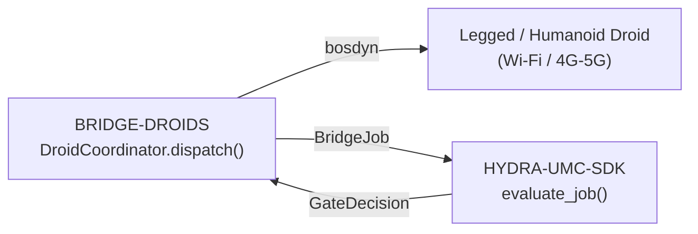

<!-- =============================================================================
HYDRA-UMC-BRIDGE-DROIDS - Droid coordination bridge
Copyright (C) JuanenRac (Electro Hobby 3D) <electrohobby3d@gmail.com>
GPL-3.0-or-later - see LICENSE
============================================================================= -->

<p align="center">
  
</p>

# 🤖 HYDRA-UMC-BRIDGE-DROIDS

<p align="center">🇺🇸 <b>English</b> | <a href="README_spa.md">🇪🇸 Español</a> | <a href="README_fra.md">🇫🇷 Français</a> | <a href="README_ita.md">🇮🇹 Italiano</a> | <a href="README_deu.md">🇩🇪 Deutsch</a> | <a href="README_zho.md">🇨🇳 简体中文</a> | <a href="README_jpn.md">🇯🇵 日本語</a> | <a href="README_por.md">🇵🇹 Português</a></p>

### 🔗 Dependency-Free Coordination Boundary Between HYDRA-UMC and Legged/Humanoid Droids

<p align="center">
  
  
  
  
  
  
</p>

---

> **Honesty check - what actually runs today:** the dependency-free coordination core (`coordinator.py`'s `DroidCoordinator`, funneling every dispatch through `HYDRA-UMC-SDK`'s own `evaluate_job()`) and the Boston Dynamics Spot command sender (`spot_transport.py`'s `SpotDroidControl`) are real and covered by 72 passing unit tests (`python tools/build_test.py` - `test_coordinator.py`, `test_spot_transport.py`, plus `test_spot_emulator.py` running the bridge against a protocol-faithful, hand-written Spot emulator, not a live robot). None of it has been exercised against a real bosdyn-client install, a real network link, or a physical Spot/droid - `test_spot_transport.py`'s own `FakeBuilder`/`FakeSink` stand in for `bosdyn-client` entirely (the real library isn't even required to be installed for these tests to pass), and there is no live `run` command yet because no transport (Wi-Fi/BT/4G-5G) or physical droid platform has been validated. See "Roadmap & Known limits" below, which already states this plainly, and `CHANGELOG.md` for exactly what has shipped so far.

> **Safety and security status:** this ecosystem is not a certified safety system. There is no hardware E-STOP path, no firmware-enforced limits or interlocks and no verified motion command yet; firmware images are checked with CRC32 and a shared-key HMAC-SHA256, not with an asymmetric signature; TLS and mutual TLS are optional and off by default; no custom board has been populated or tested yet. Read the [security baseline](https://github.com/JuanenRac/HYDRA-UMC-DOCS/blob/main/docs/SECURITY_BASELINE.md) and the [threat model](https://github.com/JuanenRac/HYDRA-UMC-DOCS/blob/main/docs/THREAT_MODEL.md) before relying on any statement here for the safety of a person.

---

## 📋 At a glance

| | |
|---|---|
| Version | `0.1.3` |
| Maturity | Functional |
| Tests | 72 (`python tools/build_test.py`) |
| Stack | Python / Boston Dynamics Spot SDK (bosdyn-client) / HYDRA-UMC-SDK |
| On real hardware | Simulated only: tested against emulators, fakes or simulators; no run on real hardware is recorded for this version |

**Jump to:** [Overview](#-overview) · [Architecture](#-architecture) · [Features](#-features) · [Security & Safety](#-security--safety) · [Interfaces](#-interfaces) · [Configuration](#-configuration) · [Quick start](#-quick-start) · [Testing](#-testing) · [Troubleshooting](#-troubleshooting) · [Repository Structure](#-repository-structure) · [Related Projects](#-related-projects)

## 🚦 Project status

Each line is one part of this repository and the light says how far it is today. It is written from what the repository can show (tests, builds, runs), not from what is planned.

🟢 Done and verified · 🟡 Works, with known limits · 🟠 Partly done or not verified yet · 🔴 Not done or not working

| Area | State | What it means here |
|---|---|---|
| Software | 🟡 | Works for its main purpose; the honesty check above lists what is still missing |
| Tests | 🟢 | 72 automated tests, run on every change |
| Real hardware | 🟠 | Simulated only: tested against emulators, fakes or simulators; no run on real hardware is recorded for this version |
| Documentation | 🟢 | README in eight languages, checked against the manifest on every change |

## 🎯 Overview

**HYDRA-UMC-BRIDGE-DROIDS** is the high-level coordination boundary between HYDRA-UMC and a legged or humanoid droid platform, reachable over Wi-Fi or a cellular (4G/5G) link. It never computes gait, balance or joint trajectories: it validates and forwards a small, named vocabulary of whole-body action triggers (`WALK_TO`, `PICK_OBJECT`, `PLACE_OBJECT`, `RETURN_HOME`, `HOLD_POSITION`, `STAND`, `SIT`), each with its own real required-parameter contract. It is not a motor-control node, and it cannot bypass HYDRA-UMC-SERVER, MCU limits, watchdogs or E-STOP. The only transport implemented is Boston Dynamics Spot's own API over an IP network (there is no Bluetooth); today it can send `sit`, `stand`, `walk_to` and the stop, and it has not been run against a real robot.

It belongs to the **Mobile & Autonomous Bridges** family alongside `HYDRA-UMC-BRIDGE-AMR` and `HYDRA-UMC-BRIDGE-UAV`, and shares the same `HYDRA-UMC-SDK` job-and-safety contract as the stationary **External Automation Bridges** (CNC, LASER, OPENPNP, PRINTER3D, ROS2) - so no bridge, mobile or stationary, invents its own definition of "safe to work".

## 🧩 Role in HYDRA-UMC

**HYDRA-UMC-BRIDGE-DROIDS** lets a robot cell ask a legged or humanoid droid for a named action (hold position, sit, stand, walk to a point, pick or place where the platform can). It turns a gated cell job into that action and never into raw motion.

It shares the safety contract of `HYDRA-UMC-SDK` with every bridge: a job is accepted only after the shared `evaluate_job()` gate says so, and the gate fails closed. This bridge has no MQTT transport; its one real transport is the Boston Dynamics Spot command sender.

## 🏛️ Architecture

<p align="center">
  
</p>

<details>
<summary>Text version of the diagram (Mermaid)</summary>



</details>

**Why it is built this way**

* **Why the core never computes gait or balance.** A droid's own onboard compute (Jetson-class or equivalent) already runs a real, hardware-specific whole-body controller - re-deriving that here would either duplicate it badly or fight it. Sending only named destination/action triggers (`WALK_TO x y`, `PICK_OBJECT object_id`) keeps HYDRA-UMC's role to coordination, matching the pasted architecture note this project started from: "do not compute the droid's gait in the core."
* **Why each action trigger has its own explicit required-parameter list.** A `WALK_TO` with no `x`/`y`, or a `PICK_OBJECT` with no `object_id`, is a real, catchable request-shape error - rejecting it here, before any transport, is strictly better than forwarding an incomplete instruction and hoping the droid's own firmware rejects it safely too.
* **Why `DroidCoordinator.dispatch()` still funnels every job through the shared `evaluate_job()` gate.** A droid is just another client of the same `bridge_contract` that CNC, LASER, OPENPNP, PRINTER3D and ROS2 use - it gets no special bypass of the IDLE/READY logic every other bridge and HYDRA-UMC-SERVER enforce.
* **Why `HOLD_POSITION` (from `ABORT`) stays requestable during a fault.** The gate's productive-phase requirement (`IDLE` + `READY`) is intentionally not applied the same way to an abort request - an operator must always be able to ask a droid to freeze in place, even mid-fault, rather than continuing whatever it was doing.
* **Why there is no transport adapter for a droid other than Spot yet.** Committing to one droid platform's real Wi-Fi/BT/4G-5G command protocol before it is selected and tested would risk baking in assumptions this local, dependency-free core cannot verify.
* **How this fits the rest of the ecosystem.** BRIDGE-DROIDS sits between a real droid and `HYDRA-UMC-SDK` → `HYDRA-UMC-SERVER` → MCU safety - it is a coordination boundary, never a motor-control node, and it cannot bypass HYDRA-UMC-SERVER, MCU limits, watchdogs or E-STOP.

## ✨ Features

* ✅ **Real, dependency-free coordination core:** `coordinator.py`'s `DroidCoordinator` has zero transport import (no socket, no vendor SDK) - it is deliberately plain Python, testable on any host without a real droid connected. *(implemented, tested in `tests/test_coordinator.py`)*
* ✅ **Real named action-trigger vocabulary:** `WALK_TO`, `PICK_OBJECT`, `PLACE_OBJECT`, `RETURN_HOME`, `HOLD_POSITION`, `STAND`, `SIT` - never a raw joint command. Whole-body gait, balance and joint-level control stay the droid's own onboard authority (Jetson-class or equivalent). `STAND`/`SIT` are real, near-universal legged-robot posture primitives - checked against Boston Dynamics' own public [Spot SDK `basic_command.proto`](https://github.com/boston-dynamics/spot-sdk/blob/master/protos/bosdyn/api/basic_command.proto), whose own foundational mobility commands are `stand`/`sit`/`selfright`/`safe_power_off`, not just walk/manipulate - exposed as standalone `sit_request()`/`stand_request()` calls, deliberately outside the `JobPhase`-driven `dispatch()` flow (no phase naturally means "stand up" or "sit down"). `sit_request()` is always accepted (a real de-escalation, same reasoning as `HOLD_POSITION`); `stand_request()` requires a `READY` cell and `IDLE` machine (a real productive-readiness transition). *(implemented)*
* ✅ **Real per-action parameter validation:** each action trigger has its own real, minimal required-parameter contract (e.g. `WALK_TO` needs `x`/`y`) checked before a job is ever forwarded - a request missing what its own action needs is rejected locally, not silently passed downstream. *(implemented, tested)*
* ✅ **Real shared safety gate:** every job dispatched through `DroidCoordinator.dispatch()` is evaluated by `evaluate_job()` from `HYDRA-UMC-SDK`'s `bridge_contract`, the same gate every sibling bridge and HYDRA-UMC-SERVER use; a productive phase requires an `IDLE` external machine and a `READY` HYDRA-UMC cell, while a `HOLD_POSITION` (mapped from `ABORT`) remains requestable during a fault. *(implemented)*
* ✅ **Fail-closed phase routing and static evidence:** an unknown future SDK phase is denied rather than guessed at. `inspect_action_plan.py` emits the static schema `1.1` action plan (now including `STAND`/`SIT`) without opening any transport. *(implemented, tested)*
* ✅ **Real Boston Dynamics Spot transport:** `spot_transport.py`'s `SpotDroidControl` sends an already-gated dispatch as a real bosdyn-client command (`synchro_stand_command`/`synchro_sit_command`/`synchro_trajectory_command_in_body_frame`, sent via `RobotCommandClient.robot_command()`) - a rejected dispatch never reaches the network. *(implemented, tested in `tests/test_spot_transport.py`)*
* ✅ **Stops, validated goals and a command that expires:** `hold_position()` sends bosdyn's `stop_command()` (the transport of `ABORT`'s `HOLD_POSITION`, never gated); `sit()` stops the robot first; a `DroidDispatch` carries the parameters the gate validated and `walk_to()` sends exactly those - only for a `WALK_TO` dispatch, with finite numbers, an optional distance limit (`PlatformProfile.max_walk_distance_m`) and a required `command_timeout_s` that becomes the command's `end_time_secs`, so the robot drops a walk when this process goes away; `stand_request()` takes its decision from `evaluate_job()` itself; a response that is not `STATUS_OK` is not reported as sent. *(implemented, tested against fakes and the emulator, which now raises bosdyn-shaped errors; never run against a real Spot - the lease, the software E-Stop with its keep-alive and the power-on are NOT done, so a real Spot cannot be commanded with this yet, and `RETURN_HOME`, `PICK_OBJECT` and `PLACE_OBJECT` have no transport)*
* ✅ **Non-mutating build/test:** `build-test.bat`/`.sh` compile the source and run deterministic unit tests without changing version or CHANGELOG. *(implemented, see Build & Release below)*
* 🔜 **A generic Wi-Fi/BT/4G-5G transport adapter for a non-Spot droid platform** - introduced only after that platform is selected and tested. *(planned)*
* ✅ **Observed machine state:** `DroidCoordinator.dispatch()` accepts the state the droid reported, which the shared gate uses instead of the `machine_state` written in the job (a message anybody on the broker may publish); without a report the claim is still used. *(implemented, tested in `tests/test_observed_state.py`)*

## 🔒 Security & Safety

| Threat | Defence | Where |
|---|---|---|
| A job for a cell or machine that is not in a safe state | Every job goes through the shared `evaluate_job()` gate of the SDK, which fails closed; the bridge has no accept/reject logic of its own | SDK `bridge_contract` |
| Oversized or unbounded job data | At most 32 parameters, keys up to 64 characters, values up to 1024, identifiers up to 128 (`MAX_PARAMETERS`, `MAX_PARAMETER_KEY_CHARS`, `MAX_PARAMETER_VALUE_CHARS`, `MAX_IDENTIFIER_CHARS`) | SDK `bridge_contract` |
| A repeated or replayed order | An `IdempotencyStore` remembers each key for 24 hours and at most 10 000 entries; a repeat gets the first answer instead of being evaluated again | SDK `job_intake` |
| An action the platform cannot do | `PlatformProfile`: `MOBILE_ONLY` allows posture and movement, `MOBILE_MANIPULATOR` also `PICK_OBJECT` and `PLACE_OBJECT`; `check_against_profile()` refuses the rest | `platform_profiles.py` |
| A walk order without a time limit or with a value that is not finite | `walk_to` needs a finite, positive `command_timeout_s` so the robot drops the command when it expires; non-finite parameters are refused | `spot_transport.py` |

**What it never does:** it never sends raw motion, never takes the lease and never powers the motors; it has never been connected to a real Spot.

## 🔌 Interfaces

There are no MQTT topics or HTTP routes: this bridge is a library.

| Item | What it is |
|---|---|
| `DroidCoordinator` | `dispatch(job, cell_state, observed_machine_state)`, `sit_request()`, `stand_request()`; returns a `DroidDispatch` |
| `SpotDroidControl` | `hold_position()`, `sit()`, `stand()`, `walk_to()`; each returns a `SpotSendResult` |
| `open_bosdyn_robot_command(hostname, username, password)` | opens the connection and returns the command builder and sink; a missing `bosdyn-client` is a clear `RuntimeError`, not an `ImportError` |

## ⚙️ Configuration

There are no environment variables and no configuration file: the host, user name and password of the Spot are the arguments of `open_bosdyn_robot_command()`, and the platform profile (`MOBILE_ONLY` or `MOBILE_MANIPULATOR`) is chosen in code. How the credentials are stored on a real installation is not decided yet.

## 🚀 Quick start

Requires Python 3.11 or newer. The tests and the build scripts expect `HYDRA-UMC-SDK` checked out next to this repository (`../HYDRA-UMC-SDK`) or pointed at with `HYDRA_UMC_SDK_ROOT`.

Try it without hardware (this checks the whole bridge against its emulators and fakes):

```bash
py -3 tools/build_test.py          # Windows
python3 tools/build_test.py         # Linux, macOS
```

Start the service (there is no console script: the service is the `run_forever()` of the MQTT transport, which you call from your own start-up code):

```python
from hydra_umc_bridge_droids import SpotDroidControl, open_bosdyn_robot_command
builder, sink = open_bosdyn_robot_command("192.168.80.3", "user", "password")   # needs the `spot` extra
control = SpotDroidControl()
control.stand(builder, sink, cell_state, machine_state)   # gated: needs a READY cell and an idle machine
control.hold_position(builder, sink)                      # a stop is never gated
```

## 🧪 Testing

72 automated `unittest` cases run with `python tools/build_test.py` (it also compiles every module). The tests need no hardware, no network and no optional package: the ones that would need `paho-mqtt`, `pyserial` or a vendor library use a stand-in or are skipped when the package is missing.

| Test file | Tests | What it covers |
|---|---|---|
| `test_coordinator.py`, `test_observed_state.py`, `test_edge_cases.py` | - | job to action mapping, the observed machine state, edge cases |
| `test_platform_profiles.py` | - | which actions each platform accepts |
| `test_spot_transport.py`, `test_spot_emulator.py`, `spot_emulator.py` | - | `SpotDroidControl` against fake builders and a bosdyn-shaped Spot emulator |

The CI runs `HYDRA_UMC_CI=1 python tools/ci_validate.py`, which checks the manifest, the documents, the eight READMEs and the pictures, and runs the tests with an SDK checkout.

## 🏗️ Build & Release

Requires Python 3.11+. `tools/build_test.py` expects `HYDRA-UMC-SDK` checked out as a sibling directory (`../HYDRA-UMC-SDK`) or pointed at via the `HYDRA_UMC_SDK_ROOT` environment variable.

```bash
# Windows
build-test.bat      # validate only — no version/CHANGELOG change
build.bat            # Validate and build (building never changes the version)

# Linux/macOS
bash build-test.sh
bash build.sh
```

`build-test` compiles every module under `src/` with `py_compile` and runs the full `unittest` suite discovered under `tests/` (every `test_*.py` file - 72 tests) - deterministically, with no real droid connection, no network and no version/CHANGELOG change. `build` runs that same validation first and, only on success, calls `tools/bump_version.py` to synchronize the version across `pyproject.toml`, `hydra-umc.project.json` and `CHANGELOG.md`. There is no live hardware `run` command yet - that requires a validated transport adapter and a real droid platform.

## 🩺 Troubleshooting

| You see | Because | Do |
|---|---|---|
| `ModuleNotFoundError: hydra_umc_sdk` | The SDK is not installed or not next to this repository | Check out `HYDRA-UMC-SDK` next to this repository or set `HYDRA_UMC_SDK_ROOT` |
| `bosdyn-client` ... `RuntimeError` | The optional Spot extra is not installed | `pip install ".[spot]"` (`bosdyn-client` 4.0 or newer) |
| `accepted` is false on a `DroidDispatch` | The shared gate, the platform profile or a parameter check refused the job | Read `reason` on the dispatch and fix the cause; a rejected dispatch is never sent to the robot |

## 📂 Repository Structure

<p align="center">
  
</p>

<details>
<summary>Text version of the tree</summary>

```text
HYDRA-UMC-BRIDGE-DROIDS/
├── src/hydra_umc_bridge_droids/
│   ├── coordinator.py             maps a job onto named action triggers, never raw motion
│   ├── platform_profiles.py       which actions a platform can be asked for; a droid that cannot move
│   └── spot_transport.py          Spot commands through bosdyn-client: hold, sit, stand, walk_to
├── tests/                         72 tests, with a bosdyn-shaped Spot emulator
├── docs/                          bridge guide
├── tools/                         build and test runner, version bump, CI validator, README and picture generators and checks
├── images/                        banner and the pictures of the README
├── .github/                       CI workflow and issue templates
├── pyproject.toml                 package metadata and dependencies
├── hydra-umc.project.json         manifest: version, maturity, family
├── CHANGELOG.md                   what changed in each version
├── build.sh build.bat             build scripts (they never change the version)
├── build-test.sh build-test.bat   build scripts (they never change the version)
├── test.sh test.bat               run the tests
└── SECURITY.md SUPPORT.md CONTRIBUTING.md CODE_OF_CONDUCT.md LICENSE LICENSE.md
```

</details>

## 🗺️ Roadmap & Known limits

**Known limits today**

**Real today:** version `0.1.3`, functional as a dependency-free coordination core (`DroidCoordinator`) with real per-action parameter validation, fail-closed phase routing, a static `plan-only` action schema, a real bosdyn-client Spot command sender (`SpotDroidControl`), and non-mutating build-test scripts wired into CI with an SDK checkout.

**Integration boundary:** this bridge is a coordination boundary only - it is not a motor-control node, and it cannot bypass HYDRA-UMC-SERVER, MCU limits, watchdogs or E-STOP; every dispatched job still passes through the same shared gate every sibling bridge uses.

**Still ahead:** no real transport (Wi-Fi/BT/4G-5G) or physical droid has been validated yet - a real transport adapter and a documented droid command interface will be introduced only after a specific platform is selected and tested.

## 🌍 Languages

This README and the documents of the repository exist in eight languages: English, Spanish, German, French, Italian, Japanese, Chinese and Portuguese (Portugal). They are written together and checked in the CI so that the eight files have the same sections and the same links. This repository has no screen or message catalogue of its own, so there are no interface strings to translate.

## 🔗 Related Projects

This project is part of the HYDRA-UMC robotics ecosystem by the same author (JuanenRac / Electro Hobby 3D). Worth knowing about, since a request might actually be about one of these rather than this repository.

**Parent Project**
- **[HYDRA-UMC-SERVER](https://github.com/JuanenRac/HYDRA-UMC-SERVER)** — the real headless backend (REST/WebSocket) every control client actually talks to; the authenticated ecosystem boundary this bridge reports to once each command has cleared this bridge's own local safety gate.

**Sibling Projects** — also talk to HYDRA-UMC-SERVER's own API, each their own client
- **[HYDRA-UMC-STUDIO](https://github.com/JuanenRac/HYDRA-UMC-STUDIO)** — web control dashboard with real-time multi-robot 3D visualization.
- **[HYDRA-UMC-SUITE](https://github.com/JuanenRac/HYDRA-UMC-SUITE)** — desktop (PySide6) swarm command center for multiple servers at once, packaged as a standalone executable.
- **[HYDRA-UMC-ANDROID-CONTROL](https://github.com/JuanenRac/HYDRA-UMC-ANDROID-CONTROL)** — native Android control app with biometric login and a paired Wear OS companion.
- **[HYDRA-UMC-IOS-CONTROL](https://github.com/JuanenRac/HYDRA-UMC-IOS-CONTROL)** — iOS/iPadOS control app (Flutter) with real-time WebSocket sync.
- **[HYDRA-UMC-DSI](https://github.com/JuanenRac/HYDRA-UMC-DSI)** — native touch UI for the onboard 7" DSI touchscreen, embedded on the CM5 itself.
- **[HYDRA-UMC-BRIDGE-AMR](https://github.com/JuanenRac/HYDRA-UMC-BRIDGE-AMR)** — coordination boundary for AGV/AMR fleets via a VDA 5050 MQTT publisher (tested against an emulated fleet only) — one of the ecosystem's 3 mobile-fleet bridges.
- **[HYDRA-UMC-BRIDGE-CNC](https://github.com/JuanenRac/HYDRA-UMC-BRIDGE-CNC)** — high-level CNC-cell coordinator with GRBL status/control-byte access (tested against an emulator only).
- **[HYDRA-UMC-BRIDGE-LASER](https://github.com/JuanenRac/HYDRA-UMC-BRIDGE-LASER)** — laser-cell coordinator reading 3 key/enclosure/interlock GPIO signals (tested against a fake chip only; it cannot arm or fire a laser).
- **[HYDRA-UMC-BRIDGE-OPENPNP](https://github.com/JuanenRac/HYDRA-UMC-BRIDGE-OPENPNP)** — safe high-level board-flow coordinator for OpenPnP pick-and-place.
- **[HYDRA-UMC-BRIDGE-PRINTER3D](https://github.com/JuanenRac/HYDRA-UMC-BRIDGE-PRINTER3D)** — safe coordination boundary for Moonraker/Klipper 3D printers, with real gated job commands.
- **[HYDRA-UMC-BRIDGE-ROS2](https://github.com/JuanenRac/HYDRA-UMC-BRIDGE-ROS2)** — coordinator with a lazily imported rclpy ROS 2 transport (not yet run against a ROS 2 installation).
- **[HYDRA-UMC-BRIDGE-UAV](https://github.com/JuanenRac/HYDRA-UMC-BRIDGE-UAV)** — coordination boundary for camera-equipped UAVs, with a MAVLink command sender (tested against an emulator only) — one of the ecosystem's 3 mobile-fleet bridges.

**Directly Related**
- **[HYDRA-UMC-SDK](https://github.com/JuanenRac/HYDRA-UMC-SDK)** — the shared JSON-Schema contract and software job-gate boundary every bridge validates its commands against (not a certified safety function).
- **[HYDRA-UMC-CONNECTOR-HUB](https://github.com/JuanenRac/HYDRA-UMC-CONNECTOR-HUB)** — declarative adapter-manifest registry and validator for external-machine connectors; extends the SDK's own contract idea to external machines without replacing the industrial-gateway projects.

**Also Part of the Ecosystem**

*Core Hardware & Platform*
- **[HYDRA-UMC](https://github.com/JuanenRac/HYDRA-UMC)** — the robot-arm motherboard design: CM5 host + dual-core STM32H745, meant to orchestrate up to 8 tool arms over CAN-OTA/SPI-OTA (firmware at an early stage; no populated board yet).
- **[HYDRA-UMC-OS](https://github.com/JuanenRac/HYDRA-UMC-OS)** — reproducible Raspberry Pi OS product layer for the CM5: read-only agent, validated config/profiles, WiFi first-contact provisioning.

*Core Backend & Clients*
- **[HYDRA-UMC-EDITOR-URDF](https://github.com/JuanenRac/HYDRA-UMC-EDITOR-URDF)** — desktop graphical URDF creator/editor that pushes finished models into STUDIO's own catalog.
- **[HYDRA-UMC-EDITOR-STL](https://github.com/JuanenRac/HYDRA-UMC-EDITOR-STL)** — desktop STL model editor, transforming/replacing/removing/adding real parts in the same model catalog HYDRA-UMC-EDITOR-URDF also edits.

*URTC Tool Platform*
- **[URTC](https://github.com/JuanenRac/URTC)** — firmware for the physical Universal Robot Tool Controller PCB, 25+ tool profiles over CAN bus.
- **[URTC-FLASHER](https://github.com/JuanenRac/URTC-FLASHER)** — desktop GUI flashing tool for URTC boards, CAN-OTA plus full-chip SWD/JTAG.
- **[URTC-TESTER](https://github.com/JuanenRac/URTC-TESTER)** — desktop live CAN-bus diagnostic tool for URTC boards, one panel per tool profile.
- **[URTC-WEB-STUDIO](https://github.com/JuanenRac/URTC-WEB-STUDIO)** — browser-based alternative to URTC-TESTER via the Web Serial API, no local install needed.
- **[URTC-GATEWAY](https://github.com/JuanenRac/URTC-GATEWAY)** — gateway in front of the URTC CAN bus: an allowed list of identifiers, a rate limit and a session key; software tested on a computer, not yet on a real bus.

*Vision AI Node (Hailo-8)*
- **[HYDRA-UMC-VISION-NODE](https://github.com/JuanenRac/HYDRA-UMC-VISION-NODE)** — integration hub for the Hailo-8 vision pipeline, with a real per-stage hardware-readiness check.
- **[HYDRA-UMC-DETECTION-HEF](https://github.com/JuanenRac/HYDRA-UMC-DETECTION-HEF)** — real compiled-model registry with Hailo-architecture/checksum safe-load verification.
- **[HYDRA-UMC-VISION-STREAMER](https://github.com/JuanenRac/HYDRA-UMC-VISION-STREAMER)** — real GStreamer pipeline + MediaMTX config generator with a real HailoRT integration boundary.
- **[HYDRA-UMC-VISUAL-SERVOING-API](https://github.com/JuanenRac/HYDRA-UMC-VISUAL-SERVOING-API)** — Position-Based Visual Servoing correction law with authorisation gated on the zone state; no camera pose estimation yet.
- **[HYDRA-UMC-SAFETY-ZONES](https://github.com/JuanenRac/HYDRA-UMC-SAFETY-ZONES)** — v0 zone-breach, calibration-freshness and E-STOP-request logic that takes object positions from a file; no detector feeds it and no physical E-STOP is wired to it yet.

*Cognitive AI Node (Hailo-10)*
- **[HYDRA-UMC-COGNITIVE-NODE](https://github.com/JuanenRac/HYDRA-UMC-COGNITIVE-NODE)** — integration hub for the Hailo-10 cognitive pipeline (LLM/VLA/voice orchestration).
- **[HYDRA-UMC-VLA-ENGINE](https://github.com/JuanenRac/HYDRA-UMC-VLA-ENGINE)** — real action-token encoding/decoding and trajectory generation for a Vision-Language-Action model.
- **[HYDRA-UMC-VOICE-UI](https://github.com/JuanenRac/HYDRA-UMC-VOICE-UI)** — real voice front-end (VAD + intent parser) with a bounded, confirmation-gated Watch relay.
- **[HYDRA-UMC-SEMANTIC-PLANNER](https://github.com/JuanenRac/HYDRA-UMC-SEMANTIC-PLANNER)** — real rule-based task decomposition and semantic error recovery over MCU error codes.
- **[HYDRA-UMC-DOCS-QA](https://github.com/JuanenRac/HYDRA-UMC-DOCS-QA)** — real stdlib-only TF-IDF document search over this ecosystem's own Markdown docs.
- **[HYDRA-UMC-LOCAL-TECHNICIAN](https://github.com/JuanenRac/HYDRA-UMC-LOCAL-TECHNICIAN)** — local, policy-gated AI maintenance technician for the ecosystem itself - observes, diagnoses and proposes fixes; the two highest risk levels are deliberately not implemented yet.

*Orchestration & Swarm*
- **[HYDRA-UMC-ORCHESTRATOR](https://github.com/JuanenRac/HYDRA-UMC-ORCHESTRATOR)** — integration hub with a real gRPC/Protobuf health-report contract and mission state machine.
- **[HYDRA-UMC-JOB-DISPATCHER](https://github.com/JuanenRac/HYDRA-UMC-JOB-DISPATCHER)** — real priority-based job queue with deduplication, over a real HTTP API.
- **[HYDRA-UMC-NODE-HEALING](https://github.com/JuanenRac/HYDRA-UMC-NODE-HEALING)** — real gRPC-based fleet health watchdog with retry/backoff and identity-mismatch detection.
- **[HYDRA-UMC-PATH-PLANNER-3D](https://github.com/JuanenRac/HYDRA-UMC-PATH-PLANNER-3D)** — real RRT-based 3D path planner with real obstacle/workspace collision validation.
- **[HYDRA-UMC-SWARM-SYNC](https://github.com/JuanenRac/HYDRA-UMC-SWARM-SYNC)** — real CRDT LWW-Element-Map state sync, property-tested for multi-cell convergence.

*Digital Twin & Simulation*
- **[HYDRA-UMC-TWIN](https://github.com/JuanenRac/HYDRA-UMC-TWIN)** — integration hub for the digital-twin engine, with a real version-compatibility sync contract.
- **[HYDRA-UMC-HIL-BRIDGE](https://github.com/JuanenRac/HYDRA-UMC-HIL-BRIDGE)** — hardware-in-the-loop router with a software collision interlock between simulation and real hardware (tested without real hardware).
- **[HYDRA-UMC-PHYSICS-REPLICA](https://github.com/JuanenRac/HYDRA-UMC-PHYSICS-REPLICA)** — real forward kinematics and joint-limit validation over a real URDF subset.
- **[HYDRA-UMC-SYNTHETIC-DATA-GEN](https://github.com/JuanenRac/HYDRA-UMC-SYNTHETIC-DATA-GEN)** — real procedural 2D scene generator with YOLO/COCO annotation export.

*Data & Analytics*
- **[HYDRA-UMC-DATALAKE](https://github.com/JuanenRac/HYDRA-UMC-DATALAKE)** — real sqlite3-backed time-series store with a real ingest/query HTTP API.
- **[HYDRA-UMC-ANOMALY-DETECTOR](https://github.com/JuanenRac/HYDRA-UMC-ANOMALY-DETECTOR)** — real FFT + statistical baseline anomaly detector with drift monitoring.
- **[HYDRA-UMC-PRODUCTION-REPORTS](https://github.com/JuanenRac/HYDRA-UMC-PRODUCTION-REPORTS)** — real OEE/availability calculation over DATALAKE history, with reproducible CSV export.
- **[HYDRA-UMC-TELEMETRY-COLLECTOR](https://github.com/JuanenRac/HYDRA-UMC-TELEMETRY-COLLECTOR)** — real CAN/WebSocket ingestion pipeline into DATALAKE, with sequence deduplication.

*Industrial Gateway*
- **[HYDRA-UMC-GATEWAY-INDUSTRIAL](https://github.com/JuanenRac/HYDRA-UMC-GATEWAY-INDUSTRIAL)** — integration hub relaying to industrial protocols, with a real command allowlist/backpressure layer.
- **[HYDRA-UMC-OPCUA-SERVER](https://github.com/JuanenRac/HYDRA-UMC-OPCUA-SERVER)** — real OPC-UA address space, verified with a real binary-protocol client session.
- **[HYDRA-UMC-MQTT-BROKER](https://github.com/JuanenRac/HYDRA-UMC-MQTT-BROKER)** — real MQTT broker with optional per-client authentication and topic ACLs.
- **[HYDRA-UMC-MTCONNECT-ADAPTER](https://github.com/JuanenRac/HYDRA-UMC-MTCONNECT-ADAPTER)** — real MTConnect `/probe` and `/current` XML endpoints with degraded-mode output.

*Complementary Tools & Ecosystem Operations*
- **[HYDRA-UMC-DASHBOARD-AI](https://github.com/JuanenRac/HYDRA-UMC-DASHBOARD-AI)** — Smart Summaries and Anomaly Highlighting panels over DATALAKE/ANOMALY-DETECTOR, with an honest statistical fallback.
- **[HYDRA-UMC-TOOL-CLI](https://github.com/JuanenRac/HYDRA-UMC-TOOL-CLI)** — fleet CLI with a real, stable exit-code contract, a genuine live client of HYDRA-UMC-SERVER's own API.
- **[HYDRA-UMC-WATCH](https://github.com/JuanenRac/HYDRA-UMC-WATCH)** — WearOS companion app with haptic alert patterns and a paired-phone voice relay (not yet run on a physical watch).
- **[URTC-SMART-RACK](https://github.com/JuanenRac/URTC-SMART-RACK)** — firmware for a board-mounting rack with real tool-ID decoding and Smart Idle pre-heating logic.
- **[URTC-VISION-TOOL](https://github.com/JuanenRac/URTC-VISION-TOOL)** — firmware plus a real Python vision companion for a thermal/RGB inspection tool head.
- **[HYDRA-UMC-UPDATER](https://github.com/JuanenRac/HYDRA-UMC-UPDATER)** — administrative desktop tool that discovers, clones and updates every repo in this ecosystem.
- **[HYDRA-UMC-OS-REBUILDER](https://github.com/JuanenRac/HYDRA-UMC-OS-REBUILDER)** — Windows/Linux desktop tool that builds a ready-to-flash CM5 image pre-loaded with the ecosystem's most current versions, with Raspberry-Pi-Imager-style first-boot Wi-Fi/user/SSH configuration.
- **[HYDRA-UMC-OPS-AGENT](https://github.com/JuanenRac/HYDRA-UMC-OPS-AGENT)** — maintenance-incident coordinator: a low-privilege edge role collects a sanitized inventory/health snapshot, a control-plane role renders it read-only and asks an AI provider to suggest a diagnosis - never applies a patch or deploys anything.
- **[HYDRA-UMC-DEV-SERVER](https://github.com/JuanenRac/HYDRA-UMC-DEV-SERVER)** — reproducible development host (Raspberry Pi 5 / CM5) that stores the ecosystem's source and runs bounded build/test tasks under a durable queue; a dedicated dev role, explicitly not an operational CM5.

## 📚 Documentation

Where to read more:

* [docs/BRIDGE_GUIDE.md](docs/BRIDGE_GUIDE.md) - scope, platform profiles, the Spot transport, scripts
* [Security baseline of the ecosystem](https://github.com/JuanenRac/HYDRA-UMC-DOCS/blob/main/docs/SECURITY_BASELINE.md)
* [Threat model of the ecosystem](https://github.com/JuanenRac/HYDRA-UMC-DOCS/blob/main/docs/THREAT_MODEL.md)
* [Changelog of this repository](CHANGELOG.md)
* [License of this repository](LICENSE.md)

## 🤝 Contributing & Community

* Before a pull request run `HYDRA_UMC_CI=1 py -3 tools/ci_validate.py` (or `HYDRA_UMC_CI=1 python3 tools/ci_validate.py`): it must print `CI_VALIDATION=PASS`. Do not run `build.sh` or `build.bat` for this check; building is not a check.
* The eight READMEs are written from one source in HYDRA-UMC-DOCS; do not edit them by hand. Change the source and write them again with `tools/make_readmes.py`.
* Do not state in a README what has not run: say "simulated" or "not tried on hardware" where that is the truth.
* See [CONTRIBUTING.md](CONTRIBUTING.md), the [code of conduct](CODE_OF_CONDUCT.md), [SECURITY.md](SECURITY.md) and [SUPPORT.md](SUPPORT.md).

## 👤 AUTHOR

**JuanenRac (Electro Hobby 3D)** · electrohobby3d@gmail.com

## 📜 LICENSE

GPL-3.0-or-later - [LICENSE](LICENSE).
