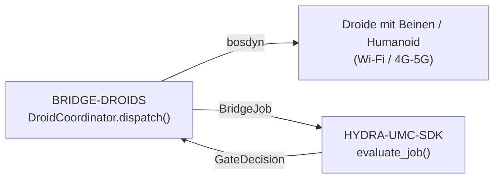

<!-- =============================================================================
HYDRA-UMC-BRIDGE-DROIDS - Droid coordination bridge
Copyright (C) JuanenRac (Electro Hobby 3D) <electrohobby3d@gmail.com>
GPL-3.0-or-later - see LICENSE
============================================================================= -->

<p align="center">
  
</p>

# 🤖 HYDRA-UMC-BRIDGE-DROIDS

<p align="center"><a href="README.md">🇺🇸 English</a> | <a href="README_spa.md">🇪🇸 Español</a> | <a href="README_fra.md">🇫🇷 Français</a> | <a href="README_ita.md">🇮🇹 Italiano</a> | 🇩🇪 <b>Deutsch</b> | <a href="README_zho.md">🇨🇳 简体中文</a> | <a href="README_jpn.md">🇯🇵 日本語</a> | <a href="README_por.md">🇵🇹 Português</a></p>

### 🔗 Abhängigkeitsfreie Koordinationsgrenze zwischen HYDRA-UMC und laufenden/humanoiden Droiden

<p align="center">
  
  
  
  
  
  
</p>

---

> **Ehrlichkeitscheck - was heute wirklich läuft:** der abhängigkeitsfreie Koordinationskern (`coordinator.py` mit `DroidCoordinator`, das jeden Dispatch durch das echte `evaluate_job()` von `HYDRA-UMC-SDK` leitet) und der Boston-Dynamics-Spot-Befehlssender (`spot_transport.py` mit `SpotDroidControl`) sind real und durch 79 bestehende Unit-Tests abgedeckt (`python tools/build_test.py` - `test_coordinator.py`, `test_spot_transport.py`, plus `test_spot_emulator.py`, das die Bridge gegen einen protokolltreuen, von Hand geschriebenen Spot-Emulator laufen lässt, keinen echten Roboter). Nichts davon wurde gegen eine echte `bosdyn-client`-Installation, eine echte Netzwerkverbindung oder einen physischen Spot/Droiden getestet - `test_spot_transport.py`s eigene `FakeBuilder`/`FakeSink` ersetzen `bosdyn-client` vollständig (die echte Bibliothek muss für das Bestehen dieser Tests nicht einmal installiert sein), und es gibt noch keinen echten `run`-Befehl, weil noch kein Transport (Wi-Fi/BT/4G-5G) oder physische Droiden-Plattform validiert wurde. Siehe „Aktueller Status & Nächste Schritte" weiter unten, das dies bereits klar sagt, sowie `CHANGELOG.md` für das, was bisher genau ausgeliefert wurde.

> **Stand von Sicherheit (Safety) und Security:** Dieses Ökosystem ist kein zertifiziertes Sicherheitssystem. Es gibt noch keinen Hardware-E-STOP-Pfad, keine von der Firmware durchgesetzten Grenzen oder Verriegelungen und keinen verifizierten Bewegungsbefehl; Firmware-Images werden mit CRC-32 und einer Ed25519-Signatur geprüft, und ein Release-Build verweigert die veröffentlichten Entwicklungsschlüssel (die Werkzeugköpfe und Erweiterungsplatinen hinter dem Relais laufen noch mit URTC-Bootloadern, die statt einer Signatur ein HMAC-SHA256 mit gemeinsamem Schlüssel verwenden); TLS und gegenseitiges TLS sind optional und standardmäßig aus; noch keine eigene Platine wurde bestückt oder getestet. Lesen Sie die [Sicherheitsbasis](https://github.com/JuanenRac/HYDRA-UMC-DOCS/blob/main/docs/SECURITY_BASELINE.md) und das [Bedrohungsmodell](https://github.com/JuanenRac/HYDRA-UMC-DOCS/blob/main/docs/THREAT_MODEL.md), bevor Sie sich für die Sicherheit einer Person auf eine Aussage hier verlassen.

---

## 📋 Auf einen Blick

| | |
|---|---|
| Version | `0.1.4` |
| Reifegrad | Funktionsfähig |
| Tests | 79 (`python tools/build_test.py`) |
| Technik | Python / Boston Dynamics Spot SDK (bosdyn-client) / HYDRA-UMC-SDK |
| Auf echter Hardware | Nur simuliert: gegen Emulatoren, Attrappen oder Simulatoren getestet; für diese Version ist kein Lauf auf echter Hardware vermerkt |

**Springe zu:** [Überblick](#-überblick) · [Architektur](#-architektur) · [Funktionen](#-funktionen) · [Sicherheit und Schutz](#-sicherheit-und-schutz) · [Schnittstellen](#-schnittstellen) · [Konfiguration](#-konfiguration) · [Schnellstart](#-schnellstart) · [Tests](#-tests) · [Fehlerbehebung](#-fehlerbehebung) · [Struktur des Repositorys](#-struktur-des-repositorys) · [Verwandte Projekte](#-verwandte-projekte)

## 🚦 Projektstatus

Jede Zeile ist ein Teil dieses Repositorys, und die Ampel sagt, wie weit er heute ist. Sie beruht auf dem, was das Repository zeigen kann (Tests, Builds, Läufe), nicht auf dem, was geplant ist.

🟢 Fertig und überprüft · 🟡 Funktioniert, mit bekannten Grenzen · 🟠 Teilweise fertig oder noch nicht überprüft · 🔴 Nicht gemacht oder funktioniert nicht

| Bereich | Stand | Was das hier bedeutet |
|---|---|---|
| Software | 🟡 | Funktioniert für seinen Hauptzweck; die Ehrlichkeitsprüfung oben nennt, was noch fehlt |
| Tests | 🟢 | 79 automatische Tests, bei jeder Änderung ausgeführt |
| Echte Hardware | 🟠 | Nur simuliert: gegen Emulatoren, Attrappen oder Simulatoren getestet; für diese Version ist kein Lauf auf echter Hardware vermerkt |
| Dokumentation | 🟢 | README in acht Sprachen, bei jeder Änderung gegen das Manifest geprüft |

## 🎯 Überblick

**HYDRA-UMC-BRIDGE-DROIDS** ist die High-Level-Koordinationsgrenze zwischen HYDRA-UMC und einer Droiden-Plattform mit Beinen oder humanoider Bauart, erreichbar über Wi-Fi oder eine Mobilfunkverbindung (4G/5G). Sie berechnet niemals Gangart, Gleichgewicht oder Gelenktrajektorien: Sie validiert und leitet ein kleines, benanntes Vokabular von Ganzkörper-Aktionsauslösern weiter (`WALK_TO`, `PICK_OBJECT`, `PLACE_OBJECT`, `RETURN_HOME`, `HOLD_POSITION`), jeder mit seinem eigenen realen Pflichtparameter-Vertrag. Sie ist kein Motorsteuerungsknoten und kann HYDRA-UMC-SERVER, MCU-Grenzen, Watchdogs oder den E-STOP nicht umgehen. Der einzige umgesetzte Transport ist die eigene API von Boston Dynamics Spot über ein IP-Netz (es gibt kein Bluetooth); heute kann er `sit`, `stand`, `walk_to` und den Stopp senden und wurde nie gegen einen echten Roboter ausgeführt.

Sie gehört zur Familie **Mobile & Autonomous Bridges** neben `HYDRA-UMC-BRIDGE-AMR` und `HYDRA-UMC-BRIDGE-UAV` und teilt denselben `HYDRA-UMC-SDK`-Auftrags- und Sicherheitsvertrag wie die stationären **External Automation Bridges** (CNC, LASER, OPENPNP, PRINTER3D, ROS2) — sodass keine Brücke, ob mobil oder stationär, ihre eigene Definition von "sicher zum Arbeiten" erfindet.

## 🧩 Rolle in HYDRA-UMC

**HYDRA-UMC-BRIDGE-DROIDS** lässt eine Roboterzelle einen laufenden oder humanoiden Droiden um eine benannte Aktion bitten (Position halten, setzen, aufstehen, zu einem Punkt gehen, greifen oder ablegen, wo die Plattform es kann). Er macht aus einem geprüften Zellenauftrag diese Aktion und nie rohe Bewegung.

Er teilt mit jedem Bridge den Sicherheitsvertrag von `HYDRA-UMC-SDK`: Ein Auftrag wird nur angenommen, wenn das gemeinsame Tor `evaluate_job()` zustimmt, und das Tor schließt im Zweifel. Dieser Bridge hat keinen MQTT-Transport; sein einziger echter Transport ist der Befehlssender für Boston Dynamics Spot.

## 🏛️ Architektur

<p align="center">
  
</p>

<details>
<summary>Textversion des Diagramms (Mermaid)</summary>



</details>

**Warum es so gebaut ist**

* **Warum der Kern niemals Gangart oder Gleichgewicht berechnet.** Das eigene Onboard-Compute des Droiden (Jetson-Klasse oder gleichwertig) führt bereits einen echten, hardwarespezifischen Ganzkörper-Controller aus — dies hier erneut herzuleiten würde ihn entweder schlecht duplizieren oder mit ihm in Konflikt geraten. Nur benannte Ziel-/Aktionsauslöser zu senden (`WALK_TO x y`, `PICK_OBJECT object_id`) hält die Rolle von HYDRA-UMC auf Koordination beschränkt, passend zu der eingefügten Architektur-Notiz, von der dieses Projekt ausging: "die Gangart des Droiden nicht im Kern berechnen."
* **Warum jeder Aktionsauslöser seine eigene explizite Liste von Pflichtparametern hat.** Ein `WALK_TO` ohne `x`/`y`, oder ein `PICK_OBJECT` ohne `object_id`, ist ein echter, erkennbarer Fehler in der Form der Anfrage — ihn hier abzulehnen, vor jedem Transport, ist strikt besser, als eine unvollständige Anweisung weiterzuleiten und zu hoffen, dass die eigene Firmware des Droiden sie ebenfalls sicher ablehnt.
* **Warum `DroidCoordinator.dispatch()` trotzdem jeden Auftrag durch das gemeinsame `evaluate_job()`-Gatter leitet.** Ein Droide ist nur ein weiterer Client desselben `bridge_contract`, den CNC, LASER, OPENPNP, PRINTER3D und ROS2 verwenden — er erhält keine besondere Umgehung der IDLE/READY-Logik, die jede andere Brücke und HYDRA-UMC-SERVER durchsetzen.
* **Warum `HOLD_POSITION` (von `ABORT`) während eines Fehlers anforderbar bleibt.** Die Anforderung der produktiven Phase des Gatters (`IDLE` + `READY`) wird bewusst nicht in derselben Weise auf eine Abbruchanfrage angewendet — ein Bediener muss einem Droiden immer befehlen können, an Ort und Stelle einzufrieren, selbst mitten in einem Fehler, statt fortzusetzen, was er gerade tat.
* **Warum es noch keinen Transportadapter für einen anderen Droiden als Spot gibt.** Sich vor der Auswahl und dem Test auf das echte Wi-Fi/BT/4G-5G-Befehlsprotokoll einer bestimmten Droiden-Plattform festzulegen, würde riskieren, Annahmen einzubauen, die dieser lokale, abhängigkeitsfreie Kern nicht verifizieren kann.
* **Wie das in den Rest des Ökosystems passt.** BRIDGE-DROIDS sitzt zwischen einem echten Droiden und `HYDRA-UMC-SDK` → `HYDRA-UMC-SERVER` → MCU-Sicherheit — es ist eine Koordinationsgrenze, niemals ein Motorsteuerungsknoten, und es kann HYDRA-UMC-SERVER, MCU-Grenzen, Watchdogs oder den E-STOP nicht umgehen.

## ✨ Funktionen

* ✅ **Echter, abhängigkeitsfreier Koordinationskern:** `coordinator.py`s `DroidCoordinator` hat keinerlei Transport-Import (kein Socket, kein Hersteller-SDK) — es ist bewusst reines Python, testbar auf jedem Host ohne angeschlossenen echten Droiden. *(implementiert, getestet in `tests/test_coordinator.py`)*
* ✅ **Echtes benanntes Aktionsauslöser-Vokabular:** `WALK_TO`, `PICK_OBJECT`, `PLACE_OBJECT`, `RETURN_HOME`, `HOLD_POSITION`, `STAND`, `SIT` - niemals ein rohes Gelenkkommando. Gangart, Balance und Gelenkregelung des ganzen Körpers bleiben die eigene Autorität des Bordcontrollers des Droiden (Jetson-Klasse oder gleichwertig). `STAND`/`SIT` sind echte, nahezu universelle Haltungsprimitive für Laufroboter - geprüft gegen die öffentliche [`basic_command.proto` des Spot SDK](https://github.com/boston-dynamics/spot-sdk/blob/master/protos/bosdyn/api/basic_command.proto) von Boston Dynamics, deren grundlegende Mobilitätskommandos `stand`/`sit`/`selfright`/`safe_power_off` sind, nicht nur Gehen/Manipulieren - bereitgestellt als eigenständige Aufrufe `sit_request()`/`stand_request()`, bewusst außerhalb des `JobPhase`-gesteuerten `dispatch()`-Ablaufs (keine Phase bedeutet von Natur aus "aufstehen" oder "hinsetzen"). `sit_request()` wird immer akzeptiert (eine echte Deeskalation, gleiche Begründung wie `HOLD_POSITION`); `stand_request()` verlangt eine `READY`-Zelle und eine `IDLE`-Maschine (ein echter Übergang in die produktive Bereitschaft). *(implementiert)*
* ✅ **Echte Parametervalidierung pro Aktion:** jeder Aktionsauslöser hat seinen eigenen echten, minimalen Pflichtparameter-Vertrag (z. B. benötigt `WALK_TO` `x`/`y`), der geprüft wird, bevor ein Auftrag überhaupt weitergeleitet wird — eine Anfrage, der fehlt, was ihre eigene Aktion benötigt, wird lokal abgelehnt, nicht stillschweigend weitergereicht. *(implementiert, getestet)*
* ✅ **Echtes gemeinsames Sicherheitsgatter:** jeder über `DroidCoordinator.dispatch()` versendete Auftrag wird durch `evaluate_job()` aus dem `bridge_contract` von `HYDRA-UMC-SDK` bewertet, demselben Gatter, das jede Schwesterbrücke und HYDRA-UMC-SERVER verwenden; eine produktive Phase erfordert eine externe Maschine im Zustand `IDLE` und eine `READY`-HYDRA-UMC-Zelle, während `HOLD_POSITION` (abgebildet von `ABORT`) auch während eines Fehlers anforderbar bleibt. *(implementiert)*
* ✅ **Ausfallsicheres Phasenrouting und statische Evidenz:** eine unbekannte zukünftige SDK-Phase wird abgelehnt statt erraten. `inspect_action_plan.py` gibt den statischen Aktionsplan des Schemas `1.0` aus, ohne einen Transport zu öffnen. *(implementiert, getestet)*
* ✅ **Echter Boston-Dynamics-Spot-Transport:** `SpotDroidControl` aus `spot_transport.py` sendet einen bereits gegatterten Dispatch als echten bosdyn-client-Befehl (`synchro_stand_command`/`synchro_sit_command`/`synchro_trajectory_command_in_body_frame`, gesendet über `RobotCommandClient.robot_command()`) - ein abgelehnter Dispatch erreicht das Netzwerk niemals. *(implementiert, getestet in `tests/test_spot_transport.py`)*
* ✅ **Stopps, validierte Ziele und ein Befehl, der verfällt:** `hold_position()` sendet das `stop_command()` von bosdyn (der Transport des `HOLD_POSITION` von `ABORT`, nie hinter dem Gate); `sit()` hält den Roboter zuerst an; ein `DroidDispatch` trägt die vom Gate validierten Parameter und `walk_to()` sendet genau diese - nur für einen `WALK_TO`-Dispatch, mit endlichen Zahlen, einer optionalen Entfernungsgrenze (`PlatformProfile.max_walk_distance_m`) und einem verpflichtenden `command_timeout_s`, der zum `end_time_secs` des Befehls wird, sodass der Roboter einen Gang verwirft, wenn dieser Prozess verschwindet; `stand_request()` übernimmt seine Entscheidung von `evaluate_job()` selbst; eine Antwort, die nicht `STATUS_OK` ist, gilt nicht als gesendet. *(implementiert, mit Attrappen und dem Emulator getestet, der jetzt bosdyn-förmige Fehler auslöst; nie gegen einen echten Spot ausgeführt - Lease, Software-E-Stop mit Keep-Alive und Einschalten sind NICHT umgesetzt, ein echter Spot lässt sich damit also noch nicht ansteuern, und `RETURN_HOME`, `PICK_OBJECT` und `PLACE_OBJECT` haben keinen Transport)*
* ✅ **Nicht-mutierender Build/Test:** `build-test.bat`/`.sh` kompilieren den Quellcode und führen deterministische Unit-Tests aus, ohne Version oder CHANGELOG zu ändern. *(implementiert, siehe Build und Veröffentlichung unten)*
* 🔜 **Wi-Fi/BT/4G-5G-Adapter für eine Nicht-Spot-Droiden-Plattform** — wird erst eingeführt, nachdem diese Plattform ausgewählt und getestet wurde. *(geplant)*
* ✅ **Beobachteter Maschinenzustand:** `DroidCoordinator.dispatch()` nimmt den Zustand an, den der Droide gemeldet hat und den das gemeinsame Tor statt des im Auftrag stehenden `machine_state` verwendet (eine Nachricht, die jeder am Broker veröffentlichen kann); ohne Meldung gilt weiterhin die Angabe. *(implementiert, getestet in `tests/test_observed_state.py`)*

## 🔒 Sicherheit und Schutz

| Bedrohung | Abwehr | Wo |
|---|---|---|
| Ein Auftrag für eine Zelle oder Maschine, die nicht sicher ist | Jeder Auftrag läuft durch das gemeinsame Tor `evaluate_job()` des SDK, das im Zweifel schließt; der Bridge hat keine eigene Annahmelogik | SDK `bridge_contract` |
| Überlange oder unbegrenzte Auftragsdaten | Höchstens 32 Parameter, Schlüssel bis 64 Zeichen, Werte bis 1024, Bezeichner bis 128 (`MAX_PARAMETERS`, `MAX_PARAMETER_KEY_CHARS`, `MAX_PARAMETER_VALUE_CHARS`, `MAX_IDENTIFIER_CHARS`) | SDK `bridge_contract` |
| Ein wiederholter oder erneut gesendeter Befehl | Ein `IdempotencyStore` merkt sich jeden Schlüssel 24 Stunden und höchstens 10 000 Einträge; eine Wiederholung bekommt die erste Antwort, statt neu bewertet zu werden | SDK `job_intake` |
| Eine Aktion, die die Plattform nicht kann | `PlatformProfile`: `MOBILE_ONLY` erlaubt Haltung und Bewegung, `MOBILE_MANIPULATOR` zusätzlich `PICK_OBJECT` und `PLACE_OBJECT`; `check_against_profile()` lehnt den Rest ab | `platform_profiles.py` |
| Ein Gehbefehl ohne Zeitlimit oder mit nicht endlichem Wert | `walk_to` verlangt ein endliches, positives `command_timeout_s`, damit der Roboter den Befehl bei Ablauf verwirft; nicht endliche Parameter werden abgelehnt | `spot_transport.py` |

**Was er nie tut:** er sendet nie rohe Bewegung, übernimmt nie die Lease und schaltet nie die Motoren ein; er war nie mit einem echten Spot verbunden.

## 🔌 Schnittstellen

Es gibt keine MQTT-Topics oder HTTP-Routen: Dieser Bridge ist eine Bibliothek.

| Element | Was es ist |
|---|---|
| `DroidCoordinator` | `dispatch(job, cell_state, observed_machine_state)`, `sit_request()`, `stand_request()`; liefert ein `DroidDispatch` |
| `SpotDroidControl` | `hold_position()`, `sit()`, `stand()`, `walk_to()`; jede liefert ein `SpotSendResult` |
| `open_bosdyn_robot_command(hostname, username, password)` | öffnet die Verbindung und liefert Befehlsbauer und Senke; ein fehlendes `bosdyn-client` ist ein klarer `RuntimeError`, kein `ImportError` |

## ⚙️ Konfiguration

Es gibt weder Umgebungsvariablen noch eine Konfigurationsdatei: Host, Benutzername und Passwort des Spot sind Argumente von `open_bosdyn_robot_command()`, und das Plattformprofil (`MOBILE_ONLY` oder `MOBILE_MANIPULATOR`) wird im Code gewählt. Wie die Zugangsdaten in einer echten Installation gespeichert werden, ist noch nicht entschieden.

## 🚀 Schnellstart

Benötigt Python 3.11 oder neuer. Die Tests und die Build-Skripte erwarten `HYDRA-UMC-SDK` neben diesem Repository (`../HYDRA-UMC-SDK`) oder über `HYDRA_UMC_SDK_ROOT` angegeben.

Ohne Hardware ausprobieren (das prüft den ganzen Bridge gegen seine Emulatoren und Attrappen):

```bash
py -3 tools/build_test.py          # Windows
python3 tools/build_test.py         # Linux, macOS
```

Den Dienst starten (es gibt kein Konsolenskript: Der Dienst ist das `run_forever()` des MQTT-Transports, das du aus deinem eigenen Startcode aufrufst):

```python
from hydra_umc_bridge_droids import SpotDroidControl, open_bosdyn_robot_command
builder, sink = open_bosdyn_robot_command("192.168.80.3", "user", "password")   # needs the `spot` extra
control = SpotDroidControl()
control.stand(builder, sink, cell_state, machine_state)   # gated: needs a READY cell and an idle machine
control.hold_position(builder, sink)                      # a stop is never gated
```

## 🧪 Tests

79 automatische `unittest`-Fälle laufen mit `python tools/build_test.py` (das kompiliert auch jedes Modul). Die Tests brauchen weder Hardware noch Netz noch optionale Pakete: Die, die `paho-mqtt`, `pyserial` oder eine Herstellerbibliothek bräuchten, nutzen einen Ersatz oder werden übersprungen, wenn das Paket fehlt.

| Testdatei | Tests | Was sie abdeckt |
|---|---|---|
| `test_coordinator.py`, `test_observed_state.py`, `test_edge_cases.py` | - | Auftrag-zu-Aktion-Abbildung, der beobachtete Maschinenzustand, Randfälle |
| `test_platform_profiles.py` | - | welche Aktionen jede Plattform annimmt |
| `test_spot_transport.py`, `test_spot_emulator.py`, `spot_emulator.py` | - | `SpotDroidControl` gegen Schein-Builder und einen bosdyn-förmigen Spot-Emulator |

Die CI führt `HYDRA_UMC_CI=1 python tools/ci_validate.py` aus; das prüft das Manifest, die Dokumente, die acht READMEs und die Bilder und führt die Tests mit einem SDK-Checkout aus.

## 🏗️ Build und Veröffentlichung

Erfordert Python 3.11+. `tools/build_test.py` erwartet, dass `HYDRA-UMC-SDK` als Schwesterverzeichnis (`../HYDRA-UMC-SDK`) ausgecheckt oder über die Umgebungsvariable `HYDRA_UMC_SDK_ROOT` angegeben ist.

```bash
# Windows
build-test.bat      # nur Validierung — keine Versions-/CHANGELOG-Änderung
build.bat            # Validiert und baut (Bauen ändert nie die Version)

# Linux/macOS
bash build-test.sh
bash build.sh
```

`build-test` kompiliert jedes Modul unter `src/` mit `py_compile` und führt die vollständige, unter `tests/` entdeckte `unittest`-Suite aus (jede Datei `test_*.py` - 79 Tests) — deterministisch, ohne echte Droiden-Verbindung, ohne Netzwerk und ohne Versions-/CHANGELOG-Änderung. `build` führt zuerst dieselbe Validierung aus und ruft nur bei Erfolg `tools/bump_version.py` auf, um die Version in `pyproject.toml`, `hydra-umc.project.json` und `CHANGELOG.md` zu synchronisieren. Es gibt noch keinen echten Hardware-`run`-Befehl — dafür sind ein validierter Transportadapter und eine echte Droiden-Plattform erforderlich.

## 🩺 Fehlerbehebung

| Du siehst | Weil | Tu |
|---|---|---|
| `ModuleNotFoundError: hydra_umc_sdk` | Das SDK ist nicht installiert oder liegt nicht neben diesem Repository | `HYDRA-UMC-SDK` neben dieses Repository klonen oder `HYDRA_UMC_SDK_ROOT` setzen |
| `bosdyn-client` ... `RuntimeError` | Das optionale Spot-Extra ist nicht installiert | `pip install ".[spot]"` (`bosdyn-client` ab 4.0) |
| `accepted` is false on a `DroidDispatch` | Das gemeinsame Tor, das Plattformprofil oder eine Parameterprüfung hat den Auftrag abgelehnt | Lies `reason` am Versand und behebe die Ursache; ein abgelehnter Versand geht nie an den Roboter |

## 📂 Struktur des Repositorys

<p align="center">
  
</p>

<details>
<summary>Textversion des Baums</summary>

```text
HYDRA-UMC-BRIDGE-DROIDS/
├── src/hydra_umc_bridge_droids/
│   ├── coordinator.py             setzt einen Auftrag in benannte Aktionsauslöser um, nie rohe Bewegung
│   ├── platform_profiles.py       welche Aktionen eine Plattform kann; ein Droide, der sich nicht bewegen kann
│   └── spot_transport.py          Spot-Befehle über bosdyn-client: hold, sit, stand, walk_to
├── tests/                         79 Tests, mit einem bosdyn-förmigen Spot-Emulator
├── docs/                          Bridge-Leitfaden
├── tools/                         Build- und Testläufer, Versionserhöhung, CI-Prüfer, README- und Bildgeneratoren samt Prüfungen
├── images/                        Banner und die Bilder der README
├── .github/                       CI-Workflow und Issue-Vorlagen
├── pyproject.toml                 Paketmetadaten und Abhängigkeiten
├── hydra-umc.project.json         Manifest: Version, Reifegrad, Familie
├── CHANGELOG.md                   was sich in jeder Version geändert hat
├── build.sh build.bat             Build-Skripte (ändern die Version nie)
├── build-test.sh build-test.bat   Build-Skripte (ändern die Version nie)
├── test.sh test.bat               führen die Tests aus
└── SECURITY.md SUPPORT.md CONTRIBUTING.md CODE_OF_CONDUCT.md LICENSE LICENSE.md
```

</details>

## 🗺️ Roadmap und bekannte Grenzen

**Bekannte Grenzen heute**

**Heute real:** Version `0.1.4`, funktionsfähig als abhängigkeitsfreier Koordinationskern (`DroidCoordinator`) mit echter Parametervalidierung pro Aktion, ausfallsicherem Phasenrouting, einem statischen `plan-only`-Aktionsschema, einem echten Boston-Dynamics-Spot-Transport (`SpotDroidControl`), der echte bosdyn-client-Befehle sendet, sowie nicht-mutierenden Build-Test-Skripten, die in CI mit SDK-Checkout eingebunden sind.

**Integrationsgrenze:** diese Brücke ist ausschließlich eine Koordinationsgrenze — sie ist kein Motorsteuerungsknoten und kann HYDRA-UMC-SERVER, MCU-Grenzen, Watchdogs oder den E-STOP nicht umgehen; jeder versendete Auftrag durchläuft weiterhin dasselbe gemeinsame Gatter, das jede Schwesterbrücke verwendet.

**Noch offen:** es wurde noch kein echter Transport (Wi-Fi/BT/4G-5G) und kein physischer Droide validiert — ein echter Transportadapter und eine dokumentierte Droiden-Befehlsschnittstelle werden erst eingeführt, nachdem eine bestimmte Plattform ausgewählt und getestet wurde.

## 🌍 Sprachen

Diese README und die Dokumente des Repositorys gibt es in acht Sprachen: Englisch, Spanisch, Deutsch, Französisch, Italienisch, Japanisch, Chinesisch und Portugiesisch (Portugal). Sie entstehen gemeinsam, und die CI prüft, dass die acht Dateien dieselben Abschnitte und dieselben Links haben. Dieses Repository hat weder eine eigene Oberfläche noch einen eigenen Meldungskatalog, es gibt also keine Oberflächentexte zu übersetzen.

## 🔗 Verwandte Projekte

Dieses Projekt ist Teil des HYDRA-UMC-Robotik-Ökosystems desselben Autors (JuanenRac / Electro Hobby 3D). Gut zu wissen, da eine Anfrage eigentlich eines dieser Projekte betreffen könnte statt dieses Repositorys.

**Übergeordnetes Projekt**
- **[HYDRA-UMC-SERVER](https://github.com/JuanenRac/HYDRA-UMC-SERVER)** — das reale Headless-Backend (REST/WebSocket), mit dem jeder Steuerungsclient tatsächlich spricht; die authentifizierte Ökosystemgrenze, an die diese Bridge berichtet, sobald jeder Befehl die eigene lokale Sicherheitsschranke dieser Bridge durchlaufen hat.

**Geschwisterprojekte** — sprechen ebenfalls mit der eigenen API von HYDRA-UMC-SERVER, jeweils als eigener Client
- **[HYDRA-UMC-STUDIO](https://github.com/JuanenRac/HYDRA-UMC-STUDIO)** — Web-Steuerungs-Dashboard mit Echtzeit-3D-Visualisierung mehrerer Roboter.
- **[HYDRA-UMC-SUITE](https://github.com/JuanenRac/HYDRA-UMC-SUITE)** — Desktop-Schwarmleitstand (PySide6) für mehrere Server gleichzeitig, verpackt als eigenständige ausführbare Datei.
- **[HYDRA-UMC-ANDROID-CONTROL](https://github.com/JuanenRac/HYDRA-UMC-ANDROID-CONTROL)** — native Android-Steuerungs-App mit biometrischem Login und einer gekoppelten Wear-OS-Begleit-App.
- **[HYDRA-UMC-IOS-CONTROL](https://github.com/JuanenRac/HYDRA-UMC-IOS-CONTROL)** — iOS/iPadOS-Steuerungs-App (Flutter) mit Echtzeit-WebSocket-Synchronisierung.
- **[HYDRA-UMC-DSI](https://github.com/JuanenRac/HYDRA-UMC-DSI)** — native Touch-UI für das eingebaute 7"-DSI-Touchscreen, direkt auf dem CM5 eingebettet.
- **[HYDRA-UMC-BRIDGE-AMR](https://github.com/JuanenRac/HYDRA-UMC-BRIDGE-AMR)** — Koordinationsschranke für AGV-/AMR-Flotten über einen VDA-5050-MQTT-Publisher (nur gegen eine emulierte Flotte getestet) — eine von 3 mobilen Flotten-Bridges des Ökosystems.
- **[HYDRA-UMC-BRIDGE-CNC](https://github.com/JuanenRac/HYDRA-UMC-BRIDGE-CNC)** — High-Level-Koordinator für CNC-Zellen mit GRBL-Status-/Steuerbyte-Zugriff (nur gegen einen Emulator getestet).
- **[HYDRA-UMC-BRIDGE-LASER](https://github.com/JuanenRac/HYDRA-UMC-BRIDGE-LASER)** — Koordinator für Laserzellen, liest 3 Schlüssel-/Gehäuse-/Verriegelungs-GPIO-Signale (nur gegen einen simulierten Chip getestet; kann keinen Laser scharfschalten oder auslösen).
- **[HYDRA-UMC-BRIDGE-OPENPNP](https://github.com/JuanenRac/HYDRA-UMC-BRIDGE-OPENPNP)** — sicherer High-Level-Koordinator für den Leiterplattenfluss von OpenPnP Pick-and-Place.
- **[HYDRA-UMC-BRIDGE-PRINTER3D](https://github.com/JuanenRac/HYDRA-UMC-BRIDGE-PRINTER3D)** — sichere Koordinationsschranke für Moonraker/Klipper-3D-Drucker, mit echten gesicherten Job-Befehlen.
- **[HYDRA-UMC-BRIDGE-ROS2](https://github.com/JuanenRac/HYDRA-UMC-BRIDGE-ROS2)** — Koordinator mit einem träge importierten rclpy-ROS-2-Transport (noch nicht gegen eine ROS-2-Installation ausgeführt).
- **[HYDRA-UMC-BRIDGE-UAV](https://github.com/JuanenRac/HYDRA-UMC-BRIDGE-UAV)** — Koordinationsschranke für kameraausgestattete UAVs, mit einem MAVLink-Befehlssender (nur gegen einen Emulator getestet) — eine von 3 mobilen Flotten-Bridges des Ökosystems.

**Direkt verwandt**
- **[HYDRA-UMC-SDK](https://github.com/JuanenRac/HYDRA-UMC-SDK)** — der gemeinsame JSON-Schema-Vertrag und die Software-Auftragsschranke, gegen die jede Bridge ihre Befehle validiert (keine zertifizierte Sicherheitsfunktion).
- **[HYDRA-UMC-CONNECTOR-HUB](https://github.com/JuanenRac/HYDRA-UMC-CONNECTOR-HUB)** — deklaratives Adapter-Manifest-Register und Validator für Konnektoren externer Maschinen; erweitert die eigene Vertragsidee des SDK auf externe Maschinen, ohne die Industrie-Gateway-Projekte zu ersetzen.

**Ebenfalls Teil des Ökosystems**

*Kern-Hardware & Plattform*
- **[HYDRA-UMC](https://github.com/JuanenRac/HYDRA-UMC)** — der Entwurf des Motherboards des Roboterarms: CM5-Host + Dual-Core-STM32H745, gedacht zur Koordination von bis zu 8 Werkzeugarmen über CAN-OTA/SPI-OTA (Firmware in einer frühen Phase; noch keine bestückte Platine).
- **[HYDRA-UMC-OS](https://github.com/JuanenRac/HYDRA-UMC-OS)** — reproduzierbare Raspberry-Pi-OS-Produktschicht für den CM5: schreibgeschützter Agent, validierte Konfiguration/Profile, WiFi-Ersteinrichtung.

*Kern-Backend & Clients*
- **[HYDRA-UMC-EDITOR-URDF](https://github.com/JuanenRac/HYDRA-UMC-EDITOR-URDF)** — grafischer Desktop-URDF-Ersteller/-Editor, der fertige Modelle in STUDIOs eigenen Katalog überträgt.
- **[HYDRA-UMC-EDITOR-STL](https://github.com/JuanenRac/HYDRA-UMC-EDITOR-STL)** — Desktop-STL-Modelleditor, der echte Teile im selben Modellkatalog transformiert/ersetzt/entfernt/hinzufügt, den auch HYDRA-UMC-EDITOR-URDF bearbeitet.

*URTC-Werkzeugplattform*
- **[URTC](https://github.com/JuanenRac/URTC)** — Firmware für die physische Universal-Robot-Tool-Controller-Platine, 25+ Werkzeugprofile über CAN-Bus.
- **[URTC-FLASHER](https://github.com/JuanenRac/URTC-FLASHER)** — Desktop-GUI-Flash-Tool für URTC-Platinen, CAN-OTA plus Full-Chip-SWD/JTAG.
- **[URTC-TESTER](https://github.com/JuanenRac/URTC-TESTER)** — Desktop-Live-CAN-Bus-Diagnosetool für URTC-Platinen, ein Panel pro Werkzeugprofil.
- **[URTC-WEB-STUDIO](https://github.com/JuanenRac/URTC-WEB-STUDIO)** — browserbasierte Alternative zu URTC-TESTER über die Web-Serial-API, ohne lokale Installation.
- **[URTC-GATEWAY](https://github.com/JuanenRac/URTC-GATEWAY)** — Gateway vor dem CAN-Bus von URTC: Liste erlaubter Kennungen, Ratenbegrenzung und Sitzungsschlüssel; Software auf dem Computer getestet, noch nicht an einem echten Bus.

*Vision-KI-Knoten (Hailo-8)*
- **[HYDRA-UMC-VISION-NODE](https://github.com/JuanenRac/HYDRA-UMC-VISION-NODE)** — Integrationsknoten für die Hailo-8-Vision-Pipeline, mit einer echten stufenweisen Hardware-Bereitschaftsprüfung.
- **[HYDRA-UMC-DETECTION-HEF](https://github.com/JuanenRac/HYDRA-UMC-DETECTION-HEF)** — echte Registry für kompilierte Modelle mit Hailo-Architektur-/Prüfsummen-Safe-Load-Verifizierung.
- **[HYDRA-UMC-VISION-STREAMER](https://github.com/JuanenRac/HYDRA-UMC-VISION-STREAMER)** — echter GStreamer-Pipeline- + MediaMTX-Konfigurationsgenerator mit einer echten HailoRT-Integrationsschranke.
- **[HYDRA-UMC-VISUAL-SERVOING-API](https://github.com/JuanenRac/HYDRA-UMC-VISUAL-SERVOING-API)** — Position-Based-Visual-Servoing-Korrekturgesetz mit Freigabe abhängig vom Zonenstatus; noch keine Posenschätzung per Kamera.
- **[HYDRA-UMC-SAFETY-ZONES](https://github.com/JuanenRac/HYDRA-UMC-SAFETY-ZONES)** — v0-Logik für Zonenverletzung, Kalibrierungsaktualität und E-STOP-Anforderung, die Objektpositionen aus einer Datei nimmt; kein Detektor speist sie, und noch kein physischer E-STOP ist angeschlossen.

*Kognitiver KI-Knoten (Hailo-10)*
- **[HYDRA-UMC-COGNITIVE-NODE](https://github.com/JuanenRac/HYDRA-UMC-COGNITIVE-NODE)** — Integrationsknoten für die Hailo-10-Cognitive-Pipeline (LLM-/VLA-/Sprach-Orchestrierung).
- **[HYDRA-UMC-VLA-ENGINE](https://github.com/JuanenRac/HYDRA-UMC-VLA-ENGINE)** — echte Aktions-Token-Kodierung/-Dekodierung und Trajektoriengenerierung für ein Vision-Language-Action-Modell.
- **[HYDRA-UMC-VOICE-UI](https://github.com/JuanenRac/HYDRA-UMC-VOICE-UI)** — echtes Sprach-Frontend (VAD + Intent-Parser) mit einem begrenzten, bestätigungsgesicherten Watch-Relay.
- **[HYDRA-UMC-SEMANTIC-PLANNER](https://github.com/JuanenRac/HYDRA-UMC-SEMANTIC-PLANNER)** — echte regelbasierte Aufgabenzerlegung und semantische Fehlerbehebung über MCU-Fehlercodes.
- **[HYDRA-UMC-DOCS-QA](https://github.com/JuanenRac/HYDRA-UMC-DOCS-QA)** — echte, nur auf der Standardbibliothek basierende TF-IDF-Dokumentensuche über die eigenen Markdown-Dokumente dieses Ökosystems.
- **[HYDRA-UMC-LOCAL-TECHNICIAN](https://github.com/JuanenRac/HYDRA-UMC-LOCAL-TECHNICIAN)** — lokaler, richtlinien-gesteuerter KI-Wartungstechniker für das Ökosystem selbst - beobachtet, diagnostiziert und schlägt Korrekturen vor; die zwei höchsten Risikostufen sind absichtlich noch nicht implementiert.

*Orchestrierung & Schwarm*
- **[HYDRA-UMC-ORCHESTRATOR](https://github.com/JuanenRac/HYDRA-UMC-ORCHESTRATOR)** — Integrationsknoten mit einem echten gRPC/Protobuf-Health-Report-Vertrag und einer Missions-Zustandsmaschine.
- **[HYDRA-UMC-JOB-DISPATCHER](https://github.com/JuanenRac/HYDRA-UMC-JOB-DISPATCHER)** — echte prioritätsbasierte Job-Queue mit Deduplizierung, über eine echte HTTP-API.
- **[HYDRA-UMC-NODE-HEALING](https://github.com/JuanenRac/HYDRA-UMC-NODE-HEALING)** — echter gRPC-basierter Flotten-Health-Watchdog mit Retry/Backoff und Identitäts-Mismatch-Erkennung.
- **[HYDRA-UMC-PATH-PLANNER-3D](https://github.com/JuanenRac/HYDRA-UMC-PATH-PLANNER-3D)** — echter RRT-basierter 3D-Pfadplaner mit echter Hindernis-/Arbeitsraum-Kollisionsvalidierung.
- **[HYDRA-UMC-SWARM-SYNC](https://github.com/JuanenRac/HYDRA-UMC-SWARM-SYNC)** — echte CRDT-LWW-Element-Map-Zustandssynchronisation, eigenschaftsgetestet auf Multi-Zellen-Konvergenz.

*Digitaler Zwilling & Simulation*
- **[HYDRA-UMC-TWIN](https://github.com/JuanenRac/HYDRA-UMC-TWIN)** — Integrationsknoten für die Digital-Twin-Engine, mit einem echten Versionskompatibilitäts-Sync-Vertrag.
- **[HYDRA-UMC-HIL-BRIDGE](https://github.com/JuanenRac/HYDRA-UMC-HIL-BRIDGE)** — Hardware-in-the-Loop-Router mit einer Software-Kollisionsverriegelung zwischen Simulation und echter Hardware (ohne echte Hardware getestet).
- **[HYDRA-UMC-PHYSICS-REPLICA](https://github.com/JuanenRac/HYDRA-UMC-PHYSICS-REPLICA)** — echte Vorwärtskinematik und Gelenkgrenzenvalidierung über eine echte URDF-Teilmenge.
- **[HYDRA-UMC-SYNTHETIC-DATA-GEN](https://github.com/JuanenRac/HYDRA-UMC-SYNTHETIC-DATA-GEN)** — echter prozeduraler 2D-Szenengenerator mit YOLO/COCO-Annotationsexport.

*Daten & Analytik*
- **[HYDRA-UMC-DATALAKE](https://github.com/JuanenRac/HYDRA-UMC-DATALAKE)** — echter sqlite3-gestützter Zeitreihenspeicher mit einer echten Ingest-/Abfrage-HTTP-API.
- **[HYDRA-UMC-ANOMALY-DETECTOR](https://github.com/JuanenRac/HYDRA-UMC-ANOMALY-DETECTOR)** — echter FFT- + statistischer Basislinien-Anomaliedetektor mit Drift-Überwachung.
- **[HYDRA-UMC-PRODUCTION-REPORTS](https://github.com/JuanenRac/HYDRA-UMC-PRODUCTION-REPORTS)** — echte OEE-/Verfügbarkeitsberechnung über den DATALAKE-Verlauf, mit reproduzierbarem CSV-Export.
- **[HYDRA-UMC-TELEMETRY-COLLECTOR](https://github.com/JuanenRac/HYDRA-UMC-TELEMETRY-COLLECTOR)** — echte CAN/WebSocket-Ingestion-Pipeline in DATALAKE, mit Sequenz-Deduplizierung.

*Industrie-Gateway*
- **[HYDRA-UMC-GATEWAY-INDUSTRIAL](https://github.com/JuanenRac/HYDRA-UMC-GATEWAY-INDUSTRIAL)** — Integrationsknoten, der zu Industrieprotokollen weiterleitet, mit einer echten Befehls-Allowlist-/Backpressure-Schicht.
- **[HYDRA-UMC-OPCUA-SERVER](https://github.com/JuanenRac/HYDRA-UMC-OPCUA-SERVER)** — echter OPC-UA-Adressraum, verifiziert mit einer echten Binärprotokoll-Client-Session.
- **[HYDRA-UMC-MQTT-BROKER](https://github.com/JuanenRac/HYDRA-UMC-MQTT-BROKER)** — echter MQTT-Broker mit optionaler Pro-Client-Authentifizierung und Topic-ACLs.
- **[HYDRA-UMC-MTCONNECT-ADAPTER](https://github.com/JuanenRac/HYDRA-UMC-MTCONNECT-ADAPTER)** — echte MTConnect-`/probe`- und `/current`-XML-Endpunkte mit Degraded-Mode-Ausgabe.

*Ergänzende Tools & Ökosystembetrieb*
- **[HYDRA-UMC-DASHBOARD-AI](https://github.com/JuanenRac/HYDRA-UMC-DASHBOARD-AI)** — Smart-Summaries- und Anomaly-Highlighting-Panels über DATALAKE/ANOMALY-DETECTOR, mit einem ehrlichen statistischen Fallback.
- **[HYDRA-UMC-TOOL-CLI](https://github.com/JuanenRac/HYDRA-UMC-TOOL-CLI)** — Flotten-CLI mit einem echten, stabilen Exit-Code-Vertrag, ein echter Live-Client der eigenen API von HYDRA-UMC-SERVER.
- **[HYDRA-UMC-WATCH](https://github.com/JuanenRac/HYDRA-UMC-WATCH)** — WearOS-Begleit-App mit haptischen Alarmmustern und einem Sprach-Relay zum gekoppelten Telefon (noch nicht auf einer physischen Uhr ausgeführt).
- **[URTC-SMART-RACK](https://github.com/JuanenRac/URTC-SMART-RACK)** — Firmware für ein Platinenmontagegestell mit echter Werkzeug-ID-Dekodierung und Smart-Idle-Vorheizlogik.
- **[URTC-VISION-TOOL](https://github.com/JuanenRac/URTC-VISION-TOOL)** — Firmware plus ein echter Python-Vision-Begleiter für einen Thermal-/RGB-Inspektionswerkzeugkopf.
- **[HYDRA-UMC-UPDATER](https://github.com/JuanenRac/HYDRA-UMC-UPDATER)** — administratives Desktop-Tool, das jedes Repository in diesem Ökosystem entdeckt, klont und aktualisiert.
- **[HYDRA-UMC-OS-REBUILDER](https://github.com/JuanenRac/HYDRA-UMC-OS-REBUILDER)** — Windows/Linux-Desktop-Tool, das ein flashbereites CM5-Image baut, vorgeladen mit den aktuellsten Versionen des Ökosystems, mit Ersteinrichtungs-Konfiguration für WLAN/Benutzer/SSH im Stil von Raspberry Pi Imager.
- **[HYDRA-UMC-OPS-AGENT](https://github.com/JuanenRac/HYDRA-UMC-OPS-AGENT)** — Wartungsvorfall-Koordinator: eine Edge-Rolle mit niedrigem Privileg sammelt einen bereinigten Inventar-/Gesundheits-Snapshot, eine Control-Plane-Rolle rendert ihn schreibgeschützt und bittet einen KI-Anbieter um einen Diagnosevorschlag - wendet nie einen Patch an und stellt nie etwas bereit.
- **[HYDRA-UMC-DEV-SERVER](https://github.com/JuanenRac/HYDRA-UMC-DEV-SERVER)** — reproduzierbarer Entwicklungshost (Raspberry Pi 5 / CM5), der den Quellcode des Ökosystems vorhält und begrenzte Build-/Test-Aufgaben über eine dauerhafte Warteschlange ausführt; eine dedizierte Entwicklerrolle, ausdrücklich kein operativer CM5.

## 📚 Dokumentation

Hier steht mehr:

* [docs/BRIDGE_GUIDE.md](docs/BRIDGE_GUIDE.md) - Umfang, Plattformprofile, der Spot-Transport, Skripte
* [Sicherheitsgrundlage des Ökosystems](https://github.com/JuanenRac/HYDRA-UMC-DOCS/blob/main/docs/SECURITY_BASELINE.md)
* [Bedrohungsmodell des Ökosystems](https://github.com/JuanenRac/HYDRA-UMC-DOCS/blob/main/docs/THREAT_MODEL.md)
* [Änderungsprotokoll dieses Repositorys](CHANGELOG.md)
* [Lizenz dieses Repositorys](LICENSE.md)

## 🤝 Mitwirken und Community

* Führe vor einem Pull Request `HYDRA_UMC_CI=1 py -3 tools/ci_validate.py` (oder `HYDRA_UMC_CI=1 python3 tools/ci_validate.py`) aus: Es muss `CI_VALIDATION=PASS` ausgeben. Führe dafür nicht `build.sh` oder `build.bat` aus; Bauen ist keine Prüfung.
* Die acht READMEs entstehen aus einer einzigen Quelle in HYDRA-UMC-DOCS; bearbeite sie nicht von Hand. Ändere die Quelle und schreibe sie mit `tools/make_readmes.py` neu.
* Behaupte in einer README nichts, was nicht gelaufen ist: Schreibe „simuliert“ oder „nicht auf Hardware erprobt“, wo das stimmt.
* Siehe [CONTRIBUTING.md](CONTRIBUTING.md), den [Verhaltenskodex](CODE_OF_CONDUCT.md), [SECURITY.md](SECURITY.md) und [SUPPORT.md](SUPPORT.md).

## 👤 AUTOR

**JuanenRac (Electro Hobby 3D)** · electrohobby3d@gmail.com

## 📜 LIZENZ

GPL-3.0-or-later - [LICENSE](LICENSE).
