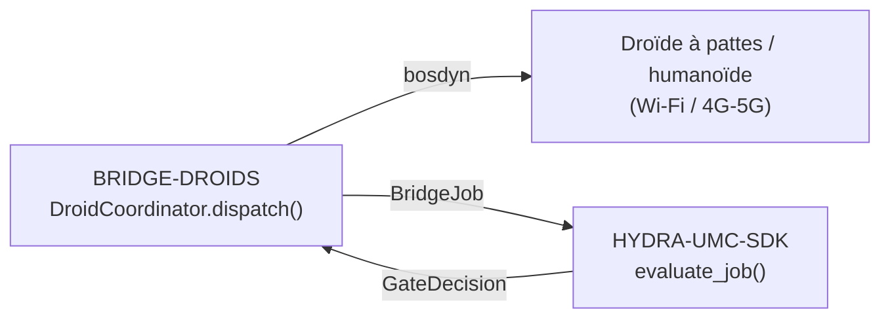

<!-- =============================================================================
HYDRA-UMC-BRIDGE-DROIDS - Droid coordination bridge
Copyright (C) JuanenRac (Electro Hobby 3D) <electrohobby3d@gmail.com>
GPL-3.0-or-later - see LICENSE
============================================================================= -->

<p align="center">
  
</p>

# 🤖 HYDRA-UMC-BRIDGE-DROIDS

<p align="center"><a href="README.md">🇺🇸 English</a> | <a href="README_spa.md">🇪🇸 Español</a> | 🇫🇷 <b>Français</b> | <a href="README_ita.md">🇮🇹 Italiano</a> | <a href="README_deu.md">🇩🇪 Deutsch</a> | <a href="README_zho.md">🇨🇳 简体中文</a> | <a href="README_jpn.md">🇯🇵 日本語</a> | <a href="README_por.md">🇵🇹 Português</a></p>

### 🔗 Frontière de coordination sans dépendance entre HYDRA-UMC et les droïdes à pattes/humanoïdes

<p align="center">
  
  
  
  
  
  
</p>

---

> **Vérification d'honnêteté - ce qui fonctionne réellement aujourd'hui :** le cœur de coordination sans dépendance (`coordinator.py` avec `DroidCoordinator`, faisant passer chaque envoi par le propre `evaluate_job()` de `HYDRA-UMC-SDK`) et l'émetteur de commandes Boston Dynamics Spot (`spot_transport.py` avec `SpotDroidControl`) sont réels et couverts par 79 tests unitaires qui passent (`python tools/build_test.py` - `test_coordinator.py`, `test_spot_transport.py`, plus `test_spot_emulator.py` qui fait tourner le bridge contre un émulateur Spot fidèle au protocole mais écrit à la main, pas un vrai robot). Rien de tout cela n'a été testé contre une vraie installation `bosdyn-client`, une vraie liaison réseau, ou un Spot/droïde physique - le `FakeBuilder`/`FakeSink` propre à `test_spot_transport.py` remplace entièrement `bosdyn-client` (la vraie bibliothèque n'a même pas besoin d'être installée pour que ces tests passent), et il n'existe pas encore de commande `run` en direct car aucun transport (Wi-Fi/BT/4G-5G) ni plateforme de droïde physique n'a été validé. Voir « Feuille de route et limites connues » ci-dessous, qui le dit déjà clairement, et `CHANGELOG.md` pour ce qui a été exactement livré jusqu'à présent.

> **État de la sûreté et de la cybersécurité :** cet écosystème n'est pas un système de sécurité certifié. Il n'existe pas encore de chaîne d'E-STOP matérielle, ni de limites ou de verrouillages imposés par le firmware, ni de commande de mouvement vérifiée ; les images de firmware sont contrôlées par CRC-32 et une signature Ed25519, et une compilation de version refuse les clés de développement publiées (les têtes d'outil et les cartes d'extension derrière le relais utilisent encore les chargeurs d'URTC, qui prennent un HMAC-SHA256 à clé partagée au lieu d'une signature) ; TLS et TLS mutuel sont optionnels et désactivés par défaut ; aucune carte propre n'a encore été assemblée ni testée. Lisez la [base de sécurité](https://github.com/JuanenRac/HYDRA-UMC-DOCS/blob/main/docs/SECURITY_BASELINE.md) et le [modèle de menaces](https://github.com/JuanenRac/HYDRA-UMC-DOCS/blob/main/docs/THREAT_MODEL.md) avant de vous fier à une affirmation d'ici pour la sécurité d'une personne.

---

## 📋 En un coup d'œil

| | |
|---|---|
| Version | `0.1.4` |
| Maturité | Fonctionnel |
| Tests | 79 (`python tools/build_test.py`) |
| Technologie | Python / Boston Dynamics Spot SDK (bosdyn-client) / HYDRA-UMC-SDK |
| Sur matériel réel | Simulé seulement : testé avec des émulateurs, des doubles de test ou des simulateurs ; aucune exécution sur du matériel réel n'est consignée pour cette version |

**Aller à :** [Présentation](#-présentation) · [Architecture](#-architecture) · [Fonctionnalités](#-fonctionnalités) · [Sécurité et protection](#-sécurité-et-protection) · [Interfaces](#-interfaces) · [Configuration](#-configuration) · [Démarrage rapide](#-démarrage-rapide) · [Tests](#-tests) · [Dépannage](#-dépannage) · [Structure du dépôt](#-structure-du-dépôt) · [Projets liés](#-projets-liés)

## 🚦 État du projet

Chaque ligne est une partie de ce dépôt et le feu dit où elle en est aujourd'hui. Elle est écrite d'après ce que le dépôt peut montrer (tests, compilations, exécutions), pas d'après ce qui est prévu.

🟢 Fait et vérifié · 🟡 Fonctionne, avec des limites connues · 🟠 À moitié fait ou pas encore vérifié · 🔴 Pas fait ou ne fonctionne pas

| Domaine | État | Ce que cela veut dire ici |
|---|---|---|
| Logiciel | 🟡 | Fonctionne pour son usage principal ; la vérification d'honnêteté ci-dessus liste ce qui manque encore |
| Tests | 🟢 | 79 tests automatiques, exécutés à chaque modification |
| Matériel réel | 🟠 | Simulé seulement : testé avec des émulateurs, des doubles de test ou des simulateurs ; aucune exécution sur du matériel réel n'est consignée pour cette version |
| Documentation | 🟢 | README en huit langues, vérifié par rapport au manifeste à chaque modification |

## 🎯 Présentation

**HYDRA-UMC-BRIDGE-DROIDS** est la frontière de coordination haut niveau entre HYDRA-UMC et une plateforme de droïde à pattes ou humanoïde, accessible par Wi-Fi ou une liaison cellulaire (4G/5G). Elle ne calcule jamais la marche, l'équilibre ni les trajectoires articulaires : elle valide et transmet un vocabulaire réduit et nommé de déclencheurs d'action corps entier (`WALK_TO`, `PICK_OBJECT`, `PLACE_OBJECT`, `RETURN_HOME`, `HOLD_POSITION`), chacun avec son propre contrat réel de paramètres obligatoires. Ce n'est pas un nœud de contrôle moteur, et elle ne peut pas contourner HYDRA-UMC-SERVER, les limites du MCU, les watchdogs ou l'E-STOP. Le seul transport implémenté est l'API propre de Boston Dynamics Spot sur un réseau IP (il n'y a pas de Bluetooth) ; aujourd'hui il peut envoyer `sit`, `stand`, `walk_to` et l'arrêt, et il n'a jamais été exécuté contre un vrai robot.

Il appartient à la famille **Mobile & Autonomous Bridges**, aux côtés de `HYDRA-UMC-BRIDGE-AMR` et `HYDRA-UMC-BRIDGE-UAV`, et partage le même contrat de tâches et de sécurité `HYDRA-UMC-SDK` que les **External Automation Bridges** stationnaires (CNC, LASER, OPENPNP, PRINTER3D, ROS2) — ainsi, aucun pont, mobile ou stationnaire, n'invente sa propre définition du « sûr pour travailler ».

## 🧩 Rôle dans HYDRA-UMC

**HYDRA-UMC-BRIDGE-DROIDS** permet à une cellule de robots de demander à un droïde à pattes ou humanoïde une action nommée (tenir la position, s'asseoir, se lever, marcher vers un point, prendre ou poser quand la plateforme le peut). Il transforme un travail de cellule validé en cette action et jamais en mouvement brut.

Il partage avec tous les bridges le contrat de sécurité de `HYDRA-UMC-SDK` : un travail n'est accepté que si la porte partagée `evaluate_job()` le permet, et cette porte échoue en position fermée. Ce bridge n'a pas de transport MQTT ; son seul transport réel est l'émetteur de commandes Boston Dynamics Spot.

## 🏛️ Architecture

<p align="center">
  
</p>

<details>
<summary>Version texte du diagramme (Mermaid)</summary>



</details>

**Pourquoi il est construit ainsi**

* **Pourquoi le noyau ne calcule jamais la marche ni l'équilibre.** Le calcul embarqué propre du droïde (classe Jetson ou équivalent) exécute déjà un contrôleur corps entier réel et spécifique au matériel — le recalculer ici le dupliquerait mal ou entrerait en conflit avec lui. N'envoyer que des déclencheurs de destination/action nommés (`WALK_TO x y`, `PICK_OBJECT object_id`) maintient le rôle de HYDRA-UMC à la coordination, conformément à la note d'architecture collée dont ce projet est parti : « ne pas calculer la marche du droïde dans le noyau ».
* **Pourquoi chaque déclencheur d'action a sa propre liste explicite de paramètres obligatoires.** Un `WALK_TO` sans `x`/`y`, ou un `PICK_OBJECT` sans `object_id`, est une véritable erreur de forme de requête, détectable — la rejeter ici, avant tout transport, est strictement préférable à transmettre une instruction incomplète en espérant que le firmware propre du droïde la rejette aussi de façon sûre.
* **Pourquoi `DroidCoordinator.dispatch()` fait quand même passer chaque tâche par le portail partagé `evaluate_job()`.** Un droïde n'est qu'un client de plus du même `bridge_contract` utilisé par CNC, LASER, OPENPNP, PRINTER3D et ROS2 — il ne bénéficie d'aucun contournement spécial de la logique IDLE/READY appliquée par tous les autres ponts et par HYDRA-UMC-SERVER.
* **Pourquoi `HOLD_POSITION` (depuis `ABORT`) reste demandable pendant un défaut.** L'exigence de phase productive du portail (`IDLE` + `READY`) n'est délibérément pas appliquée de la même manière à une demande d'abandon — un opérateur doit toujours pouvoir demander à un droïde de s'immobiliser sur place, même en plein défaut, plutôt que de continuer ce qu'il était en train de faire.
* **Pourquoi il n'y a pas encore d'adaptateur de transport pour un droïde autre que Spot.** S'engager sur le protocole de commandes réel Wi-Fi/BT/4G-5G d'une plateforme de droïde spécifique avant qu'elle ne soit sélectionnée et testée risquerait d'intégrer des hypothèses que ce noyau local sans dépendance ne peut pas vérifier.
* **Comment cela s'intègre dans le reste de l'écosystème.** BRIDGE-DROIDS se situe entre un droïde réel et `HYDRA-UMC-SDK` → `HYDRA-UMC-SERVER` → sécurité MCU : c'est une frontière de coordination, jamais un nœud de contrôle moteur, et elle ne peut pas contourner HYDRA-UMC-SERVER, les limites du MCU, les watchdogs ou l'E-STOP.

## ✨ Fonctionnalités

* ✅ **Noyau de coordination sans dépendance, réel :** `DroidCoordinator` de `coordinator.py` n'importe aucun transport (ni socket, ni SDK constructeur) — c'est délibérément du Python pur, testable sur n'importe quel hôte sans droïde réel connecté. *(implémenté, testé dans `tests/test_coordinator.py`)*
* ✅ **Vocabulaire réel de déclencheurs d'action nommés :** `WALK_TO`, `PICK_OBJECT`, `PLACE_OBJECT`, `RETURN_HOME`, `HOLD_POSITION`, `STAND`, `SIT` - jamais une commande articulaire brute. La marche, l'équilibre et le contrôle articulaire du corps entier restent l'autorité propre du contrôleur embarqué du droïde (de type Jetson ou équivalent). `STAND`/`SIT` sont des primitives de posture réelles et quasi universelles pour les robots à pattes - vérifiées avec le [`basic_command.proto` du Spot SDK](https://github.com/boston-dynamics/spot-sdk/blob/master/protos/bosdyn/api/basic_command.proto) public de Boston Dynamics, dont les commandes de mobilité fondamentales sont `stand`/`sit`/`selfright`/`safe_power_off`, pas seulement marcher/manipuler - exposées comme appels autonomes `sit_request()`/`stand_request()`, délibérément hors du flux `dispatch()` piloté par `JobPhase` (aucune phase ne signifie naturellement « se lever » ou « s'asseoir »). `sit_request()` est toujours accepté (une désescalade réelle, même raisonnement que `HOLD_POSITION`) ; `stand_request()` exige une cellule `READY` et une machine `IDLE` (une transition réelle vers la disponibilité productive). *(implémenté)*
* ✅ **Validation réelle des paramètres par action :** chaque déclencheur d'action a son propre contrat réel et minimal de paramètres obligatoires (par ex. `WALK_TO` nécessite `x`/`y`), vérifié avant qu'une tâche ne soit jamais transmise — une requête à laquelle il manque ce que sa propre action exige est rejetée localement, et non transmise en silence en aval. *(implémenté, testé)*
* ✅ **Portail de sécurité partagé, réel :** chaque tâche envoyée via `DroidCoordinator.dispatch()` est évaluée par `evaluate_job()` du `bridge_contract` de `HYDRA-UMC-SDK`, le même portail utilisé par tous les ponts frères et HYDRA-UMC-SERVER ; une phase productive nécessite une machine externe `IDLE` et une cellule HYDRA-UMC `READY`, tandis que `HOLD_POSITION` (mappé depuis `ABORT`) reste demandable pendant un défaut. *(implémenté)*
* ✅ **Routage de phases fermé et évidence statique :** une future phase SDK inconnue est refusée plutôt que devinée. `inspect_action_plan.py` émet le plan d'action statique de schéma `1.0` sans ouvrir aucun transport. *(implémenté, testé)*
* ✅ **Transport Boston Dynamics Spot réel :** `SpotDroidControl` de `spot_transport.py` envoie une répartition déjà validée comme une véritable commande bosdyn-client (`synchro_stand_command`/`synchro_sit_command`/`synchro_trajectory_command_in_body_frame`, envoyée via `RobotCommandClient.robot_command()`) - une répartition rejetée n'atteint jamais le réseau. *(implémenté, testé dans `tests/test_spot_transport.py`)*
* ✅ **Arrêts, objectifs validés et commande qui expire :** `hold_position()` envoie le `stop_command()` de bosdyn (le transport du `HOLD_POSITION` d'`ABORT`, jamais derrière la porte) ; `sit()` arrête d'abord le robot ; un `DroidDispatch` porte les paramètres validés par la porte et `walk_to()` envoie exactement ceux-là - seulement pour un envoi `WALK_TO`, avec des nombres finis, une limite de distance optionnelle (`PlatformProfile.max_walk_distance_m`) et un `command_timeout_s` obligatoire qui devient l'`end_time_secs` de la commande, de sorte que le robot abandonne une marche si ce processus disparaît ; `stand_request()` tire sa décision d'`evaluate_job()` lui-même ; une réponse qui n'est pas `STATUS_OK` n'est pas comptée comme envoyée. *(implémenté, testé avec des doublures et l'émulateur, qui lève désormais des erreurs de forme bosdyn ; jamais exécuté contre un vrai Spot - le lease, l'E-Stop logiciel avec son keep-alive et la mise sous tension ne sont PAS faits, on ne peut donc pas encore commander un vrai Spot avec ceci, et `RETURN_HOME`, `PICK_OBJECT` et `PLACE_OBJECT` n'ont pas de transport)*
* ✅ **Build/test non mutant :** `build-test.bat`/`.sh` compilent le code source et exécutent des tests unitaires déterministes sans changer la version ni le CHANGELOG. *(implémenté, voir COMPILATION ET EXÉCUTION ci-dessous)*
* 🔜 **Adaptateur Wi-Fi/BT/4G-5G propre à une plateforme de droïde autre que Spot** — introduit seulement après la sélection et le test de cette plateforme. *(prévu)*
* ✅ **État observé de la machine :** `DroidCoordinator.dispatch()` accepte l'état rapporté par le droïde, que la porte partagée utilise à la place du `machine_state` écrit dans le travail (un message que n'importe qui sur le broker peut publier) ; sans rapport, la déclaration est toujours utilisée. *(implémenté, testé dans `tests/test_observed_state.py`)*

## 🔒 Sécurité et protection

| Menace | Défense | Où |
|---|---|---|
| Un travail pour une cellule ou une machine qui n'est pas en état sûr | Chaque travail passe par la porte partagée `evaluate_job()` du SDK, qui échoue en position fermée ; le bridge n'a aucune logique propre d'acceptation | SDK `bridge_contract` |
| Données de travail démesurées | Au plus 32 paramètres, clés jusqu'à 64 caractères, valeurs jusqu'à 1024, identifiants jusqu'à 128 (`MAX_PARAMETERS`, `MAX_PARAMETER_KEY_CHARS`, `MAX_PARAMETER_VALUE_CHARS`, `MAX_IDENTIFIER_CHARS`) | SDK `bridge_contract` |
| Un ordre répété ou rejoué | Un `IdempotencyStore` retient chaque clé 24 heures et au plus 10 000 entrées ; une répétition reçoit la première réponse au lieu d'être réévaluée | SDK `job_intake` |
| Une action que la plateforme ne peut pas faire | `PlatformProfile` : `MOBILE_ONLY` autorise posture et déplacement, `MOBILE_MANIPULATOR` aussi `PICK_OBJECT` et `PLACE_OBJECT` ; `check_against_profile()` refuse le reste | `platform_profiles.py` |
| Un ordre de marche sans limite de temps ou avec une valeur non finie | `walk_to` exige un `command_timeout_s` fini et positif pour que le robot abandonne l'ordre à l'échéance ; les paramètres non finis sont refusés | `spot_transport.py` |

**Ce qu'il ne fait jamais :** il n'envoie jamais de mouvement brut, ne prend jamais le bail («lease») et n'alimente jamais les moteurs ; il n'a jamais été connecté à un vrai Spot.

## 🔌 Interfaces

Il n'y a ni topics MQTT ni routes HTTP : ce bridge est une bibliothèque.

| Élément | Ce que c'est |
|---|---|
| `DroidCoordinator` | `dispatch(job, cell_state, observed_machine_state)`, `sit_request()`, `stand_request()` ; renvoie un `DroidDispatch` |
| `SpotDroidControl` | `hold_position()`, `sit()`, `stand()`, `walk_to()` ; chacune renvoie un `SpotSendResult` |
| `open_bosdyn_robot_command(hostname, username, password)` | ouvre la connexion et renvoie le constructeur de commandes et la destination ; l'absence de `bosdyn-client` donne une `RuntimeError` claire, pas une `ImportError` |

## ⚙️ Configuration

Il n'y a ni variables d'environnement ni fichier de configuration : l'hôte, l'utilisateur et le mot de passe du Spot sont des arguments de `open_bosdyn_robot_command()`, et le profil de plateforme (`MOBILE_ONLY` ou `MOBILE_MANIPULATOR`) se choisit dans le code. La façon de stocker les identifiants sur une installation réelle n'est pas encore décidée.

## 🚀 Démarrage rapide

Nécessite Python 3.11 ou plus récent. Les tests et les scripts de build attendent `HYDRA-UMC-SDK` cloné à côté de ce dépôt (`../HYDRA-UMC-SDK`) ou indiqué par `HYDRA_UMC_SDK_ROOT`.

Essayez-le sans matériel (cela vérifie tout le bridge avec ses émulateurs et ses doubles de test) :

```bash
py -3 tools/build_test.py          # Windows
python3 tools/build_test.py         # Linux, macOS
```

Démarrer le service (il n'y a pas de script de console : le service est le `run_forever()` du transport MQTT, que vous appelez depuis votre propre code de démarrage) :

```python
from hydra_umc_bridge_droids import SpotDroidControl, open_bosdyn_robot_command
builder, sink = open_bosdyn_robot_command("192.168.80.3", "user", "password")   # needs the `spot` extra
control = SpotDroidControl()
control.stand(builder, sink, cell_state, machine_state)   # gated: needs a READY cell and an idle machine
control.hold_position(builder, sink)                      # a stop is never gated
```

## 🧪 Tests

79 cas `unittest` automatiques s'exécutent avec `python tools/build_test.py` (qui compile aussi chaque module). Les tests n'ont besoin ni de matériel, ni de réseau, ni de paquet optionnel : ceux qui exigeraient `paho-mqtt`, `pyserial` ou une bibliothèque de fabricant utilisent un substitut ou sont ignorés si le paquet manque.

| Fichier de tests | Tests | Ce qu'il couvre |
|---|---|---|
| `test_coordinator.py`, `test_observed_state.py`, `test_edge_cases.py` | - | passage du travail à l'action, état observé de la machine, cas limites |
| `test_platform_profiles.py` | - | quelles actions chaque plateforme accepte |
| `test_spot_transport.py`, `test_spot_emulator.py`, `spot_emulator.py` | - | `SpotDroidControl` contre de faux constructeurs et un émulateur de Spot à la forme de bosdyn |

La CI exécute `HYDRA_UMC_CI=1 python tools/ci_validate.py`, qui vérifie le manifeste, les documents, les huit README et les images, et lance les tests avec une copie du SDK.

## 🏗️ Compilation et publication

Nécessite Python 3.11+. `tools/build_test.py` attend que `HYDRA-UMC-SDK` soit cloné en tant que répertoire frère (`../HYDRA-UMC-SDK`) ou indiqué via la variable d'environnement `HYDRA_UMC_SDK_ROOT`.

```bash
# Windows
build-test.bat      # validation uniquement — pas de changement de version/CHANGELOG
build.bat            # Valide et compile (compiler ne change jamais la version)

# Linux/macOS
bash build-test.sh
bash build.sh
```

`build-test` compile chaque module sous `src/` avec `py_compile` et exécute la suite complète `unittest` découverte sous `tests/` (tous les fichiers `test_*.py` - 79 tests) — de manière déterministe, sans connexion réelle à un droïde, sans réseau et sans changement de version/CHANGELOG. `build` exécute d'abord cette même validation et, seulement en cas de succès, appelle `tools/bump_version.py` pour synchroniser la version dans `pyproject.toml`, `hydra-umc.project.json` et `CHANGELOG.md`. Il n'existe pas encore de commande `run` avec matériel réel — cela nécessite un adaptateur de transport validé et une plateforme de droïde réelle.

## 🩺 Dépannage

| Vous voyez | Parce que | Faites |
|---|---|---|
| `ModuleNotFoundError: hydra_umc_sdk` | Le SDK n'est ni installé ni à côté de ce dépôt | Clonez `HYDRA-UMC-SDK` à côté de ce dépôt ou définissez `HYDRA_UMC_SDK_ROOT` |
| `bosdyn-client` ... `RuntimeError` | L'extra optionnel Spot n'est pas installé | `pip install ".[spot]"` (`bosdyn-client` 4.0 ou plus) |
| `accepted` is false on a `DroidDispatch` | La porte partagée, le profil de plateforme ou un contrôle de paramètres a refusé le travail | Lisez `reason` sur l'envoi et corrigez la cause ; un envoi refusé n'est jamais transmis au robot |

## 📂 Structure du dépôt

<p align="center">
  
</p>

<details>
<summary>Version texte de l'arborescence</summary>

```text
HYDRA-UMC-BRIDGE-DROIDS/
├── src/hydra_umc_bridge_droids/
│   ├── coordinator.py             transforme un travail en déclencheurs d'action nommés, jamais de mouvement brut
│   ├── platform_profiles.py       quelles actions une plateforme peut recevoir ; un droïde qui ne peut pas bouger
│   └── spot_transport.py          commandes Spot via bosdyn-client : hold, sit, stand, walk_to
├── tests/                         79 tests, avec un émulateur de Spot à la forme de bosdyn
├── docs/                          guide du bridge
├── tools/                         exécuteur de build et de tests, montée de version, validateur CI, générateurs et vérifications des README et des images
├── images/                        bannière et images du README
├── .github/                       workflow CI et modèles de tickets
├── pyproject.toml                 métadonnées du paquet et dépendances
├── hydra-umc.project.json         manifeste : version, maturité, famille
├── CHANGELOG.md                   ce qui a changé à chaque version
├── build.sh build.bat             scripts de build (ils ne changent jamais la version)
├── build-test.sh build-test.bat   scripts de build (ils ne changent jamais la version)
├── test.sh test.bat               lancent les tests
└── SECURITY.md SUPPORT.md CONTRIBUTING.md CODE_OF_CONDUCT.md LICENSE LICENSE.md
```

</details>

## 🗺️ Feuille de route et limites connues

**Limites connues aujourd'hui**

**Réel aujourd'hui :** version `0.1.4`, fonctionnel en tant que noyau de coordination sans dépendance (`DroidCoordinator`) avec validation réelle des paramètres par action, routage de phases fermé, un schéma d'action statique `plan-only`, un transport Boston Dynamics Spot réel (`SpotDroidControl`) envoyant de véritables commandes bosdyn-client, et des scripts build-test non mutants intégrés en CI avec un checkout du SDK.

**Frontière d'intégration :** ce pont n'est qu'une frontière de coordination — ce n'est pas un nœud de contrôle moteur, et il ne peut pas contourner HYDRA-UMC-SERVER, les limites du MCU, les watchdogs ou l'E-STOP ; chaque tâche envoyée passe toujours par le même portail partagé utilisé par tous les ponts frères.

**Encore à venir :** aucun transport réel (Wi-Fi/BT/4G-5G) ni droïde physique n'a encore été validé — un adaptateur de transport réel et une interface de commandes de droïde documentée seront introduits seulement après la sélection et le test d'une plateforme spécifique.

## 🌍 Langues

Ce README et les documents du dépôt existent en huit langues : anglais, espagnol, allemand, français, italien, japonais, chinois et portugais (Portugal). Ils sont écrits ensemble et la CI vérifie que les huit fichiers ont les mêmes sections et les mêmes liens. Ce dépôt n'a ni écran ni catalogue de messages propre, il n'y a donc aucune chaîne d'interface à traduire.

## 🔗 Projets liés

Ce projet fait partie de l'écosystème robotique HYDRA-UMC du même auteur (JuanenRac / Electro Hobby 3D). Bon à savoir, car une demande pourrait en réalité concerner l'un de ceux-ci plutôt que ce dépôt.

**Projet Parent**
- **[HYDRA-UMC-SERVER](https://github.com/JuanenRac/HYDRA-UMC-SERVER)** — le vrai backend headless (REST/WebSocket) auquel parle réellement chaque client de contrôle ; la frontière authentifiée de l'écosystème à laquelle ce bridge rend compte une fois chaque commande passée par la propre barrière de sécurité locale de ce bridge.

**Projets Frères** — parlent également à la propre API de HYDRA-UMC-SERVER, chacun en tant que son propre client
- **[HYDRA-UMC-STUDIO](https://github.com/JuanenRac/HYDRA-UMC-STUDIO)** — tableau de bord de contrôle web avec visualisation 3D multi-robot en temps réel.
- **[HYDRA-UMC-SUITE](https://github.com/JuanenRac/HYDRA-UMC-SUITE)** — centre de commande d'essaim de bureau (PySide6) pour plusieurs serveurs à la fois, empaqueté en exécutable autonome.
- **[HYDRA-UMC-ANDROID-CONTROL](https://github.com/JuanenRac/HYDRA-UMC-ANDROID-CONTROL)** — application de contrôle Android native avec connexion biométrique et un compagnon Wear OS jumelé.
- **[HYDRA-UMC-IOS-CONTROL](https://github.com/JuanenRac/HYDRA-UMC-IOS-CONTROL)** — application de contrôle iOS/iPadOS (Flutter) avec synchronisation WebSocket en temps réel.
- **[HYDRA-UMC-DSI](https://github.com/JuanenRac/HYDRA-UMC-DSI)** — interface tactile native pour l'écran tactile DSI 7" embarqué, intégrée directement sur le CM5.
- **[HYDRA-UMC-BRIDGE-AMR](https://github.com/JuanenRac/HYDRA-UMC-BRIDGE-AMR)** — frontière de coordination pour les flottes AGV/AMR via un éditeur MQTT VDA 5050 (testé uniquement contre une flotte émulée) — l'un des 3 bridges de flotte mobile de l'écosystème.
- **[HYDRA-UMC-BRIDGE-CNC](https://github.com/JuanenRac/HYDRA-UMC-BRIDGE-CNC)** — coordinateur haut niveau pour cellules CNC avec accès au statut/octets de contrôle GRBL (testé uniquement contre un émulateur).
- **[HYDRA-UMC-BRIDGE-LASER](https://github.com/JuanenRac/HYDRA-UMC-BRIDGE-LASER)** — coordinateur de cellules laser lisant 3 signaux GPIO de clé/enceinte/verrouillage (testé uniquement contre une puce simulée ; il ne peut ni armer ni tirer un laser).
- **[HYDRA-UMC-BRIDGE-OPENPNP](https://github.com/JuanenRac/HYDRA-UMC-BRIDGE-OPENPNP)** — coordinateur haut niveau sûr pour le flux de cartes du pick-and-place OpenPnP.
- **[HYDRA-UMC-BRIDGE-PRINTER3D](https://github.com/JuanenRac/HYDRA-UMC-BRIDGE-PRINTER3D)** — frontière de coordination sûre pour imprimantes 3D Moonraker/Klipper, avec de vraies commandes de tâche contrôlées.
- **[HYDRA-UMC-BRIDGE-ROS2](https://github.com/JuanenRac/HYDRA-UMC-BRIDGE-ROS2)** — coordinateur avec un transport ROS 2 rclpy à importation paresseuse (pas encore exécuté contre une installation ROS 2).
- **[HYDRA-UMC-BRIDGE-UAV](https://github.com/JuanenRac/HYDRA-UMC-BRIDGE-UAV)** — frontière de coordination pour UAV équipés de caméra, avec un émetteur de commandes MAVLink (testé uniquement contre un émulateur) — l'un des 3 bridges de flotte mobile de l'écosystème.

**Directement Liés**
- **[HYDRA-UMC-SDK](https://github.com/JuanenRac/HYDRA-UMC-SDK)** — le contrat JSON-Schema partagé et la barrière logicielle de contrôle des jobs contre laquelle chaque bridge valide ses commandes (pas une fonction de sécurité certifiée).
- **[HYDRA-UMC-CONNECTOR-HUB](https://github.com/JuanenRac/HYDRA-UMC-CONNECTOR-HUB)** — registre déclaratif et validateur de manifestes d'adaptateur pour les connecteurs de machines externes ; étend la propre idée de contrat du SDK aux machines externes sans remplacer les projets de passerelle industrielle.

**Fait Également Partie de l'Écosystème**

*Matériel & Plateforme de Base*
- **[HYDRA-UMC](https://github.com/JuanenRac/HYDRA-UMC)** — la conception de la carte mère du bras robotique : hôte CM5 + coprocesseur STM32H745 double cœur, destinée à coordonner jusqu'à 8 bras-outils via CAN-OTA/SPI-OTA (firmware à un stade précoce ; aucune carte assemblée pour l'instant).
- **[HYDRA-UMC-OS](https://github.com/JuanenRac/HYDRA-UMC-OS)** — couche produit reproductible sur Raspberry Pi OS pour le CM5 : agent en lecture seule, config/profils validés, provisionnement WiFi de premier contact.

*Backend Central & Clients*
- **[HYDRA-UMC-EDITOR-URDF](https://github.com/JuanenRac/HYDRA-UMC-EDITOR-URDF)** — créateur/éditeur graphique de bureau pour URDF qui envoie les modèles terminés vers le propre catalogue de STUDIO.
- **[HYDRA-UMC-EDITOR-STL](https://github.com/JuanenRac/HYDRA-UMC-EDITOR-STL)** — éditeur de bureau de modèles STL, transformant/remplaçant/retirant/ajoutant de vraies pièces dans le même catalogue de modèles qu'édite aussi HYDRA-UMC-EDITOR-URDF.

*Plateforme d'Outils URTC*
- **[URTC](https://github.com/JuanenRac/URTC)** — firmware pour la carte physique Universal Robot Tool Controller, plus de 25 profils d'outil sur bus CAN.
- **[URTC-FLASHER](https://github.com/JuanenRac/URTC-FLASHER)** — outil de bureau à interface graphique pour flasher les cartes URTC, CAN-OTA plus SWD/JTAG puce complète.
- **[URTC-TESTER](https://github.com/JuanenRac/URTC-TESTER)** — outil de bureau de diagnostic CAN-bus en direct pour cartes URTC, un panneau par profil d'outil.
- **[URTC-WEB-STUDIO](https://github.com/JuanenRac/URTC-WEB-STUDIO)** — alternative basée navigateur à URTC-TESTER via la Web Serial API, sans installation locale.
- **[URTC-GATEWAY](https://github.com/JuanenRac/URTC-GATEWAY)** — passerelle devant le bus CAN d'URTC : liste d'identifiants autorisés, limite de débit et clé de session ; logiciel testé sur ordinateur, pas encore sur un bus réel.

*Nœud IA de Vision (Hailo-8)*
- **[HYDRA-UMC-VISION-NODE](https://github.com/JuanenRac/HYDRA-UMC-VISION-NODE)** — hub d'intégration pour le pipeline de vision Hailo-8, avec une vraie vérification de disponibilité matérielle par étape.
- **[HYDRA-UMC-DETECTION-HEF](https://github.com/JuanenRac/HYDRA-UMC-DETECTION-HEF)** — registre réel de modèles compilés avec vérification de chargement sécurisé par architecture Hailo/checksum.
- **[HYDRA-UMC-VISION-STREAMER](https://github.com/JuanenRac/HYDRA-UMC-VISION-STREAMER)** — générateur réel de pipeline GStreamer + config MediaMTX, avec une vraie frontière d'intégration HailoRT.
- **[HYDRA-UMC-VISUAL-SERVOING-API](https://github.com/JuanenRac/HYDRA-UMC-VISUAL-SERVOING-API)** — loi de correction Position-Based Visual Servoing avec autorisation conditionnée à l'état de zone ; pas encore d'estimation de pose par caméra.
- **[HYDRA-UMC-SAFETY-ZONES](https://github.com/JuanenRac/HYDRA-UMC-SAFETY-ZONES)** — logique v0 de violation de zone, de fraîcheur de calibration et de demande d'E-STOP qui lit les positions d'objets dans un fichier ; aucun détecteur ne l'alimente et aucun E-STOP physique n'y est encore relié.

*Nœud IA Cognitif (Hailo-10)*
- **[HYDRA-UMC-COGNITIVE-NODE](https://github.com/JuanenRac/HYDRA-UMC-COGNITIVE-NODE)** — hub d'intégration pour le pipeline cognitif Hailo-10 (orchestration LLM/VLA/voix).
- **[HYDRA-UMC-VLA-ENGINE](https://github.com/JuanenRac/HYDRA-UMC-VLA-ENGINE)** — vrai encodage/décodage de jetons d'action et génération de trajectoire pour un modèle Vision-Language-Action.
- **[HYDRA-UMC-VOICE-UI](https://github.com/JuanenRac/HYDRA-UMC-VOICE-UI)** — vrai front-end vocal (VAD + analyseur d'intention) avec un relais Watch borné et soumis à confirmation.
- **[HYDRA-UMC-SEMANTIC-PLANNER](https://github.com/JuanenRac/HYDRA-UMC-SEMANTIC-PLANNER)** — vraie décomposition de tâches basée sur des règles et récupération sémantique d'erreurs sur les codes d'erreur MCU.
- **[HYDRA-UMC-DOCS-QA](https://github.com/JuanenRac/HYDRA-UMC-DOCS-QA)** — vraie recherche documentaire TF-IDF (bibliothèque standard uniquement) sur les propres documents Markdown de cet écosystème.
- **[HYDRA-UMC-LOCAL-TECHNICIAN](https://github.com/JuanenRac/HYDRA-UMC-LOCAL-TECHNICIAN)** — technicien de maintenance IA local et à portes de politique pour l'écosystème lui-même - observe, diagnostique et propose des corrections ; les deux niveaux de risque les plus élevés ne sont délibérément pas encore implémentés.

*Orchestration & Essaim*
- **[HYDRA-UMC-ORCHESTRATOR](https://github.com/JuanenRac/HYDRA-UMC-ORCHESTRATOR)** — hub d'intégration avec un vrai contrat de rapport de santé gRPC/Protobuf et une machine à états de mission.
- **[HYDRA-UMC-JOB-DISPATCHER](https://github.com/JuanenRac/HYDRA-UMC-JOB-DISPATCHER)** — vraie file de tâches basée sur la priorité avec déduplication, via une vraie API HTTP.
- **[HYDRA-UMC-NODE-HEALING](https://github.com/JuanenRac/HYDRA-UMC-NODE-HEALING)** — vrai chien de garde de santé de flotte basé sur gRPC, avec retry/backoff et détection d'incohérence d'identité.
- **[HYDRA-UMC-PATH-PLANNER-3D](https://github.com/JuanenRac/HYDRA-UMC-PATH-PLANNER-3D)** — vrai planificateur de trajectoire 3D basé sur RRT, avec vraie validation des collisions obstacle/espace de travail.
- **[HYDRA-UMC-SWARM-SYNC](https://github.com/JuanenRac/HYDRA-UMC-SWARM-SYNC)** — vraie synchronisation d'état CRDT LWW-Element-Map, testée par propriétés pour la convergence multi-cellule.

*Jumeau Numérique & Simulation*
- **[HYDRA-UMC-TWIN](https://github.com/JuanenRac/HYDRA-UMC-TWIN)** — hub d'intégration pour le moteur de jumeau numérique, avec un vrai contrat de synchronisation par compatibilité de version.
- **[HYDRA-UMC-HIL-BRIDGE](https://github.com/JuanenRac/HYDRA-UMC-HIL-BRIDGE)** — routeur hardware-in-the-loop avec un verrouillage logiciel de collision entre simulation et matériel réel (testé sans matériel réel).
- **[HYDRA-UMC-PHYSICS-REPLICA](https://github.com/JuanenRac/HYDRA-UMC-PHYSICS-REPLICA)** — vraie cinématique directe et validation des limites articulaires sur un vrai sous-ensemble URDF.
- **[HYDRA-UMC-SYNTHETIC-DATA-GEN](https://github.com/JuanenRac/HYDRA-UMC-SYNTHETIC-DATA-GEN)** — vrai générateur procédural de scènes 2D avec export d'annotations YOLO/COCO.

*Données & Analytique*
- **[HYDRA-UMC-DATALAKE](https://github.com/JuanenRac/HYDRA-UMC-DATALAKE)** — vrai magasin de séries temporelles basé sur sqlite3, avec une vraie API HTTP d'ingestion/requête.
- **[HYDRA-UMC-ANOMALY-DETECTOR](https://github.com/JuanenRac/HYDRA-UMC-ANOMALY-DETECTOR)** — vrai détecteur d'anomalies FFT + ligne de base statistique, avec surveillance de dérive.
- **[HYDRA-UMC-PRODUCTION-REPORTS](https://github.com/JuanenRac/HYDRA-UMC-PRODUCTION-REPORTS)** — vrai calcul OEE/disponibilité sur l'historique de DATALAKE, avec export CSV reproductible.
- **[HYDRA-UMC-TELEMETRY-COLLECTOR](https://github.com/JuanenRac/HYDRA-UMC-TELEMETRY-COLLECTOR)** — vrai pipeline d'ingestion CAN/WebSocket vers DATALAKE, avec déduplication par séquence.

*Passerelle Industrielle*
- **[HYDRA-UMC-GATEWAY-INDUSTRIAL](https://github.com/JuanenRac/HYDRA-UMC-GATEWAY-INDUSTRIAL)** — hub d'intégration relayant vers les protocoles industriels, avec une vraie couche de liste blanche de commandes/contre-pression.
- **[HYDRA-UMC-OPCUA-SERVER](https://github.com/JuanenRac/HYDRA-UMC-OPCUA-SERVER)** — vrai espace d'adressage OPC-UA, vérifié avec une vraie session client du protocole binaire.
- **[HYDRA-UMC-MQTT-BROKER](https://github.com/JuanenRac/HYDRA-UMC-MQTT-BROKER)** — vrai broker MQTT avec authentification par client optionnelle et ACL de sujets.
- **[HYDRA-UMC-MTCONNECT-ADAPTER](https://github.com/JuanenRac/HYDRA-UMC-MTCONNECT-ADAPTER)** — vrais points de terminaison XML MTConnect `/probe` et `/current`, avec sortie en mode dégradé.

*Outils Complémentaires & Opérations de l'Écosystème*
- **[HYDRA-UMC-DASHBOARD-AI](https://github.com/JuanenRac/HYDRA-UMC-DASHBOARD-AI)** — panneaux Smart Summaries et Anomaly Highlighting sur DATALAKE/ANOMALY-DETECTOR, avec un repli statistique honnête.
- **[HYDRA-UMC-TOOL-CLI](https://github.com/JuanenRac/HYDRA-UMC-TOOL-CLI)** — CLI de flotte avec un vrai contrat de codes de sortie stable, un vrai client en direct de la propre API de HYDRA-UMC-SERVER.
- **[HYDRA-UMC-WATCH](https://github.com/JuanenRac/HYDRA-UMC-WATCH)** — application compagnon WearOS avec des motifs d'alerte haptique et un relais vocal vers le téléphone jumelé (pas encore exécutée sur une montre physique).
- **[URTC-SMART-RACK](https://github.com/JuanenRac/URTC-SMART-RACK)** — firmware pour un rack de montage de cartes avec décodage réel d'ID d'outil et logique de préchauffage Smart Idle.
- **[URTC-VISION-TOOL](https://github.com/JuanenRac/URTC-VISION-TOOL)** — firmware plus un vrai compagnon de vision Python pour une tête d'outil d'inspection thermique/RGB.
- **[HYDRA-UMC-UPDATER](https://github.com/JuanenRac/HYDRA-UMC-UPDATER)** — outil administratif de bureau qui découvre, clone et met à jour chaque dépôt de cet écosystème.
- **[HYDRA-UMC-OS-REBUILDER](https://github.com/JuanenRac/HYDRA-UMC-OS-REBUILDER)** — outil de bureau Windows/Linux qui construit une image de la CM5 prête à graver, préchargée avec les versions les plus actuelles de l'écosystème, avec une configuration de premier démarrage Wi-Fi/utilisateur/SSH façon Raspberry Pi Imager.
- **[HYDRA-UMC-OPS-AGENT](https://github.com/JuanenRac/HYDRA-UMC-OPS-AGENT)** — coordinateur d'incidents de maintenance : un rôle edge à faible privilège collecte un instantané d'inventaire/santé assaini, un rôle control-plane le rend en lecture seule et demande à un fournisseur d'IA de suggérer un diagnostic - n'applique jamais de correctif ni ne déploie rien.
- **[HYDRA-UMC-DEV-SERVER](https://github.com/JuanenRac/HYDRA-UMC-DEV-SERVER)** — hôte de développement reproductible (Raspberry Pi 5 / CM5) qui héberge le code source de l'écosystème et exécute des tâches de compilation/test délimitées via une file d'attente durable ; un rôle de développement dédié, explicitement distinct d'un CM5 opérationnel.

## 📚 Documentation

Où lire la suite :

* [docs/BRIDGE_GUIDE.md](docs/BRIDGE_GUIDE.md) - périmètre, profils de plateforme, le transport Spot, scripts
* [Base de sécurité de l'écosystème](https://github.com/JuanenRac/HYDRA-UMC-DOCS/blob/main/docs/SECURITY_BASELINE.md)
* [Modèle de menaces de l'écosystème](https://github.com/JuanenRac/HYDRA-UMC-DOCS/blob/main/docs/THREAT_MODEL.md)
* [Journal des modifications de ce dépôt](CHANGELOG.md)
* [Licence de ce dépôt](LICENSE.md)

## 🤝 Contribuer et communauté

* Avant une pull request, exécutez `HYDRA_UMC_CI=1 py -3 tools/ci_validate.py` (ou `HYDRA_UMC_CI=1 python3 tools/ci_validate.py`) : il doit afficher `CI_VALIDATION=PASS`. N'exécutez pas `build.sh` ni `build.bat` pour cette vérification ; compiler n'est pas vérifier.
* Les huit README sont écrits à partir d'une source unique dans HYDRA-UMC-DOCS ; ne les modifiez pas à la main. Changez la source et réécrivez-les avec `tools/make_readmes.py`.
* N'affirmez pas dans un README ce qui n'a pas tourné : écrivez « simulé » ou « non essayé sur matériel » quand c'est la vérité.
* Voir [CONTRIBUTING.md](CONTRIBUTING.md), le [code de conduite](CODE_OF_CONDUCT.md), [SECURITY.md](SECURITY.md) et [SUPPORT.md](SUPPORT.md).

## 👤 AUTEUR

**JuanenRac (Electro Hobby 3D)** · electrohobby3d@gmail.com

## 📜 LICENCE

GPL-3.0-or-later - [LICENSE](LICENSE).
