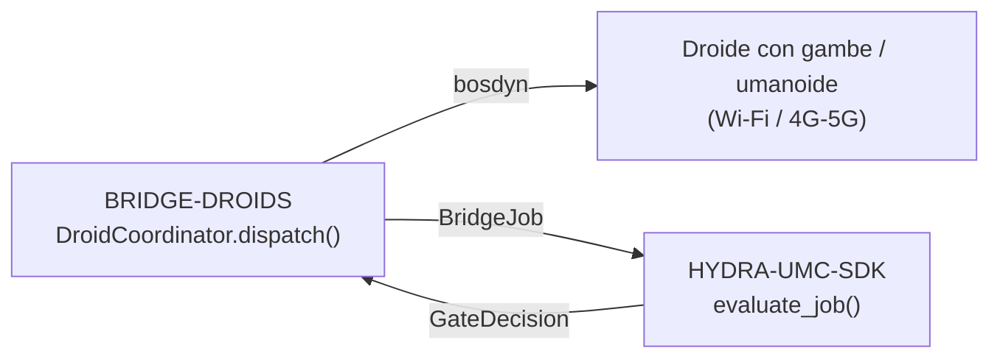

<!-- =============================================================================
HYDRA-UMC-BRIDGE-DROIDS - Droid coordination bridge
Copyright (C) JuanenRac (Electro Hobby 3D) <electrohobby3d@gmail.com>
GPL-3.0-or-later - see LICENSE
============================================================================= -->

<p align="center">
  
</p>

# 🤖 HYDRA-UMC-BRIDGE-DROIDS

<p align="center"><a href="README.md">🇺🇸 English</a> | <a href="README_spa.md">🇪🇸 Español</a> | <a href="README_fra.md">🇫🇷 Français</a> | 🇮🇹 <b>Italiano</b> | <a href="README_deu.md">🇩🇪 Deutsch</a> | <a href="README_zho.md">🇨🇳 简体中文</a> | <a href="README_jpn.md">🇯🇵 日本語</a> | <a href="README_por.md">🇵🇹 Português</a></p>

### 🔗 Confine di coordinamento privo di dipendenze tra HYDRA-UMC e i droidi con gambe/umanoidi

<p align="center">
  
  
  
  
  
  
</p>

---

> **Verifica di onestà - cosa funziona davvero oggi:** il nucleo di coordinamento senza dipendenze (`coordinator.py` con `DroidCoordinator`, che fa passare ogni dispatch attraverso il vero `evaluate_job()` di `HYDRA-UMC-SDK`) e il mittente di comandi Boston Dynamics Spot (`spot_transport.py` con `SpotDroidControl`) sono reali e coperti da 79 test unitari superati (`python tools/build_test.py` - `test_coordinator.py`, `test_spot_transport.py`, più `test_spot_emulator.py` che esegue il bridge contro un emulatore Spot fedele al protocollo ma scritto a mano, non un robot reale). Nulla di tutto ciò è stato testato contro una vera installazione `bosdyn-client`, un vero collegamento di rete, o uno Spot/droide fisico - il `FakeBuilder`/`FakeSink` proprio di `test_spot_transport.py` sostituisce interamente `bosdyn-client` (la libreria reale non deve nemmeno essere installata perché questi test passino), e non esiste ancora un comando `run` dal vivo perché nessun trasporto (Wi-Fi/BT/4G-5G) o piattaforma droide fisica è stata validata. Vedi "Roadmap e limiti noti" qui sotto, che lo dice già chiaramente, e `CHANGELOG.md` per cosa è stato esattamente consegnato finora.

> **Stato di sicurezza (safety e security):** questo ecosistema non è un sistema di sicurezza certificato. Non esiste ancora un percorso E-STOP hardware, né limiti o interblocchi imposti dal firmware, né un comando di movimento verificato; le immagini firmware sono controllate con CRC-32 e una firma Ed25519, e una compilazione di rilascio rifiuta le chiavi di sviluppo pubblicate (le teste utensile e le schede di espansione dietro il relè usano ancora i bootloader di URTC, che accettano un HMAC-SHA256 a chiave condivisa invece di una firma); TLS e TLS reciproco sono opzionali e disattivati per impostazione predefinita; nessuna scheda propria è stata ancora assemblata o provata. Leggi la [base di sicurezza](https://github.com/JuanenRac/HYDRA-UMC-DOCS/blob/main/docs/SECURITY_BASELINE.md) e il [modello delle minacce](https://github.com/JuanenRac/HYDRA-UMC-DOCS/blob/main/docs/THREAT_MODEL.md) prima di fidarti di qualsiasi affermazione qui per la sicurezza di una persona.

---

## 📋 In breve

| | |
|---|---|
| Versione | `0.1.4` |
| Maturità | Funzionale |
| Test | 79 (`python tools/build_test.py`) |
| Tecnologia | Python / Boston Dynamics Spot SDK (bosdyn-client) / HYDRA-UMC-SDK |
| Su hardware reale | Solo simulato: provato con emulatori, test double o simulatori; per questa versione non risulta alcuna esecuzione su hardware reale |

**Vai a:** [Panoramica](#-panoramica) · [Architettura](#-architettura) · [Funzionalità](#-funzionalità) · [Sicurezza e protezione](#-sicurezza-e-protezione) · [Interfacce](#-interfacce) · [Configurazione](#-configurazione) · [Avvio rapido](#-avvio-rapido) · [Test](#-test) · [Risoluzione dei problemi](#-risoluzione-dei-problemi) · [Struttura del repository](#-struttura-del-repository) · [Progetti correlati](#-progetti-correlati)

## 🚦 Stato del progetto

Ogni riga è una parte di questo repository e il semaforo dice a che punto è oggi. È scritta in base a ciò che il repository può mostrare (test, compilazioni, esecuzioni), non a ciò che è previsto.

🟢 Fatto e verificato · 🟡 Funziona, con limiti noti · 🟠 Fatto a metà o non ancora verificato · 🔴 Non fatto o non funzionante

| Area | Stato | Cosa significa qui |
|---|---|---|
| Software | 🟡 | Funziona per il suo scopo principale; la verifica di onestà qui sopra elenca ciò che manca ancora |
| Test | 🟢 | 79 test automatici, eseguiti a ogni modifica |
| Hardware reale | 🟠 | Solo simulato: provato con emulatori, test double o simulatori; per questa versione non risulta alcuna esecuzione su hardware reale |
| Documentazione | 🟢 | README in otto lingue, verificato rispetto al manifesto a ogni modifica |

## 🎯 Panoramica

**HYDRA-UMC-BRIDGE-DROIDS** è il confine di coordinamento di alto livello tra HYDRA-UMC e una piattaforma droide con gambe o umanoide, raggiungibile via Wi-Fi o un collegamento cellulare (4G/5G). Non calcola mai l'andatura, l'equilibrio o le traiettorie articolari: valida e inoltra un vocabolario ridotto e con nome di trigger di azione a corpo intero (`WALK_TO`, `PICK_OBJECT`, `PLACE_OBJECT`, `RETURN_HOME`, `HOLD_POSITION`), ciascuno con il proprio contratto reale di parametri obbligatori. Non è un nodo di controllo motore e non può aggirare HYDRA-UMC-SERVER, i limiti dell'MCU, i watchdog o l'E-STOP. L'unico trasporto implementato è l'API propria di Boston Dynamics Spot su una rete IP (non c'è Bluetooth); oggi può inviare `sit`, `stand`, `walk_to` e l'arresto, e non è mai stato eseguito contro un robot reale.

Appartiene alla famiglia **Mobile & Autonomous Bridges** insieme a `HYDRA-UMC-BRIDGE-AMR` e `HYDRA-UMC-BRIDGE-UAV`, e condivide lo stesso contratto di lavoro e sicurezza `HYDRA-UMC-SDK` degli **External Automation Bridges** stazionari (CNC, LASER, OPENPNP, PRINTER3D, ROS2) - così nessun ponte, mobile o stazionario, inventa una propria definizione di "sicuro per lavorare".

## 🧩 Ruolo in HYDRA-UMC

**HYDRA-UMC-BRIDGE-DROIDS** permette a una cella di robot di chiedere a un droide a zampe o umanoide un'azione con nome (mantenere la posizione, sedersi, alzarsi, camminare verso un punto, prendere o posare dove la piattaforma può). Trasforma un lavoro di cella validato in quell'azione e mai in movimento grezzo.

Condivide con ogni bridge il contratto di sicurezza di `HYDRA-UMC-SDK`: un lavoro viene accettato solo se la porta condivisa `evaluate_job()` lo permette, e quella porta fallisce chiusa. Questo bridge non ha un trasporto MQTT; il suo unico trasporto reale è il mittente di comandi per Boston Dynamics Spot.

## 🏛️ Architettura

<p align="center">
  
</p>

<details>
<summary>Versione testuale del diagramma (Mermaid)</summary>



</details>

**Perché è fatto così**

* **Perché il nucleo non calcola mai l'andatura o l'equilibrio.** Il computer di bordo del droide (di classe Jetson o equivalente) esegue già un controller reale a corpo intero specifico per l'hardware - ricalcolarlo qui lo duplicherebbe male o entrerebbe in conflitto con esso. Inviare solo trigger di destinazione/azione con nome (`WALK_TO x y`, `PICK_OBJECT object_id`) mantiene il ruolo di HYDRA-UMC limitato al coordinamento, in linea con la nota di architettura incollata da cui è partito questo progetto: "non calcolare l'andatura del droide nel nucleo."
* **Perché ogni trigger di azione ha il proprio elenco esplicito di parametri obbligatori.** Un `WALK_TO` senza `x`/`y`, o un `PICK_OBJECT` senza `object_id`, è un errore reale e rilevabile nella forma della richiesta - rifiutarlo qui, prima di qualsiasi trasporto, è rigorosamente meglio che inoltrare un'istruzione incompleta sperando che anche il firmware del droide la rifiuti in modo sicuro.
* **Perché `DroidCoordinator.dispatch()` incanala comunque ogni lavoro attraverso la porta condivisa `evaluate_job()`.** Un droide è semplicemente un altro client dello stesso `bridge_contract` usato da CNC, LASER, OPENPNP, PRINTER3D e ROS2 - non ottiene alcun bypass speciale della logica IDLE/READY applicata da tutti gli altri ponti e da HYDRA-UMC-SERVER.
* **Perché `HOLD_POSITION` (da `ABORT`) resta richiedibile durante un guasto.** Il requisito di fase produttiva della porta (`IDLE` + `READY`) non viene deliberatamente applicato allo stesso modo a una richiesta di abort - un operatore deve sempre poter chiedere a un droide di bloccarsi sul posto, anche in pieno guasto, invece di continuare qualunque cosa stesse facendo.
* **Perché non c'è ancora un adattatore di trasporto per un droide diverso da Spot.** Vincolarsi al protocollo di comandi reale Wi-Fi/BT/4G-5G di una specifica piattaforma droide prima che sia selezionata e testata rischierebbe di incorporare ipotesi che questo nucleo locale privo di dipendenze non può verificare.
* **Come si inserisce nel resto dell'ecosistema.** BRIDGE-DROIDS si trova tra un droide reale e `HYDRA-UMC-SDK` → `HYDRA-UMC-SERVER` → sicurezza MCU - è un confine di coordinamento, mai un nodo di controllo motore, e non può aggirare HYDRA-UMC-SERVER, i limiti dell'MCU, i watchdog o l'E-STOP.

## ✨ Funzionalità

* ✅ **Nucleo di coordinamento privo di dipendenze, reale:** `DroidCoordinator` in `coordinator.py` non ha alcun import di trasporto (né socket, né SDK del produttore) - è deliberatamente Python semplice, testabile su qualsiasi host senza un droide reale collegato. *(implementato, testato in `tests/test_coordinator.py`)*
* ✅ **Vocabolario reale di trigger di azione con nome:** `WALK_TO`, `PICK_OBJECT`, `PLACE_OBJECT`, `RETURN_HOME`, `HOLD_POSITION`, `STAND`, `SIT` - mai un comando articolare grezzo. Andatura, equilibrio e controllo articolare dell'intero corpo restano autorità propria del controllore di bordo del droide (di classe Jetson o equivalente). `STAND`/`SIT` sono primitive di postura reali e quasi universali per i robot a gambe - verificate con il [`basic_command.proto` dello Spot SDK](https://github.com/boston-dynamics/spot-sdk/blob/master/protos/bosdyn/api/basic_command.proto) pubblico di Boston Dynamics, i cui comandi di mobilità fondamentali sono `stand`/`sit`/`selfright`/`safe_power_off`, non solo camminare/manipolare - esposte come chiamate autonome `sit_request()`/`stand_request()`, deliberatamente fuori dal flusso `dispatch()` guidato da `JobPhase` (nessuna fase significa naturalmente "alzati" o "siediti"). `sit_request()` è sempre accettata (una vera de-escalation, stesso ragionamento di `HOLD_POSITION`); `stand_request()` richiede una cella `READY` e una macchina `IDLE` (una vera transizione verso la prontezza produttiva). *(implementato)*
* ✅ **Validazione reale dei parametri per azione:** ogni trigger di azione ha il proprio contratto reale e minimo di parametri obbligatori (ad es. `WALK_TO` richiede `x`/`y`) verificato prima che un lavoro venga mai inoltrato - una richiesta a cui manca ciò che la propria azione richiede viene rifiutata localmente, non passata silenziosamente a valle. *(implementato, testato)*
* ✅ **Porta di sicurezza condivisa, reale:** ogni lavoro inviato tramite `DroidCoordinator.dispatch()` viene valutato da `evaluate_job()` del `bridge_contract` di `HYDRA-UMC-SDK`, la stessa porta usata da tutti i ponti fratelli e da HYDRA-UMC-SERVER; una fase produttiva richiede una macchina esterna `IDLE` e una cella HYDRA-UMC `READY`, mentre `HOLD_POSITION` (mappato da `ABORT`) resta richiedibile durante un guasto. *(implementato)*
* ✅ **Instradamento delle fasi chiuso ed evidenza statica:** una futura fase SDK sconosciuta viene negata anziché ipotizzata. `inspect_action_plan.py` emette il piano d'azione statico di schema `1.0` senza aprire alcun trasporto. *(implementato, testato)*
* ✅ **Trasporto Boston Dynamics Spot reale:** `SpotDroidControl` di `spot_transport.py` invia un dispatch già validato come un vero comando bosdyn-client (`synchro_stand_command`/`synchro_sit_command`/`synchro_trajectory_command_in_body_frame`, inviato tramite `RobotCommandClient.robot_command()`) - un dispatch rifiutato non raggiunge mai la rete. *(implementato, testato in `tests/test_spot_transport.py`)*
* ✅ **Arresti, obiettivi validati e un comando che scade:** `hold_position()` invia lo `stop_command()` di bosdyn (il trasporto dell'`HOLD_POSITION` di `ABORT`, mai dietro la porta); `sit()` ferma prima il robot; un `DroidDispatch` porta i parametri validati dalla porta e `walk_to()` invia esattamente quelli - solo per un invio `WALK_TO`, con numeri finiti, un limite di distanza opzionale (`PlatformProfile.max_walk_distance_m`) e un `command_timeout_s` obbligatorio che diventa l'`end_time_secs` del comando, così il robot scarta una camminata se questo processo scompare; `stand_request()` prende la sua decisione da `evaluate_job()` stesso; una risposta che non è `STATUS_OK` non è data per inviata. *(implementato, testato con sostituti e con l'emulatore, che ora solleva errori nella forma di bosdyn; mai eseguito contro un vero Spot - lease, E-Stop software con il suo keep-alive e accensione NON sono fatti, quindi con questo non si può ancora comandare un vero Spot, e `RETURN_HOME`, `PICK_OBJECT` e `PLACE_OBJECT` non hanno trasporto)*
* ✅ **Build/test non mutante:** `build-test.bat`/`.sh` compilano il codice sorgente ed eseguono test unitari deterministici senza cambiare versione o CHANGELOG. *(implementato, vedi Compilazione e rilascio più sotto)*
* 🔜 **Adattatore Wi-Fi/BT/4G-5G specifico per una piattaforma di droide non Spot** - introdotto solo dopo che quella piattaforma sarà selezionata e testata. *(pianificato)*
* ✅ **Stato osservato della macchina:** `DroidCoordinator.dispatch()` accetta lo stato riferito da il droide, che la porta condivisa usa al posto del `machine_state` scritto nel lavoro (un messaggio che chiunque sul broker può pubblicare); senza un rapporto si usa ancora quanto dichiarato. *(implementato, testato in `tests/test_observed_state.py`)*

## 🔒 Sicurezza e protezione

| Minaccia | Difesa | Dove |
|---|---|---|
| Un lavoro per una cella o macchina che non è in stato sicuro | Ogni lavoro passa dalla porta condivisa `evaluate_job()` dell'SDK, che fallisce chiusa; il bridge non ha una logica propria di accettazione | SDK `bridge_contract` |
| Dati di lavoro smisurati | Al massimo 32 parametri, chiavi fino a 64 caratteri, valori fino a 1024, identificatori fino a 128 (`MAX_PARAMETERS`, `MAX_PARAMETER_KEY_CHARS`, `MAX_PARAMETER_VALUE_CHARS`, `MAX_IDENTIFIER_CHARS`) | SDK `bridge_contract` |
| Un ordine ripetuto o rinviato | Un `IdempotencyStore` ricorda ogni chiave per 24 ore e al massimo 10 000 voci; una ripetizione riceve la prima risposta invece di essere valutata di nuovo | SDK `job_intake` |
| Un'azione che la piattaforma non può fare | `PlatformProfile`: `MOBILE_ONLY` consente postura e movimento, `MOBILE_MANIPULATOR` anche `PICK_OBJECT` e `PLACE_OBJECT`; `check_against_profile()` rifiuta il resto | `platform_profiles.py` |
| Un ordine di marcia senza limite di tempo o con un valore non finito | `walk_to` richiede un `command_timeout_s` finito e positivo perché il robot scarti il comando alla scadenza; i parametri non finiti vengono rifiutati | `spot_transport.py` |

**Cosa non fa mai:** non invia mai movimento grezzo, non prende mai il lease e non alimenta mai i motori; non è mai stato collegato a uno Spot reale.

## 🔌 Interfacce

Non ci sono topic MQTT né rotte HTTP: questo bridge è una libreria.

| Elemento | Cos'è |
|---|---|
| `DroidCoordinator` | `dispatch(job, cell_state, observed_machine_state)`, `sit_request()`, `stand_request()`; restituisce un `DroidDispatch` |
| `SpotDroidControl` | `hold_position()`, `sit()`, `stand()`, `walk_to()`; ognuna restituisce un `SpotSendResult` |
| `open_bosdyn_robot_command(hostname, username, password)` | apre la connessione e restituisce il costruttore di comandi e la destinazione; l'assenza di `bosdyn-client` è un `RuntimeError` chiaro, non un `ImportError` |

## ⚙️ Configurazione

Non ci sono variabili d'ambiente né file di configurazione: host, utente e password dello Spot sono argomenti di `open_bosdyn_robot_command()`, e il profilo di piattaforma (`MOBILE_ONLY` o `MOBILE_MANIPULATOR`) si sceglie nel codice. Come si conservano le credenziali in un'installazione reale non è ancora deciso.

## 🚀 Avvio rapido

Richiede Python 3.11 o successivo. I test e gli script di build si aspettano `HYDRA-UMC-SDK` clonato accanto a questo repository (`../HYDRA-UMC-SDK`) o indicato con `HYDRA_UMC_SDK_ROOT`.

Provalo senza hardware (questo verifica tutto il bridge con i suoi emulatori e test double):

```bash
py -3 tools/build_test.py          # Windows
python3 tools/build_test.py         # Linux, macOS
```

Avviare il servizio (non c'è uno script da console: il servizio è il `run_forever()` del trasporto MQTT, che chiami dal tuo codice di avvio):

```python
from hydra_umc_bridge_droids import SpotDroidControl, open_bosdyn_robot_command
builder, sink = open_bosdyn_robot_command("192.168.80.3", "user", "password")   # needs the `spot` extra
control = SpotDroidControl()
control.stand(builder, sink, cell_state, machine_state)   # gated: needs a READY cell and an idle machine
control.hold_position(builder, sink)                      # a stop is never gated
```

## 🧪 Test

79 casi `unittest` automatici si eseguono con `python tools/build_test.py` (che compila anche ogni modulo). I test non richiedono hardware, rete né pacchetti opzionali: quelli che richiederebbero `paho-mqtt`, `pyserial` o una libreria del produttore usano un sostituto o vengono saltati se il pacchetto manca.

| File di test | Test | Cosa copre |
|---|---|---|
| `test_coordinator.py`, `test_observed_state.py`, `test_edge_cases.py` | - | passaggio da lavoro ad azione, lo stato osservato della macchina, casi limite |
| `test_platform_profiles.py` | - | quali azioni accetta ogni piattaforma |
| `test_spot_transport.py`, `test_spot_emulator.py`, `spot_emulator.py` | - | `SpotDroidControl` contro costruttori finti e un emulatore di Spot con la forma di bosdyn |

La CI esegue `HYDRA_UMC_CI=1 python tools/ci_validate.py`, che controlla il manifesto, i documenti, gli otto README e le immagini, ed esegue i test con una copia dell'SDK.

## 🏗️ Compilazione e rilascio

Richiede Python 3.11+. `tools/build_test.py` si aspetta che `HYDRA-UMC-SDK` sia clonato come directory fratella (`../HYDRA-UMC-SDK`) o indicato tramite la variabile d'ambiente `HYDRA_UMC_SDK_ROOT`.

```bash
# Windows
build-test.bat      # solo validazione — nessun cambio di versione/CHANGELOG
build.bat            # valida e, se ha successo, aggiorna versione + CHANGELOG

# Linux/macOS
bash build-test.sh
bash build.sh
```

`build-test` compila ogni modulo sotto `src/` con `py_compile` ed esegue l'intera suite `unittest` individuata sotto `tests/` (tutti i file `test_*.py` - 79 test) - in modo deterministico, senza connessione reale a un droide, senza rete e senza cambio di versione/CHANGELOG. `build` esegue prima quella stessa validazione e, solo in caso di successo, chiama `tools/bump_version.py` per sincronizzare la versione tra `pyproject.toml`, `hydra-umc.project.json` e `CHANGELOG.md`. Non esiste ancora un comando `run` con hardware reale - serve un adattatore di trasporto validato e una piattaforma droide reale.

## 🩺 Risoluzione dei problemi

| Vedi | Perché | Fai |
|---|---|---|
| `ModuleNotFoundError: hydra_umc_sdk` | L'SDK non è installato né accanto a questo repository | Clona `HYDRA-UMC-SDK` accanto a questo repository o imposta `HYDRA_UMC_SDK_ROOT` |
| `bosdyn-client` ... `RuntimeError` | L'extra opzionale Spot non è installato | `pip install ".[spot]"` (`bosdyn-client` 4.0 o successivo) |
| `accepted` is false on a `DroidDispatch` | La porta condivisa, il profilo di piattaforma o un controllo dei parametri ha rifiutato il lavoro | Leggi `reason` sull'invio e correggi la causa; un invio rifiutato non viene mai inviato al robot |

## 📂 Struttura del repository

<p align="center">
  
</p>

<details>
<summary>Versione testuale dell'albero</summary>

```text
HYDRA-UMC-BRIDGE-DROIDS/
├── src/hydra_umc_bridge_droids/
│   ├── coordinator.py             trasforma un lavoro in trigger di azione con nome, mai movimento grezzo
│   ├── platform_profiles.py       quali azioni si possono chiedere a una piattaforma; un droide che non può muoversi
│   └── spot_transport.py          comandi a Spot con bosdyn-client: hold, sit, stand, walk_to
├── tests/                         79 test, con un emulatore di Spot con la forma di bosdyn
├── docs/                          guida del bridge
├── tools/                         esecutore di build e test, aumento di versione, validatore CI, generatori e controlli di README e immagini
├── images/                        banner e immagini del README
├── .github/                       workflow CI e modelli di segnalazione
├── pyproject.toml                 metadati del pacchetto e dipendenze
├── hydra-umc.project.json         manifesto: versione, maturità, famiglia
├── CHANGELOG.md                   cosa è cambiato in ogni versione
├── build.sh build.bat             script di build (non cambiano mai la versione)
├── build-test.sh build-test.bat   script di build (non cambiano mai la versione)
├── test.sh test.bat               eseguono i test
└── SECURITY.md SUPPORT.md CONTRIBUTING.md CODE_OF_CONDUCT.md LICENSE LICENSE.md
```

</details>

## 🗺️ Roadmap e limiti noti

**Limiti noti oggi**

**Reale oggi:** versione `0.1.4`, funzionale come nucleo di coordinamento privo di dipendenze (`DroidCoordinator`) con validazione reale dei parametri per azione, instradamento delle fasi chiuso, uno schema di azione statico `plan-only`, un trasporto Boston Dynamics Spot reale (`SpotDroidControl`) che invia veri comandi bosdyn-client, e script build-test non mutanti collegati alla CI con un checkout dell'SDK.

**Confine di integrazione:** questo ponte è solo un confine di coordinamento - non è un nodo di controllo motore, e non può aggirare HYDRA-UMC-SERVER, i limiti dell'MCU, i watchdog o l'E-STOP; ogni lavoro inviato passa comunque attraverso la stessa porta condivisa usata da tutti i ponti fratelli.

**Ancora da fare:** nessun trasporto reale (Wi-Fi/BT/4G-5G) né un droide fisico è ancora stato validato - un adattatore di trasporto reale e un'interfaccia di comandi per droidi documentata saranno introdotti solo dopo che una piattaforma specifica sarà selezionata e testata.

## 🌍 Lingue

Questo README e i documenti del repository esistono in otto lingue: inglese, spagnolo, tedesco, francese, italiano, giapponese, cinese e portoghese (Portogallo). Sono scritti insieme e la CI verifica che gli otto file abbiano le stesse sezioni e gli stessi link. Questo repository non ha uno schermo né un catalogo di messaggi propri, quindi non ci sono stringhe di interfaccia da tradurre.

## 🔗 Progetti correlati

Questo progetto fa parte dell'ecosistema robotico HYDRA-UMC dello stesso autore (JuanenRac / Electro Hobby 3D). Vale la pena conoscerlo, poiché una richiesta potrebbe in realtà riguardare uno di questi invece di questo repository.

**Progetto Padre**
- **[HYDRA-UMC-SERVER](https://github.com/JuanenRac/HYDRA-UMC-SERVER)** — il vero backend headless (REST/WebSocket) con cui parla davvero ogni client di controllo; il confine autenticato dell'ecosistema a cui questo bridge riporta una volta che ogni comando ha superato la barriera di sicurezza locale di questo stesso bridge.

**Progetti Fratelli** — parlano anch'essi con la stessa API di HYDRA-UMC-SERVER, ciascuno come proprio client
- **[HYDRA-UMC-STUDIO](https://github.com/JuanenRac/HYDRA-UMC-STUDIO)** — dashboard di controllo web con visualizzazione 3D multi-robot in tempo reale.
- **[HYDRA-UMC-SUITE](https://github.com/JuanenRac/HYDRA-UMC-SUITE)** — centro di comando sciame desktop (PySide6) per più server contemporaneamente, pacchettizzato come eseguibile standalone.
- **[HYDRA-UMC-ANDROID-CONTROL](https://github.com/JuanenRac/HYDRA-UMC-ANDROID-CONTROL)** — app di controllo nativa per Android con login biometrico e un companion Wear OS abbinato.
- **[HYDRA-UMC-IOS-CONTROL](https://github.com/JuanenRac/HYDRA-UMC-IOS-CONTROL)** — app di controllo per iOS/iPadOS (Flutter) con sincronizzazione WebSocket in tempo reale.
- **[HYDRA-UMC-DSI](https://github.com/JuanenRac/HYDRA-UMC-DSI)** — interfaccia touch nativa per il touchscreen DSI da 7" a bordo, incorporata direttamente nel CM5.
- **[HYDRA-UMC-BRIDGE-AMR](https://github.com/JuanenRac/HYDRA-UMC-BRIDGE-AMR)** — barriera di coordinamento per flotte AGV/AMR tramite un publisher MQTT VDA 5050 (testato solo contro una flotta emulata) — uno dei 3 bridge per flotte mobili dell'ecosistema.
- **[HYDRA-UMC-BRIDGE-CNC](https://github.com/JuanenRac/HYDRA-UMC-BRIDGE-CNC)** — coordinatore ad alto livello per celle CNC con accesso a stato/byte di controllo GRBL (testato solo contro un emulatore).
- **[HYDRA-UMC-BRIDGE-LASER](https://github.com/JuanenRac/HYDRA-UMC-BRIDGE-LASER)** — coordinatore per celle laser che legge 3 segnali GPIO di chiave/involucro/interblocco (testato solo contro un chip simulato; non può armare né far partire un laser).
- **[HYDRA-UMC-BRIDGE-OPENPNP](https://github.com/JuanenRac/HYDRA-UMC-BRIDGE-OPENPNP)** — coordinatore ad alto livello sicuro per il flusso schede del pick-and-place OpenPnP.
- **[HYDRA-UMC-BRIDGE-PRINTER3D](https://github.com/JuanenRac/HYDRA-UMC-BRIDGE-PRINTER3D)** — barriera di coordinamento sicura per stampanti 3D Moonraker/Klipper, con comandi di lavoro reali e controllati.
- **[HYDRA-UMC-BRIDGE-ROS2](https://github.com/JuanenRac/HYDRA-UMC-BRIDGE-ROS2)** — coordinatore con un trasporto ROS 2 rclpy importato in modo lazy (non ancora eseguito contro un'installazione ROS 2).
- **[HYDRA-UMC-BRIDGE-UAV](https://github.com/JuanenRac/HYDRA-UMC-BRIDGE-UAV)** — barriera di coordinamento per UAV dotati di fotocamera, con un mittente di comandi MAVLink (testato solo contro un emulatore) — uno dei 3 bridge per flotte mobili dell'ecosistema.

**Direttamente Correlati**
- **[HYDRA-UMC-SDK](https://github.com/JuanenRac/HYDRA-UMC-SDK)** — il contratto JSON-Schema condiviso e la barriera software di controllo dei job contro cui ogni bridge valida i propri comandi (non è una funzione di sicurezza certificata).
- **[HYDRA-UMC-CONNECTOR-HUB](https://github.com/JuanenRac/HYDRA-UMC-CONNECTOR-HUB)** — registro dichiarativo e validatore di manifesti adattatore per connettori di macchine esterne; estende la propria idea di contratto dell'SDK alle macchine esterne senza sostituire i progetti di gateway industriale.

**Fa Anche Parte dell'Ecosistema**

*Hardware e Piattaforma di Base*
- **[HYDRA-UMC](https://github.com/JuanenRac/HYDRA-UMC)** — il progetto della scheda madre del braccio robotico: host CM5 + coprocessore STM32H745 dual-core, pensato per coordinare fino a 8 bracci utensile via CAN-OTA/SPI-OTA (firmware in fase iniziale; nessuna scheda assemblata per ora).
- **[HYDRA-UMC-OS](https://github.com/JuanenRac/HYDRA-UMC-OS)** — livello prodotto riproducibile su Raspberry Pi OS per il CM5: agente in sola lettura, config/profili validati, provisioning WiFi al primo contatto.

*Backend Centrale e Client*
- **[HYDRA-UMC-EDITOR-URDF](https://github.com/JuanenRac/HYDRA-UMC-EDITOR-URDF)** — creatore/editor grafico desktop di URDF che invia i modelli finiti al catalogo di STUDIO.
- **[HYDRA-UMC-EDITOR-STL](https://github.com/JuanenRac/HYDRA-UMC-EDITOR-STL)** — editor desktop di modelli STL, che trasforma/sostituisce/rimuove/aggiunge veri pezzi nello stesso catalogo di modelli modificato anche da HYDRA-UMC-EDITOR-URDF.

*Piattaforma Strumenti URTC*
- **[URTC](https://github.com/JuanenRac/URTC)** — firmware per la scheda fisica dell'Universal Robot Tool Controller, oltre 25 profili utensile su bus CAN.
- **[URTC-FLASHER](https://github.com/JuanenRac/URTC-FLASHER)** — strumento desktop con GUI per il flashing delle schede URTC, CAN-OTA più SWD/JTAG a chip intero.
- **[URTC-TESTER](https://github.com/JuanenRac/URTC-TESTER)** — strumento desktop di diagnostica CAN-bus dal vivo per schede URTC, un pannello per profilo utensile.
- **[URTC-WEB-STUDIO](https://github.com/JuanenRac/URTC-WEB-STUDIO)** — alternativa basata su browser a URTC-TESTER tramite la Web Serial API, senza installazione locale.
- **[URTC-GATEWAY](https://github.com/JuanenRac/URTC-GATEWAY)** — gateway davanti al bus CAN di URTC: elenco di identificatori consentiti, limite di frequenza e chiave di sessione; software provato su computer, non ancora su un bus reale.

*Nodo IA Visione (Hailo-8)*
- **[HYDRA-UMC-VISION-NODE](https://github.com/JuanenRac/HYDRA-UMC-VISION-NODE)** — hub di integrazione per la pipeline di visione Hailo-8, con un vero controllo di prontezza hardware per fase.
- **[HYDRA-UMC-DETECTION-HEF](https://github.com/JuanenRac/HYDRA-UMC-DETECTION-HEF)** — registro reale di modelli compilati con verifica di caricamento sicuro per architettura Hailo/checksum.
- **[HYDRA-UMC-VISION-STREAMER](https://github.com/JuanenRac/HYDRA-UMC-VISION-STREAMER)** — generatore reale di pipeline GStreamer + config MediaMTX, con una vera barriera di integrazione HailoRT.
- **[HYDRA-UMC-VISUAL-SERVOING-API](https://github.com/JuanenRac/HYDRA-UMC-VISUAL-SERVOING-API)** — legge di correzione Position-Based Visual Servoing con autorizzazione condizionata allo stato di zona; ancora nessuna stima di posa da telecamera.
- **[HYDRA-UMC-SAFETY-ZONES](https://github.com/JuanenRac/HYDRA-UMC-SAFETY-ZONES)** — logica v0 di violazione zona, freschezza di calibrazione e richiesta E-STOP che legge le posizioni degli oggetti da un file; nessun rilevatore la alimenta e nessun E-STOP fisico è ancora collegato.

*Nodo IA Cognitivo (Hailo-10)*
- **[HYDRA-UMC-COGNITIVE-NODE](https://github.com/JuanenRac/HYDRA-UMC-COGNITIVE-NODE)** — hub di integrazione per la pipeline cognitiva Hailo-10 (orchestrazione LLM/VLA/voce).
- **[HYDRA-UMC-VLA-ENGINE](https://github.com/JuanenRac/HYDRA-UMC-VLA-ENGINE)** — vera codifica/decodifica di token d'azione e generazione di traiettoria per un modello Vision-Language-Action.
- **[HYDRA-UMC-VOICE-UI](https://github.com/JuanenRac/HYDRA-UMC-VOICE-UI)** — vero front-end vocale (VAD + parser di intenti) con un relay verso Watch limitato e soggetto a conferma.
- **[HYDRA-UMC-SEMANTIC-PLANNER](https://github.com/JuanenRac/HYDRA-UMC-SEMANTIC-PLANNER)** — vera scomposizione dei task basata su regole e recupero semantico degli errori sui codici errore MCU.
- **[HYDRA-UMC-DOCS-QA](https://github.com/JuanenRac/HYDRA-UMC-DOCS-QA)** — vera ricerca documentale TF-IDF (solo libreria standard) sui documenti Markdown di questo ecosistema.
- **[HYDRA-UMC-LOCAL-TECHNICIAN](https://github.com/JuanenRac/HYDRA-UMC-LOCAL-TECHNICIAN)** — tecnico di manutenzione IA locale e con cancelli di policy per l'ecosistema stesso - osserva, diagnostica e propone correzioni; i due livelli di rischio più alti non sono deliberatamente ancora implementati.

*Orchestrazione e Sciame*
- **[HYDRA-UMC-ORCHESTRATOR](https://github.com/JuanenRac/HYDRA-UMC-ORCHESTRATOR)** — hub di integrazione con un vero contratto di health-report gRPC/Protobuf e una macchina a stati di missione.
- **[HYDRA-UMC-JOB-DISPATCHER](https://github.com/JuanenRac/HYDRA-UMC-JOB-DISPATCHER)** — vera coda di lavori basata su priorità con deduplicazione, su una vera API HTTP.
- **[HYDRA-UMC-NODE-HEALING](https://github.com/JuanenRac/HYDRA-UMC-NODE-HEALING)** — vero watchdog di salute della flotta basato su gRPC, con retry/backoff e rilevamento di discrepanza d'identità.
- **[HYDRA-UMC-PATH-PLANNER-3D](https://github.com/JuanenRac/HYDRA-UMC-PATH-PLANNER-3D)** — vero pianificatore di percorsi 3D basato su RRT, con vera validazione delle collisioni ostacolo/spazio di lavoro.
- **[HYDRA-UMC-SWARM-SYNC](https://github.com/JuanenRac/HYDRA-UMC-SWARM-SYNC)** — vera sincronizzazione di stato CRDT LWW-Element-Map, con property test per la convergenza multi-cella.

*Gemello Digitale e Simulazione*
- **[HYDRA-UMC-TWIN](https://github.com/JuanenRac/HYDRA-UMC-TWIN)** — hub di integrazione per il motore di gemello digitale, con un vero contratto di sincronizzazione per compatibilità di versione.
- **[HYDRA-UMC-HIL-BRIDGE](https://github.com/JuanenRac/HYDRA-UMC-HIL-BRIDGE)** — router hardware-in-the-loop con un interblocco software di collisione tra simulazione e hardware reale (testato senza hardware reale).
- **[HYDRA-UMC-PHYSICS-REPLICA](https://github.com/JuanenRac/HYDRA-UMC-PHYSICS-REPLICA)** — vera cinematica diretta e validazione dei limiti articolari su un vero sottoinsieme URDF.
- **[HYDRA-UMC-SYNTHETIC-DATA-GEN](https://github.com/JuanenRac/HYDRA-UMC-SYNTHETIC-DATA-GEN)** — vero generatore procedurale di scene 2D con esportazione di annotazioni YOLO/COCO.

*Dati e Analisi*
- **[HYDRA-UMC-DATALAKE](https://github.com/JuanenRac/HYDRA-UMC-DATALAKE)** — vero archivio di serie temporali basato su sqlite3, con una vera API HTTP di ingestione/query.
- **[HYDRA-UMC-ANOMALY-DETECTOR](https://github.com/JuanenRac/HYDRA-UMC-ANOMALY-DETECTOR)** — vero rilevatore di anomalie FFT + baseline statistica, con monitoraggio della deriva.
- **[HYDRA-UMC-PRODUCTION-REPORTS](https://github.com/JuanenRac/HYDRA-UMC-PRODUCTION-REPORTS)** — vero calcolo OEE/disponibilità sullo storico di DATALAKE, con esportazione CSV riproducibile.
- **[HYDRA-UMC-TELEMETRY-COLLECTOR](https://github.com/JuanenRac/HYDRA-UMC-TELEMETRY-COLLECTOR)** — vera pipeline di ingestione CAN/WebSocket verso DATALAKE, con deduplicazione per sequenza.

*Gateway Industriale*
- **[HYDRA-UMC-GATEWAY-INDUSTRIAL](https://github.com/JuanenRac/HYDRA-UMC-GATEWAY-INDUSTRIAL)** — hub di integrazione che inoltra ai protocolli industriali, con un vero livello di allowlist dei comandi/backpressure.
- **[HYDRA-UMC-OPCUA-SERVER](https://github.com/JuanenRac/HYDRA-UMC-OPCUA-SERVER)** — vero spazio di indirizzi OPC-UA, verificato con una vera sessione client del protocollo binario.
- **[HYDRA-UMC-MQTT-BROKER](https://github.com/JuanenRac/HYDRA-UMC-MQTT-BROKER)** — vero broker MQTT con autenticazione opzionale per client e ACL sui topic.
- **[HYDRA-UMC-MTCONNECT-ADAPTER](https://github.com/JuanenRac/HYDRA-UMC-MTCONNECT-ADAPTER)** — veri endpoint XML `/probe` e `/current` di MTConnect, con output in modalità degradata.

*Strumenti Complementari e Operazioni dell'Ecosistema*
- **[HYDRA-UMC-DASHBOARD-AI](https://github.com/JuanenRac/HYDRA-UMC-DASHBOARD-AI)** — pannelli Smart Summaries e Anomaly Highlighting su DATALAKE/ANOMALY-DETECTOR, con un fallback statistico onesto.
- **[HYDRA-UMC-TOOL-CLI](https://github.com/JuanenRac/HYDRA-UMC-TOOL-CLI)** — CLI di flotta con un vero e stabile contratto di exit-code, un client live reale della stessa API di HYDRA-UMC-SERVER.
- **[HYDRA-UMC-WATCH](https://github.com/JuanenRac/HYDRA-UMC-WATCH)** — app companion WearOS con schemi di avviso aptico e un relay vocale verso il telefono abbinato (non ancora eseguita su un orologio fisico).
- **[URTC-SMART-RACK](https://github.com/JuanenRac/URTC-SMART-RACK)** — firmware per un rack di montaggio schede con decodifica reale dell'ID utensile e logica di preriscaldamento Smart Idle.
- **[URTC-VISION-TOOL](https://github.com/JuanenRac/URTC-VISION-TOOL)** — firmware più un vero companion di visione Python per una testa utensile di ispezione termica/RGB.
- **[HYDRA-UMC-UPDATER](https://github.com/JuanenRac/HYDRA-UMC-UPDATER)** — strumento amministrativo desktop che scopre, clona e aggiorna ogni repository di questo ecosistema.
- **[HYDRA-UMC-OS-REBUILDER](https://github.com/JuanenRac/HYDRA-UMC-OS-REBUILDER)** — strumento desktop Windows/Linux che costruisce un'immagine della CM5 pronta da scrivere, precaricata con le versioni più aggiornate dell'ecosistema, con configurazione di primo avvio Wi-Fi/utente/SSH in stile Raspberry Pi Imager.
- **[HYDRA-UMC-OPS-AGENT](https://github.com/JuanenRac/HYDRA-UMC-OPS-AGENT)** — coordinatore di incidenti di manutenzione: un ruolo edge a basso privilegio raccoglie uno snapshot di inventario/salute sanificato, un ruolo control-plane lo rende in sola lettura e chiede a un provider di IA di suggerire una diagnosi - non applica mai una patch né distribuisce nulla.
- **[HYDRA-UMC-DEV-SERVER](https://github.com/JuanenRac/HYDRA-UMC-DEV-SERVER)** — host di sviluppo riproducibile (Raspberry Pi 5 / CM5) che conserva il codice sorgente dell'ecosistema ed esegue attività delimitate di build/test tramite una coda durevole; un ruolo di sviluppo dedicato, esplicitamente distinto da un CM5 operativo.

## 📚 Documentazione

Dove leggere di più:

* [docs/BRIDGE_GUIDE.md](docs/BRIDGE_GUIDE.md) - ambito, profili di piattaforma, il trasporto Spot, script
* [Base di sicurezza dell'ecosistema](https://github.com/JuanenRac/HYDRA-UMC-DOCS/blob/main/docs/SECURITY_BASELINE.md)
* [Modello delle minacce dell'ecosistema](https://github.com/JuanenRac/HYDRA-UMC-DOCS/blob/main/docs/THREAT_MODEL.md)
* [Registro delle modifiche di questo repository](CHANGELOG.md)
* [Licenza di questo repository](LICENSE.md)

## 🤝 Contribuire e comunità

* Prima di una pull request esegui `HYDRA_UMC_CI=1 py -3 tools/ci_validate.py` (oppure `HYDRA_UMC_CI=1 python3 tools/ci_validate.py`): deve stampare `CI_VALIDATION=PASS`. Non eseguire `build.sh` né `build.bat` per questa verifica; compilare non è verificare.
* I otto README sono scritti da un'unica fonte in HYDRA-UMC-DOCS; non modificarli a mano. Cambia la fonte e riscrivili con `tools/make_readmes.py`.
* Non affermare in un README ciò che non è stato eseguito: scrivi «simulato» o «non provato su hardware» quando è la verità.
* Vedi [CONTRIBUTING.md](CONTRIBUTING.md), il [codice di condotta](CODE_OF_CONDUCT.md), [SECURITY.md](SECURITY.md) e [SUPPORT.md](SUPPORT.md).

## 👤 AUTORE

**JuanenRac (Electro Hobby 3D)** · electrohobby3d@gmail.com

## 📜 LICENZA

GPL-3.0-or-later - [LICENSE](LICENSE).
