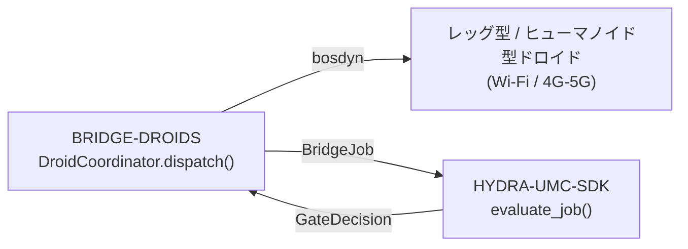

<!-- =============================================================================
HYDRA-UMC-BRIDGE-DROIDS - Droid coordination bridge
Copyright (C) JuanenRac (Electro Hobby 3D) <electrohobby3d@gmail.com>
GPL-3.0-or-later - see LICENSE
============================================================================= -->

<p align="center">
  
</p>

# 🤖 HYDRA-UMC-BRIDGE-DROIDS

<p align="center"><a href="README.md">🇺🇸 English</a> | <a href="README_spa.md">🇪🇸 Español</a> | <a href="README_fra.md">🇫🇷 Français</a> | <a href="README_ita.md">🇮🇹 Italiano</a> | <a href="README_deu.md">🇩🇪 Deutsch</a> | <a href="README_zho.md">🇨🇳 简体中文</a> | 🇯🇵 <b>日本語</b> | <a href="README_por.md">🇵🇹 Português</a></p>

### 🔗 HYDRA-UMCとレッグ型・ヒューマノイド型ドロイドとの間の依存関係なし連携境界

<p align="center">
  
  
  
  
  
  
</p>

---

> **誠実性チェック - 今日実際に動くもの:** 依存関係のない調整コア（`coordinator.py` の `DroidCoordinator`。すべてのディスパッチは `HYDRA-UMC-SDK` 自身の本物の `evaluate_job()` を通過する）と Boston Dynamics Spot コマンド送信部（`spot_transport.py` の `SpotDroidControl`）は本物であり、79件の通過するユニットテストで検証されている（`python tools/build_test.py` - `test_coordinator.py`、`test_spot_transport.py`、および実際のロボットではなくプロトコルに忠実な手書きの Spot エミュレータに対してブリッジを動かす `test_spot_emulator.py`）。これらはいずれも、本物の `bosdyn-client` インストール、本物のネットワーク接続、あるいは物理的な Spot・droid に対しては検証されていない - `test_spot_transport.py` 独自の `FakeBuilder`/`FakeSink` が `bosdyn-client` を完全に置き換えており（本物のライブラリがインストールされていなくてもこれらのテストは通過する）、トランスポート（Wi-Fi/BT/4G-5G）も物理的な droid プラットフォームもまだ検証されていないため、実機向けの `run` コマンドもまだ存在しない。詳細は下記の「ロードマップと既知の制限」に既に明記されており、これまでに実際に出荷された内容は `CHANGELOG.md` を参照。

> **安全性とセキュリティの現状:** このエコシステムは認証された安全システムではありません。ハードウェアの E-STOP 経路、ファームウェアが強制する制限やインターロック、検証済みの動作コマンドはまだありません。ファームウェアイメージは CRC-32 と Ed25519 署名で検査し、リリースビルドは公開済みの開発用鍵を拒否します(リレーの先のツールヘッドと拡張ボードは引き続き URTC のブートローダーを使い、署名ではなく共有鍵の HMAC-SHA256 を使います)。TLS と相互 TLS は任意で、既定では無効です。独自基板はまだ実装も試験もされていません。ここに書かれた内容を人の安全のために頼る前に、[セキュリティベースライン](https://github.com/JuanenRac/HYDRA-UMC-DOCS/blob/main/docs/SECURITY_BASELINE.md)と[脅威モデル](https://github.com/JuanenRac/HYDRA-UMC-DOCS/blob/main/docs/THREAT_MODEL.md)をお読みください。

---

## 📋 ひと目で

| | |
|---|---|
| バージョン | `0.1.4` |
| 成熟度 | 機能する |
| テスト | 79 (`python tools/build_test.py`) |
| 技術 | Python / Boston Dynamics Spot SDK (bosdyn-client) / HYDRA-UMC-SDK |
| 実機での確認 | シミュレーションのみ：エミュレーター、模擬部品、シミュレーターで試験済み。このバージョンについて実機での動作記録はありません |

**移動：** [概要](#-概要) · [アーキテクチャ](#-アーキテクチャ) · [機能](#-機能) · [セキュリティと安全](#-セキュリティと安全) · [インターフェース](#-インターフェース) · [設定](#-設定) · [クイックスタート](#-クイックスタート) · [テスト](#-テスト) · [トラブルシューティング](#-トラブルシューティング) · [リポジトリの構成](#-リポジトリの構成) · [関連プロジェクト](#-関連プロジェクト)

## 🚦 プロジェクトの状況

各行はこのリポジトリの一部分で、信号は今日どこまで進んでいるかを示します。計画ではなく、リポジトリが示せるもの（テスト、ビルド、実行）に基づいて書かれています。

🟢 完了・検証済み · 🟡 動作する（既知の制限あり） · 🟠 一部のみ、または未検証 · 🔴 未実装または動作しない

| 領域 | 状態 | ここでの意味 |
|---|---|---|
| ソフトウェア | 🟡 | 主な目的では動作します。足りない点は上の正直さの確認に書かれています |
| テスト | 🟢 | 自動テスト 79 件。変更のたびに実行されます |
| 実機 | 🟠 | シミュレーションのみ：エミュレーター、模擬部品、シミュレーターで試験済み。このバージョンについて実機での動作記録はありません |
| ドキュメント | 🟢 | 8 言語の README。変更のたびにマニフェストと照合されます |

## 🎯 概要

**HYDRA-UMC-BRIDGE-DROIDS** は、HYDRA-UMCとレッグ型またはヒューマノイド型のドロイドプラットフォームとの間の高レベルの連携境界であり、Wi-Fi、またはセルラー(4G/5G)リンク経由で到達可能である。歩容、バランス、関節軌道を計算することは一切なく、それぞれが独自の実在する必須パラメータ契約を持つ、小規模で命名された全身アクション・トリガーの語彙(`WALK_TO`、`PICK_OBJECT`、`PLACE_OBJECT`、`RETURN_HOME`、`HOLD_POSITION`)を検証・転送するのみである。モーター制御ノードではなく、HYDRA-UMC-SERVER、MCUの限界、ウォッチドッグ、E-STOPを迂回することはできない。 実装済みのトランスポートはBoston Dynamics Spot自身のAPI(IPネットワーク経由)のみで、Bluetoothはない。現時点で送れるのは `sit`、`stand`、`walk_to`、停止で、実機のロボットでは実行されていない。

`HYDRA-UMC-BRIDGE-AMR` および `HYDRA-UMC-BRIDGE-UAV` とともに **Mobile & Autonomous Bridges** ファミリーに属し、静的な **External Automation Bridges**(CNC、LASER、OPENPNP、PRINTER3D、ROS2)と同じ `HYDRA-UMC-SDK` のジョブ・安全契約を共有している —— つまりモバイルであれ静的であれ、いずれのブリッジも独自の「作業に安全」という定義を勝手に作ることはない。

## 🧩 HYDRA-UMC での役割

**HYDRA-UMC-BRIDGE-DROIDS** は、ロボットセルが脚式またはヒューマノイドのドロイドに名前付きの動作（位置保持、座る、立つ、地点へ歩く、可能なプラットフォームでの把持・設置）を依頼できるようにします。ゲートを通ったジョブをその動作に変換し、生の動作にはしません。

すべてのブリッジと同じ `HYDRA-UMC-SDK` の安全契約に従います。ジョブは共通の `evaluate_job()` ゲートが許可したときだけ受け付けられ、ゲートは安全側に倒れます。このブリッジに MQTT トランスポートはなく、唯一の実トランスポートは Boston Dynamics Spot のコマンド送信です。

## 🏛️ アーキテクチャ

<p align="center">
  
</p>

<details>
<summary>図のテキスト版（Mermaid）</summary>



</details>

**この作りにした理由**

* **なぜコアは歩容やバランスを一切計算しないのか。** ドロイド自身の車載コンピュート(Jetsonクラスまたは同等品)は、すでに実在するハードウェア固有の全身コントローラーを実行している —— これをここで再導出することは、それを不出来に複製するか、それと衝突するかのいずれかになる。命名された目的地/アクション・トリガー(`WALK_TO x y`、`PICK_OBJECT object_id`)のみを送信することで、HYDRA-UMCの役割は連携にとどまる。これは本プロジェクトが出発点とした貼り付けられたアーキテクチャノート「コア内でドロイドの歩容を計算しないこと」と一致する。
* **なぜ各アクション・トリガーは独自の明示的な必須パラメータリストを持つのか。** `x`/`y` のない `WALK_TO`、あるいは `object_id` のない `PICK_OBJECT` は、実在する検出可能なリクエスト形式のエラーである —— トランスポートに至る前にここで拒否することは、不完全な指示を転送してドロイド自身のファームウェアも安全に拒否することを期待するよりも、明確に優れている。
* **なぜ `DroidCoordinator.dispatch()` はそれでも共有の `evaluate_job()` ゲートを通してすべてのジョブを流すのか。** ドロイドは、CNC、LASER、OPENPNP、PRINTER3D、ROS2が使うのと同じ `bridge_contract` の単なる別のクライアントに過ぎない —— 他のすべてのブリッジやHYDRA-UMC-SERVERが強制するIDLE/READYロジックを特別に迂回することはない。
* **なぜ(`ABORT` からの)`HOLD_POSITION` は故障中でも要求可能なままなのか。** ゲートの生産フェーズ要件(`IDLE` + `READY`)は、中止リクエストには意図的に同じ方法で適用されない —— オペレーターは、それまで行っていたことを続けるのではなく、故障の最中であってもドロイドにその場で静止するよう常に要求できなければならない。
* **なぜSpot以外のドロイド向けのトランスポートアダプターがまだないのか。** 特定のドロイドプラットフォームの実際のWi-Fi/BT/4G-5Gコマンドプロトコルに、それが選定・テストされる前にコミットすることは、この依存関係のないローカルコアが検証できない前提を組み込むリスクを伴う。
* **エコシステムの他部分とどう関係するか。** BRIDGE-DROIDSは実際のドロイドと `HYDRA-UMC-SDK` → `HYDRA-UMC-SERVER` → MCU安全との間に位置する —— 連携境界であり、モーター制御ノードでは決してなく、HYDRA-UMC-SERVER、MCUの限界、ウォッチドッグ、E-STOPを迂回することはできない。

## ✨ 機能

* ✅ **実在する依存関係なしの連携コア:** `coordinator.py` の `DroidCoordinator` はトランスポートのインポートが一切ない(socketもベンダーSDKもなし)—— 意図的に純粋なPythonであり、実際のドロイドが接続されていないどのホストでもテスト可能である。*(実装済み、`tests/test_coordinator.py` でテスト済み)*
* ✅ **実在する命名済みアクション・トリガー語彙:** `WALK_TO`, `PICK_OBJECT`, `PLACE_OBJECT`, `RETURN_HOME`, `HOLD_POSITION`, `STAND`, `SIT` - 生の関節コマンドは決して使いません。全身の歩行・バランス・関節レベルの制御は、ドロイド自身の搭載コントローラ(Jetson クラスまたは同等品)の権限のままです。`STAND`/`SIT` は脚式ロボットに共通する実在の姿勢プリミティブで、Boston Dynamics 公開の [Spot SDK `basic_command.proto`](https://github.com/boston-dynamics/spot-sdk/blob/master/protos/bosdyn/api/basic_command.proto) で確認済みです(その基本的な移動コマンドは歩行/操作だけでなく `stand`/`sit`/`selfright`/`safe_power_off` です)。単独の `sit_request()`/`stand_request()` 呼び出しとして提供され、`JobPhase` 駆動の `dispatch()` フローの外に意図的に置かれています(「立つ」「座る」を自然に意味するフェーズはありません)。`sit_request()` は常に受理されます(実際の緊張緩和で、`HOLD_POSITION` と同じ考え方)。`stand_request()` には `READY` のセルと `IDLE` のマシンが必要です(実際の生産準備への遷移)。*(実装済み)*
* ✅ **実在するアクションごとのパラメータ検証:** 各アクション・トリガーは、ジョブが転送される前にチェックされる独自の実在する最小限の必須パラメータ契約を持つ(例:`WALK_TO` は `x`/`y` を必要とする)—— 自身のアクションが必要とするものが欠けたリクエストはローカルで拒否され、下流に黙って通過することはない。*(実装済み、テスト済み)*
* ✅ **実在する共有安全ゲート:** `DroidCoordinator.dispatch()` を通じて送信されるすべてのジョブは、`HYDRA-UMC-SDK` の `bridge_contract` にある `evaluate_job()` によって評価される。これは他のすべての兄弟ブリッジとHYDRA-UMC-SERVERが使うのと同じゲートである。生産フェーズには外部機械が `IDLE` であり、HYDRA-UMCセルが `READY` であることが必要だが、(`ABORT` からマッピングされる)`HOLD_POSITION` は故障中でも要求可能なままである。*(実装済み)*
* ✅ **フェイルクローズのフェーズルーティングと静的エビデンス:** 未知の将来SDKフェーズは、推測されるのではなく拒否される。`inspect_action_plan.py` はトランスポートを一切開かずに静的スキーマ `1.0` のアクションプランを出力する。*(実装・テスト済み)*
* ✅ **実際の Boston Dynamics Spot トランスポート:** `spot_transport.py` の `SpotDroidControl` は、すでにゲートを通過したディスパッチを、実際の bosdyn-client コマンド（`synchro_stand_command`/`synchro_sit_command`/`synchro_trajectory_command_in_body_frame`、`RobotCommandClient.robot_command()` 経由で送信）として送信する —— 拒否されたディスパッチがネットワークに届くことは決してない。*(実装済み、`tests/test_spot_transport.py` でテスト済み)*
* ✅ **停止、検証済みの目標、期限切れになるコマンド:** `hold_position()` はbosdynの `stop_command()` を送ります(`ABORT` の `HOLD_POSITION` のトランスポートで、ゲートを通しません)。`sit()` は先にロボットを停止させます。`DroidDispatch` はゲートが検証したパラメータを持ち、`walk_to()` はまさにそれだけを送ります - `WALK_TO` のディスパッチに限り、有限の数値、任意の距離上限(`PlatformProfile.max_walk_distance_m`)、そしてコマンドの `end_time_secs` になる必須の `command_timeout_s` を伴い、このプロセスが消えるとロボットは歩行を破棄します。`stand_request()` は `evaluate_job()` 自身から判断を得ます。`STATUS_OK` でない応答は送信済みとは扱いません。*(実装済み、ダブルとエミュレーター(bosdyn形式のエラーを送出するようになりました)でテスト済み。実際のSpotでは未実行 - リース、キープアライブ付きのソフトウェアE-Stop、電源投入は未実装のため、これだけでは実機のSpotを動かせません。`RETURN_HOME`、`PICK_OBJECT`、`PLACE_OBJECT` にはトランスポートがありません)*
* ✅ **非破壊的なビルド/テスト:** `build-test.bat`/`.sh` はソースをコンパイルし、バージョンやCHANGELOGを変更せずに決定論的なユニットテストを実行する。*(実装済み、下記「ビルドとリリース」を参照)*
* 🔜 **Spot 以外のドロイドプラットフォーム向けの Wi-Fi/BT/4G-5G アダプター** —— そのプラットフォームが選定・テストされた後にのみ導入される。*(計画中)*
* ✅ **観測した機器の状態:** `DroidCoordinator.dispatch()` はドロイドが報告した状態を受け取り、共有ゲートはジョブに書かれた `machine_state`（ブローカー上の誰でも発行できるメッセージ）の代わりにそれを使います。報告がない場合は従来どおり申告値を使います。*（実装済み、`tests/test_observed_state.py` でテスト済み）*

## 🔒 セキュリティと安全

| 脅威 | 防御 | 場所 |
|---|---|---|
| 安全でない状態のセルや機械へのジョブ | すべてのジョブは SDK の共通 `evaluate_job()` ゲートを通り、ゲートは安全側に倒れます。ブリッジ自身に受理・拒否のロジックはありません | SDK `bridge_contract` |
| 過大なジョブデータ | パラメーターは最大 32 個、キーは 64 文字、値は 1024 文字、識別子は 128 文字まで（`MAX_PARAMETERS`、`MAX_PARAMETER_KEY_CHARS`、`MAX_PARAMETER_VALUE_CHARS`、`MAX_IDENTIFIER_CHARS`） | SDK `bridge_contract` |
| 繰り返された、または再送された命令 | `IdempotencyStore` は各キーを 24 時間、最大 10 000 件まで記憶し、再送には再評価せず最初の応答を返します | SDK `job_intake` |
| プラットフォームにできない動作 | `PlatformProfile`：`MOBILE_ONLY` は姿勢と移動、`MOBILE_MANIPULATOR` はさらに `PICK_OBJECT` と `PLACE_OBJECT` を許可し、`check_against_profile()` が残りを拒否します | `platform_profiles.py` |
| 時間制限のない、または有限でない値の歩行命令 | `walk_to` には有限で正の `command_timeout_s` が必要で、期限が来るとロボットは命令を破棄します。有限でないパラメーターは拒否されます | `spot_transport.py` |

**絶対にしないこと：** 生の動作は送らず、リース（lease）を取らず、モーターを入れず、実際の Spot に接続したことはありません。

## 🔌 インターフェース

MQTT トピックも HTTP ルートもありません。このブリッジはライブラリです。

| 項目 | 内容 |
|---|---|
| `DroidCoordinator` | `dispatch(job, cell_state, observed_machine_state)`、`sit_request()`、`stand_request()`。`DroidDispatch` を返します |
| `SpotDroidControl` | `hold_position()`、`sit()`、`stand()`、`walk_to()`。それぞれ `SpotSendResult` を返します |
| `open_bosdyn_robot_command(hostname, username, password)` | 接続を開き、コマンドビルダーと送信先を返します。`bosdyn-client` がなければ `ImportError` ではなく分かりやすい `RuntimeError` になります |

## ⚙️ 設定

環境変数も設定ファイルもありません。Spot のホスト・ユーザー名・パスワードは `open_bosdyn_robot_command()` の引数で、プラットフォームプロファイル（`MOBILE_ONLY` または `MOBILE_MANIPULATOR`）はコードで選びます。実際の設置で認証情報をどう保管するかはまだ決まっていません。

## 🚀 クイックスタート

Python 3.11 以上が必要です。テストとビルドスクリプトは、このリポジトリの隣にある `HYDRA-UMC-SDK`（`../HYDRA-UMC-SDK`）、または `HYDRA_UMC_SDK_ROOT` で指定した場所を前提にします。

ハードウェアなしで試す（エミュレーターと模擬部品でブリッジ全体を確認します）：

```bash
py -3 tools/build_test.py          # Windows
python3 tools/build_test.py         # Linux, macOS
```

サービスを起動する（コンソールスクリプトはありません。サービスは MQTT トランスポートの `run_forever()` で、自分の起動コードから呼び出します）：

```python
from hydra_umc_bridge_droids import SpotDroidControl, open_bosdyn_robot_command
builder, sink = open_bosdyn_robot_command("192.168.80.3", "user", "password")   # needs the `spot` extra
control = SpotDroidControl()
control.stand(builder, sink, cell_state, machine_state)   # gated: needs a READY cell and an idle machine
control.hold_position(builder, sink)                      # a stop is never gated
```

## 🧪 テスト

`python tools/build_test.py` で自動 `unittest` 79 件を実行します（各モジュールのコンパイルも行います）。テストにハードウェア、ネットワーク、オプションのパッケージは不要で、`paho-mqtt`・`pyserial`・ベンダーのライブラリが必要なものは代用品を使うか、パッケージがなければスキップされます。

| テストファイル | テスト数 | 対象 |
|---|---|---|
| `test_coordinator.py`, `test_observed_state.py`, `test_edge_cases.py` | - | ジョブから動作への変換、観測された機械状態、境界ケース |
| `test_platform_profiles.py` | - | 各プラットフォームが受け付ける動作 |
| `test_spot_transport.py`, `test_spot_emulator.py`, `spot_emulator.py` | - | 偽のビルダーと bosdyn 形式の Spot エミュレーターに対する `SpotDroidControl` |

CI は `HYDRA_UMC_CI=1 python tools/ci_validate.py` を実行し、マニフェスト、文書、8 つの README、図を検査し、SDK のチェックアウトを使ってテストを実行します。

## 🏗️ ビルドとリリース

Python 3.11以上が必要。`tools/build_test.py` は `HYDRA-UMC-SDK` が兄弟ディレクトリ(`../HYDRA-UMC-SDK`)としてチェックアウトされているか、環境変数 `HYDRA_UMC_SDK_ROOT` で指定されていることを期待する。

```bash
# Windows
build-test.bat      # 検証のみ —— バージョン/CHANGELOGの変更なし
build.bat            # 検証後、成功時にバージョン + CHANGELOG を更新

# Linux/macOS
bash build-test.sh
bash build.sh
```

`build-test` は `src/` 配下の各モジュールを `py_compile` でコンパイルし、`tests/` 配下で検出される `unittest` の全スイート(すべての `test_*.py` - 79件のテスト)を実行する —— 実際のドロイド接続もネットワークもなく決定論的に動作し、バージョンやCHANGELOGを変更しない。`build` はまず同じ検証を実行し、成功した場合のみ `tools/bump_version.py` を呼び出して `pyproject.toml`、`hydra-umc.project.json`、`CHANGELOG.md` の間でバージョンを同期する。実際のハードウェア向け `run` コマンドはまだ存在しない —— それには検証済みのトランスポートアダプターと実際のドロイドプラットフォームが必要である。

## 🩺 トラブルシューティング

| 表示 | 原因 | 対処 |
|---|---|---|
| `ModuleNotFoundError: hydra_umc_sdk` | SDK がインストールされておらず、このリポジトリの隣にもありません | `HYDRA-UMC-SDK` をこのリポジトリの隣に置くか、`HYDRA_UMC_SDK_ROOT` を設定します |
| `bosdyn-client` ... `RuntimeError` | オプションの Spot 追加パッケージが未インストールです | `pip install ".[spot]"`（`bosdyn-client` 4.0 以上） |
| `accepted` is false on a `DroidDispatch` | 共通ゲート、プラットフォームプロファイル、またはパラメーター検査がジョブを拒否しました | ディスパッチの `reason` を読んで原因を直します。拒否されたディスパッチはロボットに送られません |

## 📂 リポジトリの構成

<p align="center">
  
</p>

<details>
<summary>ツリーのテキスト版</summary>

```text
HYDRA-UMC-BRIDGE-DROIDS/
├── src/hydra_umc_bridge_droids/
│   ├── coordinator.py             ジョブを名前付きの動作トリガーに変換（生の動作は不可）
│   ├── platform_profiles.py       プラットフォームに要求できる動作と、動けないドロイド
│   └── spot_transport.py          bosdyn-client 経由の Spot コマンド：hold・sit・stand・walk_to
├── tests/                         79 件（bosdyn 形式の Spot エミュレーター付き）
├── docs/                          ブリッジガイド
├── tools/                         ビルド・テスト実行、バージョン引き上げ、CI 検証、README と図の生成・検査
├── images/                        バナーと README の図
├── .github/                       CI ワークフローと Issue テンプレート
├── pyproject.toml                 パッケージのメタデータと依存関係
├── hydra-umc.project.json         マニフェスト：バージョン・成熟度・ファミリー
├── CHANGELOG.md                   各バージョンの変更点
├── build.sh build.bat             ビルドスクリプト（バージョンは変えません）
├── build-test.sh build-test.bat   ビルドスクリプト（バージョンは変えません）
├── test.sh test.bat               テストを実行
└── SECURITY.md SUPPORT.md CONTRIBUTING.md CODE_OF_CONDUCT.md LICENSE LICENSE.md
```

</details>

## 🗺️ ロードマップと既知の制限

**現時点の既知の制限**

**現時点で実在するもの:** バージョン `0.1.4`。実在するアクションごとのパラメータ検証、フェイルクローズのフェーズルーティング、静的な `plan-only` アクションスキーマ、実際の bosdyn-client コマンドを送信する実際の Boston Dynamics Spot トランスポート(`SpotDroidControl`)、SDKチェックアウトを伴いCIに組み込まれた非破壊的なbuild-testスクリプトを備える依存関係なしの連携コア(`DroidCoordinator`)として機能している。

**統合境界:** このブリッジは連携境界に過ぎない —— モーター制御ノードではなく、HYDRA-UMC-SERVER、MCUの限界、ウォッチドッグ、E-STOPを迂回することはできない。送信されるすべてのジョブは、依然としてすべての兄弟ブリッジが使う同じ共有ゲートを通過する。

**今後の課題:** 実際のトランスポート(Wi-Fi/BT/4G-5G)も物理的なドロイドもまだ一切検証されていない —— 実際のトランスポートアダプターと文書化されたドロイドコマンドインターフェースは、具体的なプラットフォームが選定・テストされた後にのみ導入される。

## 🌍 言語

この README とリポジトリの文書は、英語・スペイン語・ドイツ語・フランス語・イタリア語・日本語・中国語・ポルトガル語（ポルトガル）の 8 言語で提供されています。8 つのファイルは同時に書かれ、同じ節と同じリンクを持つことを CI が確認します。 このリポジトリには独自の画面もメッセージカタログもないため、翻訳すべきインターフェース文字列はありません。

## 🔗 関連プロジェクト

本プロジェクトは、同じ作者(JuanenRac / Electro Hobby 3D)による HYDRA-UMC ロボティクスエコシステムの一部です。リクエストが実はこの中のどれかについてのものである可能性があるため、知っておく価値があります。

**親プロジェクト**
- **[HYDRA-UMC-SERVER](https://github.com/JuanenRac/HYDRA-UMC-SERVER)** — すべての制御クライアントが実際に通信する、本物のヘッドレスバックエンド(REST/WebSocket)。各コマンドがこのブリッジ自身のローカル安全ゲートを通過した後、本ブリッジが報告する認証済みエコシステム境界。

**兄弟プロジェクト** —— それぞれ独自のクライアントとして、同じく HYDRA-UMC-SERVER 自身の API と通信する
- **[HYDRA-UMC-STUDIO](https://github.com/JuanenRac/HYDRA-UMC-STUDIO)** — リアルタイムのマルチロボット 3D 可視化を備えたウェブ制御ダッシュボード。
- **[HYDRA-UMC-SUITE](https://github.com/JuanenRac/HYDRA-UMC-SUITE)** — 複数のサーバーを同時に扱えるデスクトップ(PySide6)スウォームコマンドセンター、スタンドアロン実行ファイルとしてパッケージ化。
- **[HYDRA-UMC-ANDROID-CONTROL](https://github.com/JuanenRac/HYDRA-UMC-ANDROID-CONTROL)** — 生体認証ログインとペアリングされた Wear OS コンパニオンを備えたネイティブ Android 制御アプリ。
- **[HYDRA-UMC-IOS-CONTROL](https://github.com/JuanenRac/HYDRA-UMC-IOS-CONTROL)** — リアルタイム WebSocket 同期を備えた iOS/iPadOS 制御アプリ(Flutter)。
- **[HYDRA-UMC-DSI](https://github.com/JuanenRac/HYDRA-UMC-DSI)** — 本体搭載の 7 インチ DSI タッチスクリーン向けネイティブタッチ UI、CM5 自体に組み込み。
- **[HYDRA-UMC-BRIDGE-AMR](https://github.com/JuanenRac/HYDRA-UMC-BRIDGE-AMR)** — VDA 5050 MQTT パブリッシャーによる AGV/AMR フリートの調整境界(エミュレートしたフリートに対してのみテスト済み) — このエコシステムにおける 3 つのモバイルフリートブリッジのひとつ。
- **[HYDRA-UMC-BRIDGE-CNC](https://github.com/JuanenRac/HYDRA-UMC-BRIDGE-CNC)** — GRBL ステータス/制御バイトへのアクセスを持つ、CNC セルの高レベルコーディネーター(エミュレーターに対してのみテスト済み)。
- **[HYDRA-UMC-BRIDGE-LASER](https://github.com/JuanenRac/HYDRA-UMC-BRIDGE-LASER)** — キー/筐体/インターロックの GPIO 信号 3 系統を読み取るレーザーセルのコーディネーター(模擬チップに対してのみテスト済み。レーザーの武装や発射はできない)。
- **[HYDRA-UMC-BRIDGE-OPENPNP](https://github.com/JuanenRac/HYDRA-UMC-BRIDGE-OPENPNP)** — OpenPnP ピックアンドプレースの基板フローを安全に統括する高レベルコーディネーター。
- **[HYDRA-UMC-BRIDGE-PRINTER3D](https://github.com/JuanenRac/HYDRA-UMC-BRIDGE-PRINTER3D)** — 実際にゲート制御されたジョブコマンドを持つ、Moonraker/Klipper 3D プリンター向けの安全な調整境界。
- **[HYDRA-UMC-BRIDGE-ROS2](https://github.com/JuanenRac/HYDRA-UMC-BRIDGE-ROS2)** — 遅延インポートの rclpy ROS 2 トランスポートを持つコーディネーター(ROS 2 環境ではまだ実行していない)。
- **[HYDRA-UMC-BRIDGE-UAV](https://github.com/JuanenRac/HYDRA-UMC-BRIDGE-UAV)** — MAVLink コマンド送信機能を持つ、カメラ搭載 UAV の調整境界(エミュレーターに対してのみテスト済み) — このエコシステムにおける 3 つのモバイルフリートブリッジのひとつ。

**直接関連**
- **[HYDRA-UMC-SDK](https://github.com/JuanenRac/HYDRA-UMC-SDK)** — すべてのブリッジが自身のコマンドを検証する共有 JSON-Schema 契約とソフトウェアのジョブゲート境界(認証済みの安全機能ではない)。
- **[HYDRA-UMC-CONNECTOR-HUB](https://github.com/JuanenRac/HYDRA-UMC-CONNECTOR-HUB)** — 外部マシン用コネクタのための宣言的アダプターマニフェストのレジストリとバリデーター。SDK 自身の契約という発想を外部マシンにまで拡張し、産業用ゲートウェイ系のプロジェクトを置き換えることはありません。

**エコシステムの他のプロジェクト**

*コアハードウェア&プラットフォーム*
- **[HYDRA-UMC](https://github.com/JuanenRac/HYDRA-UMC)** — ロボットアームのマザーボードの設計——CM5 ホスト + デュアルコア STM32H745、CAN-OTA/SPI-OTA 経由で最大 8 本のツールアームを統括することを目指す(ファームウェアは初期段階で、実装済みの基板はまだない)。
- **[HYDRA-UMC-OS](https://github.com/JuanenRac/HYDRA-UMC-OS)** — CM5 向けの再現可能な Raspberry Pi OS プロダクト層——読み取り専用エージェント、検証済み設定/プロファイル、WiFi 初回接続プロビジョニング。

*コアバックエンド&クライアント*
- **[HYDRA-UMC-EDITOR-URDF](https://github.com/JuanenRac/HYDRA-UMC-EDITOR-URDF)** — 完成したモデルを STUDIO 自身のカタログへ送信するデスクトップ用グラフィカル URDF 作成/編集ツール。
- **[HYDRA-UMC-EDITOR-STL](https://github.com/JuanenRac/HYDRA-UMC-EDITOR-STL)** — HYDRA-UMC-EDITOR-URDF も編集する同じモデルカタログ内で、実在するパーツを変換/置換/削除/追加するデスクトップ STL モデルエディタ。

*URTC ツールプラットフォーム*
- **[URTC](https://github.com/JuanenRac/URTC)** — 物理的な Universal Robot Tool Controller 基板向けファームウェア、CAN バス経由の 25 以上のツールプロファイル。
- **[URTC-FLASHER](https://github.com/JuanenRac/URTC-FLASHER)** — URTC 基板用のデスクトップ GUI 書き込みツール、CAN-OTA およびフルチップ SWD/JTAG。
- **[URTC-TESTER](https://github.com/JuanenRac/URTC-TESTER)** — URTC 基板向けのデスクトップ CAN バスライブ診断ツール、ツールプロファイルごとに 1 パネル。
- **[URTC-WEB-STUDIO](https://github.com/JuanenRac/URTC-WEB-STUDIO)** — Web Serial API を使ったブラウザベースの URTC-TESTER の代替、ローカルインストール不要。
- **[URTC-GATEWAY](https://github.com/JuanenRac/URTC-GATEWAY)** — URTC の CAN バスの前に置くゲートウェイ：許可する識別子のリスト、レート制限、セッション鍵。コンピューター上でテスト済みで、実際のバスではまだ試していません。

*ビジョン AI ノード(Hailo-8)*
- **[HYDRA-UMC-VISION-NODE](https://github.com/JuanenRac/HYDRA-UMC-VISION-NODE)** — Hailo-8 ビジョンパイプラインの統合ハブ、段階ごとの実際のハードウェア準備状況チェック付き。
- **[HYDRA-UMC-DETECTION-HEF](https://github.com/JuanenRac/HYDRA-UMC-DETECTION-HEF)** — Hailo アーキテクチャ/チェックサムによる安全読み込み検証を備えた、実際のコンパイル済みモデルレジストリ。
- **[HYDRA-UMC-VISION-STREAMER](https://github.com/JuanenRac/HYDRA-UMC-VISION-STREAMER)** — 実際の HailoRT 統合境界を持つ、実際の GStreamer パイプライン + MediaMTX 設定生成器。
- **[HYDRA-UMC-VISUAL-SERVOING-API](https://github.com/JuanenRac/HYDRA-UMC-VISUAL-SERVOING-API)** — ゾーン状態を条件に承認する Position-Based Visual Servoing 補正則。カメラによる姿勢推定はまだない。
- **[HYDRA-UMC-SAFETY-ZONES](https://github.com/JuanenRac/HYDRA-UMC-SAFETY-ZONES)** — ファイルから物体位置を受け取る、ゾーン侵入・キャリブレーション鮮度・E-STOP 要求の v0 ロジック。検出器は接続されておらず、物理 E-STOP もまだ配線されていない。

*コグニティブ AI ノード(Hailo-10)*
- **[HYDRA-UMC-COGNITIVE-NODE](https://github.com/JuanenRac/HYDRA-UMC-COGNITIVE-NODE)** — Hailo-10 コグニティブパイプライン(LLM/VLA/音声オーケストレーション)の統合ハブ。
- **[HYDRA-UMC-VLA-ENGINE](https://github.com/JuanenRac/HYDRA-UMC-VLA-ENGINE)** — Vision-Language-Action モデル向けの、実際のアクショントークンのエンコード/デコードと軌道生成。
- **[HYDRA-UMC-VOICE-UI](https://github.com/JuanenRac/HYDRA-UMC-VOICE-UI)** — 確認ゲート付きの限定的な Watch リレーを備えた、実際の音声フロントエンド(VAD + 意図解析)。
- **[HYDRA-UMC-SEMANTIC-PLANNER](https://github.com/JuanenRac/HYDRA-UMC-SEMANTIC-PLANNER)** — MCU エラーコードに対する、実際のルールベースのタスク分解と意味的エラー復旧。
- **[HYDRA-UMC-DOCS-QA](https://github.com/JuanenRac/HYDRA-UMC-DOCS-QA)** — このエコシステム自身の Markdown ドキュメントに対する、標準ライブラリのみの実際の TF-IDF 文書検索。
- **[HYDRA-UMC-LOCAL-TECHNICIAN](https://github.com/JuanenRac/HYDRA-UMC-LOCAL-TECHNICIAN)** — エコシステム自身のための、ローカルでポリシーゲート付きのAIメンテナンス技術者 — 観察、診断し、修正を提案する;最上位の2つのリスクレベルは意図的にまだ実装されていない。

*オーケストレーション&スウォーム*
- **[HYDRA-UMC-ORCHESTRATOR](https://github.com/JuanenRac/HYDRA-UMC-ORCHESTRATOR)** — 実際の gRPC/Protobuf ヘルスレポート契約とミッションステートマシンを持つ統合ハブ。
- **[HYDRA-UMC-JOB-DISPATCHER](https://github.com/JuanenRac/HYDRA-UMC-JOB-DISPATCHER)** — 実際の HTTP API 上に構築された、優先度ベースの実際のジョブキュー(重複排除付き)。
- **[HYDRA-UMC-NODE-HEALING](https://github.com/JuanenRac/HYDRA-UMC-NODE-HEALING)** — リトライ/バックオフとアイデンティティ不一致検出を備えた、実際の gRPC ベースのフリートヘルスウォッチドッグ。
- **[HYDRA-UMC-PATH-PLANNER-3D](https://github.com/JuanenRac/HYDRA-UMC-PATH-PLANNER-3D)** — 実際の障害物/ワークスペース衝突検証を備えた、実際の RRT ベースの 3D 経路プランナー。
- **[HYDRA-UMC-SWARM-SYNC](https://github.com/JuanenRac/HYDRA-UMC-SWARM-SYNC)** — 複数セルの収束についてプロパティテストされた、実際の CRDT LWW-Element-Map 状態同期。

*デジタルツイン&シミュレーション*
- **[HYDRA-UMC-TWIN](https://github.com/JuanenRac/HYDRA-UMC-TWIN)** — 実際のバージョン互換性同期契約を持つ、デジタルツインエンジンの統合ハブ。
- **[HYDRA-UMC-HIL-BRIDGE](https://github.com/JuanenRac/HYDRA-UMC-HIL-BRIDGE)** — シミュレーションと実機の間にソフトウェアの衝突インターロックを備えたハードウェア・イン・ザ・ループのルーター(実機なしでテスト済み)。
- **[HYDRA-UMC-PHYSICS-REPLICA](https://github.com/JuanenRac/HYDRA-UMC-PHYSICS-REPLICA)** — 実際の URDF サブセットに対する、実際の順運動学と関節限界検証。
- **[HYDRA-UMC-SYNTHETIC-DATA-GEN](https://github.com/JuanenRac/HYDRA-UMC-SYNTHETIC-DATA-GEN)** — YOLO/COCO アノテーションのエクスポート機能を持つ、実際のプロシージャル 2D シーンジェネレーター。

*データ&分析*
- **[HYDRA-UMC-DATALAKE](https://github.com/JuanenRac/HYDRA-UMC-DATALAKE)** — 実際の取り込み/クエリ HTTP API を備えた、実際の sqlite3 ベースの時系列ストア。
- **[HYDRA-UMC-ANOMALY-DETECTOR](https://github.com/JuanenRac/HYDRA-UMC-ANOMALY-DETECTOR)** — ドリフト監視を備えた、実際の FFT + 統計ベースラインによる異常検知器。
- **[HYDRA-UMC-PRODUCTION-REPORTS](https://github.com/JuanenRac/HYDRA-UMC-PRODUCTION-REPORTS)** — DATALAKE の履歴に対する実際の OEE/稼働率計算、再現可能な CSV エクスポート付き。
- **[HYDRA-UMC-TELEMETRY-COLLECTOR](https://github.com/JuanenRac/HYDRA-UMC-TELEMETRY-COLLECTOR)** — シーケンス重複排除機能を備えた、DATALAKE への実際の CAN/WebSocket 取り込みパイプライン。

*産業用ゲートウェイ*
- **[HYDRA-UMC-GATEWAY-INDUSTRIAL](https://github.com/JuanenRac/HYDRA-UMC-GATEWAY-INDUSTRIAL)** — 実際のコマンド許可リスト/バックプレッシャー層を持つ、産業用プロトコルへ中継する統合ハブ。
- **[HYDRA-UMC-OPCUA-SERVER](https://github.com/JuanenRac/HYDRA-UMC-OPCUA-SERVER)** — 実際のバイナリプロトコルクライアントセッションで検証された、実際の OPC-UA アドレス空間。
- **[HYDRA-UMC-MQTT-BROKER](https://github.com/JuanenRac/HYDRA-UMC-MQTT-BROKER)** — クライアント単位のオプション認証とトピック ACL を備えた、実際の MQTT ブローカー。
- **[HYDRA-UMC-MTCONNECT-ADAPTER](https://github.com/JuanenRac/HYDRA-UMC-MTCONNECT-ADAPTER)** — 縮退モード出力を備えた、実際の MTConnect `/probe` および `/current` XML エンドポイント。

*補完ツール&エコシステム運用*
- **[HYDRA-UMC-DASHBOARD-AI](https://github.com/JuanenRac/HYDRA-UMC-DASHBOARD-AI)** — 誠実な統計フォールバックを備えた、DATALAKE/ANOMALY-DETECTOR 上のスマートサマリーと異常ハイライトパネル。
- **[HYDRA-UMC-TOOL-CLI](https://github.com/JuanenRac/HYDRA-UMC-TOOL-CLI)** — 実際の安定した終了コード契約を持つフリート CLI、HYDRA-UMC-SERVER 自身の API の本物のライブクライアント。
- **[HYDRA-UMC-WATCH](https://github.com/JuanenRac/HYDRA-UMC-WATCH)** — 触覚アラートのパターンとペアリング済みスマートフォンへの音声リレーを備えた WearOS コンパニオンアプリ(物理的なウォッチではまだ実行していない)。
- **[URTC-SMART-RACK](https://github.com/JuanenRac/URTC-SMART-RACK)** — 実際の工具 ID デコードと Smart Idle 予熱ロジックを備えた、基板搭載ラック用ファームウェア。
- **[URTC-VISION-TOOL](https://github.com/JuanenRac/URTC-VISION-TOOL)** — サーマル/RGB 検査ツールヘッド向けの、ファームウェアと実際の Python ビジョンコンパニオン。
- **[HYDRA-UMC-UPDATER](https://github.com/JuanenRac/HYDRA-UMC-UPDATER)** — このエコシステム内のすべてのリポジトリを検出・クローン・更新する、管理用デスクトップツール。
- **[HYDRA-UMC-OS-REBUILDER](https://github.com/JuanenRac/HYDRA-UMC-OS-REBUILDER)** — エコシステムの最新バージョンをプリロードした、書き込み可能なCM5イメージを構築するWindows/Linuxデスクトップツール。Raspberry Pi Imager方式の初回起動Wi-Fi/ユーザー/SSH設定を備える。
- **[HYDRA-UMC-OPS-AGENT](https://github.com/JuanenRac/HYDRA-UMC-OPS-AGENT)** — 保守インシデントコーディネーター: 低権限のエッジ役割がサニタイズされたインベントリ/ヘルスのスナップショットを収集し、コントロールプレーン役割がそれを読み取り専用でレンダリングして AI プロバイダーに診断の提案を依頼します - パッチを適用することも、何かをデプロイすることも決してありません。
- **[HYDRA-UMC-DEV-SERVER](https://github.com/JuanenRac/HYDRA-UMC-DEV-SERVER)** — 再現可能な開発ホスト（Raspberry Pi 5 / CM5）。エコシステムのソースコードを保管し、永続キューのもとで境界の明確なビルド/テストタスクを実行する。運用中の CM5 とは明確に異なる、開発専用の役割。

## 📚 ドキュメント

さらに読むには：

* [docs/BRIDGE_GUIDE.md](docs/BRIDGE_GUIDE.md) - 範囲、プラットフォームプロファイル、Spot トランスポート、スクリプト
* [エコシステムのセキュリティ基準](https://github.com/JuanenRac/HYDRA-UMC-DOCS/blob/main/docs/SECURITY_BASELINE.md)
* [エコシステムの脅威モデル](https://github.com/JuanenRac/HYDRA-UMC-DOCS/blob/main/docs/THREAT_MODEL.md)
* [このリポジトリの変更履歴](CHANGELOG.md)
* [このリポジトリのライセンス](LICENSE.md)

## 🤝 コントリビュートとコミュニティ

* プルリクエストの前に `HYDRA_UMC_CI=1 py -3 tools/ci_validate.py`（または `HYDRA_UMC_CI=1 python3 tools/ci_validate.py`）を実行してください。`CI_VALIDATION=PASS` と表示される必要があります。この確認に `build.sh` や `build.bat` は使わないでください。ビルドは検査ではありません。
* 8 つの README は HYDRA-UMC-DOCS の 1 つのソースから書かれます。手で編集しないでください。ソースを変更し、`tools/make_readmes.py` で書き直します。
* 実行していないことを README に書かないでください。事実であれば「シミュレーションのみ」「実機では未確認」と書きます。
* [CONTRIBUTING.md](CONTRIBUTING.md)、[行動規範](CODE_OF_CONDUCT.md)、[SECURITY.md](SECURITY.md)、[SUPPORT.md](SUPPORT.md) を参照してください。

## 👤 作者

**JuanenRac (Electro Hobby 3D)** · electrohobby3d@gmail.com

## 📜 ライセンス

GPL-3.0-or-later - [LICENSE](LICENSE).
