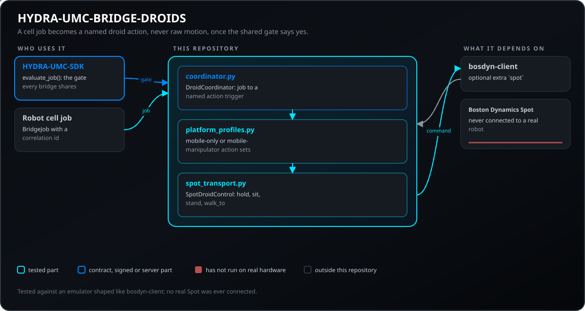
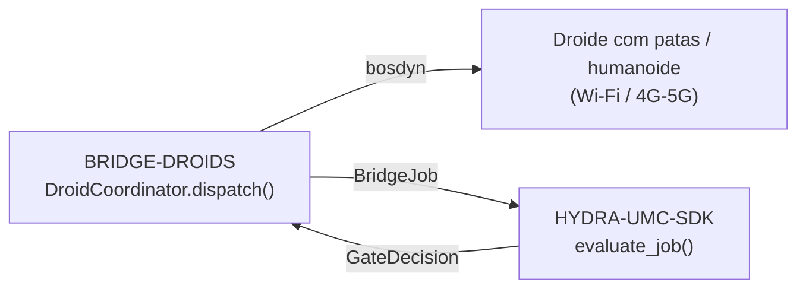
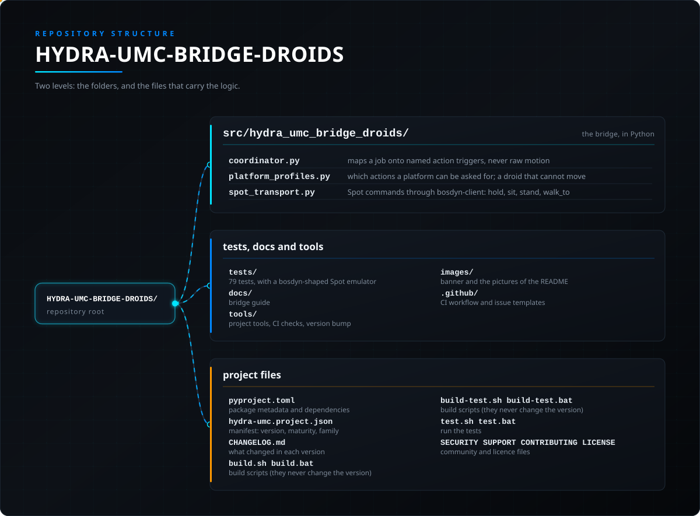

<!-- =============================================================================
HYDRA-UMC-BRIDGE-DROIDS - Droid coordination bridge
Copyright (C) JuanenRac (Electro Hobby 3D) <electrohobby3d@gmail.com>
GPL-3.0-or-later - see LICENSE
============================================================================= -->

<p align="center">
  
</p>

# 🤖 HYDRA-UMC-BRIDGE-DROIDS

<p align="center"><a href="README.md">🇺🇸 English</a> | <a href="README_spa.md">🇪🇸 Español</a> | <a href="README_fra.md">🇫🇷 Français</a> | <a href="README_ita.md">🇮🇹 Italiano</a> | <a href="README_deu.md">🇩🇪 Deutsch</a> | <a href="README_zho.md">🇨🇳 简体中文</a> | <a href="README_jpn.md">🇯🇵 日本語</a> | 🇵🇹 <b>Português</b></p>

### 🔗 Fronteira de coordenação sem dependências entre o HYDRA-UMC e droides com patas/humanoides

<p align="center">
  
  
  
  
  
  
</p>

---

> **Verificação de honestidade - o que realmente corre hoje:** o núcleo de coordenação sem dependências (o `DroidCoordinator` de `coordinator.py`, que encaminha cada despacho pelo `evaluate_job()` do próprio `HYDRA-UMC-SDK`) e o emissor de comandos para o Boston Dynamics Spot (o `SpotDroidControl` de `spot_transport.py`) são reais e estão cobertos por 79 testes unitários que passam (`python tools/build_test.py` - `test_coordinator.py`, `test_spot_transport.py`, mais `test_spot_emulator.py`, que executa o bridge contra um emulador de Spot escrito à mão e fiel ao protocolo, não contra um robô real). Nada disto foi exercitado contra uma instalação real do bosdyn-client, uma ligação de rede real ou um Spot/droide físico: o `FakeBuilder`/`FakeSink` de `test_spot_transport.py` substituem por completo o `bosdyn-client` (nem sequer é preciso ter a biblioteca real instalada para estes testes passarem), e ainda não há comando `run` vivo porque não se validou nenhum transporte (Wi-Fi/BT/4G-5G) nem plataforma física de droide. Ver «Roteiro e limites conhecidos» abaixo, que já o diz com clareza, e `CHANGELOG.md` para saber exatamente o que foi entregue até agora.
> **Estado de segurança (safety e security):** este ecossistema não é um sistema de segurança certificado. Ainda não existe um caminho de E-STOP por hardware, nem limites ou interlocks impostos pelo firmware, nem um comando de movimento verificado; as imagens de firmware são verificadas com CRC-32 e uma assinatura Ed25519, e uma compilação de versão recusa as chaves de desenvolvimento publicadas (as cabeças de ferramenta e as placas de expansão atrás do relé ainda usam os bootloaders do URTC, que aceitam um HMAC-SHA256 de chave partilhada em vez de uma assinatura); TLS e TLS mútuo são opcionais e estão desativados por defeito; nenhuma placa própria foi ainda montada ou testada. Leia a [base de segurança](https://github.com/JuanenRac/HYDRA-UMC-DOCS/blob/main/docs/SECURITY_BASELINE.md) e o [modelo de ameaças](https://github.com/JuanenRac/HYDRA-UMC-DOCS/blob/main/docs/THREAT_MODEL.md) antes de confiar em qualquer afirmação aqui para a segurança de uma pessoa.

---

## 📋 Num relance

| | |
|---|---|
| Versão | `0.1.4` |
| Maturidade | Funcional |
| Testes | 79 (`python tools/build_test.py`) |
| Tecnologia | Python / Boston Dynamics Spot SDK (bosdyn-client) / HYDRA-UMC-SDK |
| Em hardware real | Só simulado: testado com emuladores, dublês de teste ou simuladores; não há registo de execução em hardware real para esta versão |

**Ir para:** [Visão geral](#-visão-geral) · [Arquitetura](#-arquitetura) · [Funcionalidades](#-funcionalidades) · [Segurança e proteção](#-segurança-e-proteção) · [Interfaces](#-interfaces) · [Configuração](#-configuração) · [Início rápido](#-início-rápido) · [Testes](#-testes) · [Resolução de problemas](#-resolução-de-problemas) · [Estrutura do repositório](#-estrutura-do-repositório) · [Projetos relacionados](#-projetos-relacionados)

## 🚦 Estado do projeto

Cada linha é uma parte deste repositório e a luz diz até onde chega hoje. É escrita com o que o repositório consegue demonstrar (testes, compilações, execuções), não com o que está previsto.

🟢 Feito e verificado · 🟡 Funciona, com limites conhecidos · 🟠 Feito a meio ou ainda por verificar · 🔴 Por fazer ou a não funcionar

| Área | Estado | O que significa aqui |
|---|---|---|
| Software | 🟡 | Funciona para o seu propósito principal; a verificação de honestidade acima lista o que ainda falta |
| Testes | 🟢 | 79 testes automáticos, executados a cada alteração |
| Hardware real | 🟠 | Só simulado: testado com emuladores, dublês de teste ou simuladores; não há registo de execução em hardware real para esta versão |
| Documentação | 🟢 | README em oito idiomas, verificado contra o manifesto a cada alteração |

## 🎯 Visão geral

O **HYDRA-UMC-BRIDGE-DROIDS** é a fronteira de coordenação de alto nível entre o HYDRA-UMC e uma plataforma de droide com patas ou humanoide, acessível por Wi-Fi ou uma ligação celular (4G/5G). Nunca calcula marcha, equilíbrio nem trajetórias de juntas: valida e reencaminha um pequeno vocabulário com nome de ordens de corpo inteiro (`WALK_TO`, `PICK_OBJECT`, `PLACE_OBJECT`, `RETURN_HOME`, `HOLD_POSITION`, `STAND`, `SIT`), cada uma com o seu próprio contrato real de parâmetros obrigatórios. Não é um nó de controlo de motores e não pode contornar o HYDRA-UMC-SERVER, os limites do MCU, os watchdogs nem a paragem de emergência (E-STOP). O único transporte implementado é a API própria do Boston Dynamics Spot sobre uma rede IP (não há Bluetooth); hoje consegue enviar `sit`, `stand`, `walk_to` e a paragem, e nunca foi executado contra um robô real.

Pertence à família de **Bridges móveis e autónomos**, ao lado do `HYDRA-UMC-BRIDGE-AMR` e do `HYDRA-UMC-BRIDGE-UAV`, e partilha o mesmo contrato de trabalho e segurança do `HYDRA-UMC-SDK` que os **Bridges de automação externa** fixos (CNC, LASER, OPENPNP, PRINTER3D, ROS2), de modo que nenhum bridge, móvel ou fixo, inventa a sua própria definição de «seguro para trabalhar».

## 🧩 Papel no HYDRA-UMC

O **HYDRA-UMC-BRIDGE-DROIDS** permite a uma célula de robôs pedir a um droide de pernas ou humanoide uma ação com nome (manter a posição, sentar, levantar, andar até um ponto, pegar ou pousar onde a plataforma puder). Converte um trabalho de célula já validado nessa ação e nunca em movimento bruto.

Partilha com todos os bridges o contrato de segurança do `HYDRA-UMC-SDK`: um trabalho só é aceite quando a porta partilhada `evaluate_job()` o permite, e essa porta falha fechada. Este bridge não tem transporte MQTT; o seu único transporte real é o emissor de comandos do Boston Dynamics Spot.

## 🏛️ Arquitetura

<p align="center">
  
</p>

<details>
<summary>Versão em texto do diagrama (Mermaid)</summary>



</details>

**Porque é construído assim**

* **Porque o núcleo nunca calcula marcha nem equilíbrio.** A computação a bordo do próprio droide (classe Jetson ou equivalente) já executa um controlador de corpo inteiro real e específico do hardware; voltar a derivá-lo aqui duplicá-lo-ia mal ou lutaria contra ele. Enviar apenas ordens de destino/ação com nome (`WALK_TO x y`, `PICK_OBJECT object_id`) mantém o papel do HYDRA-UMC na coordenação, de acordo com a nota de arquitetura colada de que este projeto partiu: «não calcular a marcha do droide no núcleo».
* **Porque cada ordem tem a sua própria lista explícita de parâmetros obrigatórios.** Um `WALK_TO` sem `x`/`y`, ou um `PICK_OBJECT` sem `object_id`, é um erro real e detetável na forma do pedido; rejeitá-lo aqui, antes de qualquer transporte, é claramente melhor do que reencaminhar uma instrução incompleta e esperar que o próprio firmware do droide também a rejeite em segurança.
* **Porque `DroidCoordinator.dispatch()` continua a encaminhar cada trabalho pela porta partilhada `evaluate_job()`.** Um droide é apenas mais um cliente do mesmo `bridge_contract` que usam o CNC, o LASER, o OPENPNP, o PRINTER3D e o ROS2: não tem nenhum atalho para contornar a lógica IDLE/READY que impõem todos os outros bridges e o HYDRA-UMC-SERVER.
* **Porque `HOLD_POSITION` (a partir de `ABORT`) continua a poder pedir-se durante uma falha.** O requisito de fase produtiva da porta (`IDLE` + `READY`) não se aplica de propósito da mesma forma a um pedido de abortar: um operador tem de poder sempre pedir a um droide que fique imóvel onde está, mesmo a meio de uma falha, em vez de continuar o que estava a fazer.
* **Porque ainda não há um adaptador de transporte para um droide que não seja o Spot.** Comprometer-se com o protocolo real de comandos Wi-Fi/BT/4G-5G de uma plataforma de droide antes de ela ser escolhida e testada arriscaria fixar pressupostos que este núcleo local e sem dependências não consegue verificar.
* **Como se encaixa no resto do ecossistema.** O BRIDGE-DROIDS fica entre um droide real e o `HYDRA-UMC-SDK` → `HYDRA-UMC-SERVER` → segurança do MCU: é uma fronteira de coordenação, nunca um nó de controlo de motores, e não pode contornar o HYDRA-UMC-SERVER, os limites do MCU, os watchdogs nem a paragem de emergência (E-STOP).

## ✨ Funcionalidades

* ✅ **Núcleo de coordenação real e sem dependências:** o `DroidCoordinator` de `coordinator.py` não importa nenhum transporte (nem socket nem SDK de fabricante): é Python simples de propósito, testável em qualquer máquina sem um droide real ligado. *(implementado, testado em `tests/test_coordinator.py`)*
* ✅ **Vocabulário real de ordens com nome:** `WALK_TO`, `PICK_OBJECT`, `PLACE_OBJECT`, `RETURN_HOME`, `HOLD_POSITION`, `STAND`, `SIT`: nunca um comando de junta em bruto. A marcha de corpo inteiro, o equilíbrio e o controlo ao nível das juntas continuam a ser a autoridade a bordo do próprio droide (classe Jetson ou equivalente). `STAND`/`SIT` são primitivas de postura reais e quase universais de robôs com patas, verificadas contra o [`basic_command.proto` do Spot SDK](https://github.com/boston-dynamics/spot-sdk/blob/master/protos/bosdyn/api/basic_command.proto) público da Boston Dynamics, cujos comandos básicos de mobilidade são `stand`/`sit`/`selfright`/`safe_power_off`, e não apenas andar/manipular; expõem-se como chamadas autónomas `sit_request()`/`stand_request()`, de propósito fora do fluxo `dispatch()` guiado por `JobPhase` (nenhuma fase significa naturalmente «levantar-se» ou «sentar-se»). `sit_request()` aceita-se sempre (uma desescalada real, com o mesmo raciocínio de `HOLD_POSITION`); `stand_request()` exige uma célula `READY` e uma máquina `IDLE` (uma transição real de prontidão produtiva). *(implementado)*
* ✅ **Validação real de parâmetros por ordem:** cada ordem tem o seu próprio contrato real e mínimo de parâmetros obrigatórios (p. ex. `WALK_TO` precisa de `x`/`y`), verificado antes de um trabalho ser reencaminhado; um pedido que não leve o que a sua própria ordem precisa é rejeitado localmente, não passado em silêncio a jusante. *(implementado, testado)*
* ✅ **Porta de segurança partilhada real:** cada trabalho despachado por `DroidCoordinator.dispatch()` é avaliado pelo `evaluate_job()` do `bridge_contract` do `HYDRA-UMC-SDK`, a mesma porta que usam todos os bridges irmãos e o HYDRA-UMC-SERVER; uma fase produtiva exige uma máquina externa `IDLE` e uma célula do HYDRA-UMC `READY`, enquanto um `HOLD_POSITION` (mapeado a partir de `ABORT`) continua a poder pedir-se durante uma falha. *(implementado)*
* ✅ **Encaminhamento de fases com falha segura e evidência estática:** uma fase futura desconhecida do SDK é negada em vez de adivinhada. `inspect_action_plan.py` emite o plano de ações estático do esquema `1.1` (agora com `STAND`/`SIT`) sem abrir nenhum transporte. *(implementado, testado)*
* ✅ **Transporte real para o Boston Dynamics Spot:** o `SpotDroidControl` de `spot_transport.py` envia um despacho já aprovado como comando real do bosdyn-client (`synchro_stand_command`/`synchro_sit_command`/`synchro_trajectory_command_in_body_frame`, enviados por `RobotCommandClient.robot_command()`); um despacho rejeitado nunca chega à rede. *(implementado, testado em `tests/test_spot_transport.py`)*
* ✅ **Paragens, objetivos validados e um comando que expira:** o `hold_position()` envia o `stop_command()` do bosdyn (o transporte do `HOLD_POSITION` de `ABORT`, nunca atrás da porta); o `sit()` pára primeiro o robô; um `DroidDispatch` leva os parâmetros que a porta validou e o `walk_to()` envia exatamente esses - só para um despacho `WALK_TO`, com números finitos, um limite de distância opcional (`PlatformProfile.max_walk_distance_m`) e um `command_timeout_s` obrigatório que passa a ser o `end_time_secs` do comando, de modo que o robô descarta uma caminhada se este processo desaparecer; o `stand_request()` tira a sua decisão do próprio `evaluate_job()`; uma resposta que não seja `STATUS_OK` não é dada como enviada. *(implementado, testado com dobles e com o emulador, que agora lança erros com a forma do bosdyn; nunca executado contra um Spot real - o lease, o E-Stop por software com o seu keep-alive e o arranque dos motores NÃO estão feitos, pelo que com isto ainda não se consegue comandar um Spot real, e `RETURN_HOME`, `PICK_OBJECT` e `PLACE_OBJECT` não têm transporte)*
* ✅ **Compilação/teste que não altera nada:** `build-test.bat`/`.sh` compilam o código-fonte e executam testes unitários deterministas sem alterar a versão nem o CHANGELOG. *(implementado, ver Compilação e publicação abaixo)*
* 🔜 **Um adaptador de transporte Wi-Fi/BT/4G-5G genérico para uma plataforma de droide que não seja o Spot:** só se introduzirá depois de se escolher e testar essa plataforma. *(planeado)*
* ✅ **Estado observado da máquina:** `DroidCoordinator.dispatch()` aceita o estado que o droide comunicou, que a porta partilhada usa em vez do `machine_state` escrito no trabalho (uma mensagem que qualquer pessoa no broker pode publicar); sem comunicação continua a usar-se o declarado. *(implementado, testado em `tests/test_observed_state.py`)*

## 🔒 Segurança e proteção

| Ameaça | Defesa | Onde |
|---|---|---|
| Um trabalho para uma célula ou máquina que não está em estado seguro | Todo o trabalho passa pela porta partilhada `evaluate_job()` do SDK, que falha fechada; o bridge não tem lógica própria de aceitar ou recusar | SDK `bridge_contract` |
| Dados de trabalho desmesurados | No máximo 32 parâmetros, chaves até 64 carateres, valores até 1024, identificadores até 128 (`MAX_PARAMETERS`, `MAX_PARAMETER_KEY_CHARS`, `MAX_PARAMETER_VALUE_CHARS`, `MAX_IDENTIFIER_CHARS`) | SDK `bridge_contract` |
| Uma ordem repetida ou reenviada | Um `IdempotencyStore` lembra cada chave durante 24 horas e no máximo 10 000 entradas; uma repetição recebe a primeira resposta em vez de ser avaliada de novo | SDK `job_intake` |
| Uma ação que a plataforma não pode fazer | `PlatformProfile`: `MOBILE_ONLY` permite postura e movimento, `MOBILE_MANIPULATOR` também `PICK_OBJECT` e `PLACE_OBJECT`; `check_against_profile()` recusa o resto | `platform_profiles.py` |
| Uma ordem de marcha sem limite de tempo ou com valor não finito | `walk_to` exige um `command_timeout_s` finito e positivo para o robô descartar a ordem quando expira; os parâmetros não finitos são recusados | `spot_transport.py` |

**O que nunca faz:** nunca envia movimento bruto, nunca toma o lease nem liga os motores; nunca foi ligado a um Spot real.

## 🔌 Interfaces

Não há tópicos MQTT nem rotas HTTP: este bridge é uma biblioteca.

| Elemento | O que é |
|---|---|
| `DroidCoordinator` | `dispatch(job, cell_state, observed_machine_state)`, `sit_request()`, `stand_request()`; devolve um `DroidDispatch` |
| `SpotDroidControl` | `hold_position()`, `sit()`, `stand()`, `walk_to()`; cada uma devolve um `SpotSendResult` |
| `open_bosdyn_robot_command(hostname, username, password)` | abre a ligação e devolve o construtor de comandos e o destino; a falta do `bosdyn-client` é um `RuntimeError` claro, não um `ImportError` |

## ⚙️ Configuração

Não há variáveis de ambiente nem ficheiro de configuração: o anfitrião, o utilizador e a palavra-passe do Spot são argumentos de `open_bosdyn_robot_command()`, e o perfil de plataforma (`MOBILE_ONLY` ou `MOBILE_MANIPULATOR`) escolhe-se no código. Como se guardam as credenciais numa instalação real ainda não está decidido.

## 🚀 Início rápido

Requer Python 3.11 ou superior. Os testes e os scripts de compilação esperam o `HYDRA-UMC-SDK` clonado ao lado deste repositório (`../HYDRA-UMC-SDK`) ou indicado com `HYDRA_UMC_SDK_ROOT`.

Experimente sem hardware (isto verifica todo o bridge com os seus emuladores e dublês de teste):

```bash
py -3 tools/build_test.py          # Windows
python3 tools/build_test.py         # Linux, macOS
```

Arrancar o serviço (não há um script de consola: o serviço é o `run_forever()` do transporte MQTT, que chama a partir do seu próprio código de arranque):

```python
from hydra_umc_bridge_droids import SpotDroidControl, open_bosdyn_robot_command
builder, sink = open_bosdyn_robot_command("192.168.80.3", "user", "password")   # needs the `spot` extra
control = SpotDroidControl()
control.stand(builder, sink, cell_state, machine_state)   # gated: needs a READY cell and an idle machine
control.hold_position(builder, sink)                      # a stop is never gated
```

## 🧪 Testes

79 casos `unittest` automáticos correm com `python tools/build_test.py` (que também compila cada módulo). Os testes não precisam de hardware, rede nem pacotes opcionais: os que precisariam de `paho-mqtt`, `pyserial` ou de uma biblioteca do fabricante usam um substituto ou são saltados se o pacote faltar.

| Ficheiro de testes | Testes | O que cobre |
|---|---|---|
| `test_coordinator.py`, `test_observed_state.py`, `test_edge_cases.py` | - | mapeamento de trabalho para ação, o estado observado da máquina, casos limite |
| `test_platform_profiles.py` | - | que ações cada plataforma aceita |
| `test_spot_transport.py`, `test_spot_emulator.py`, `spot_emulator.py` | - | `SpotDroidControl` contra construtores simulados e um emulador de Spot com a forma do bosdyn |

A CI executa `HYDRA_UMC_CI=1 python tools/ci_validate.py`, que verifica o manifesto, os documentos, os oito README e as imagens, e corre os testes com uma cópia do SDK.

## 🏗️ Compilação e publicação

Requer Python 3.11+. `tools/build_test.py` espera o `HYDRA-UMC-SDK` extraído como diretoria irmã (`../HYDRA-UMC-SDK`) ou indicado pela variável de ambiente `HYDRA_UMC_SDK_ROOT`.

```bash
# Windows
build-test.bat      # só valida - sem alteração de versão/CHANGELOG
build.bat            # Valida e compila (compilar nunca altera a versão)

# Linux/macOS
bash build-test.sh
bash build.sh
```

`build-test` compila com `py_compile` cada módulo em `src/` e executa a suíte `unittest` completa descoberta em `tests/` (todos os ficheiros `test_*.py` - 79 testes), de forma determinista, sem ligação a nenhum droide real, sem rede e sem alteração de versão/CHANGELOG. `build` executa primeiro essa mesma validação e, só se correr bem, chama `tools/bump_version.py` para sincronizar a versão em `pyproject.toml`, `hydra-umc.project.json` e `CHANGELOG.md`. Ainda não há comando `run` de hardware vivo: exige um adaptador de transporte validado e uma plataforma de droide real.

## 🩺 Resolução de problemas

| Vê | Porque | Faça |
|---|---|---|
| `ModuleNotFoundError: hydra_umc_sdk` | O SDK não está instalado nem ao lado deste repositório | Clone o `HYDRA-UMC-SDK` ao lado deste repositório ou defina `HYDRA_UMC_SDK_ROOT` |
| `bosdyn-client` ... `RuntimeError` | O extra opcional do Spot não está instalado | `pip install ".[spot]"` (`bosdyn-client` 4.0 ou superior) |
| `accepted` is false on a `DroidDispatch` | A porta partilhada, o perfil de plataforma ou uma verificação de parâmetros recusou o trabalho | Leia `reason` no envio e corrija a causa; um envio recusado nunca é enviado ao robô |

## 📂 Estrutura do repositório

<p align="center">
  
</p>

<details>
<summary>Versão em texto da árvore</summary>

```text
HYDRA-UMC-BRIDGE-DROIDS/
├── src/hydra_umc_bridge_droids/
│   ├── coordinator.py             converte um trabalho em disparadores de ação com nome, nunca movimento bruto
│   ├── platform_profiles.py       que ações se podem pedir a uma plataforma; um droide que não se pode mover
│   └── spot_transport.py          comandos ao Spot com bosdyn-client: hold, sit, stand, walk_to
├── tests/                         79 testes, com um emulador de Spot com a forma do bosdyn
├── docs/                          guia do bridge
├── tools/                         executor de compilação e testes, subida de versão, validador de CI, geradores e verificações de README e imagens
├── images/                        faixa e imagens do README
├── .github/                       fluxo de CI e modelos de questões
├── pyproject.toml                 metadados do pacote e dependências
├── hydra-umc.project.json         manifesto: versão, maturidade, família
├── CHANGELOG.md                   o que mudou em cada versão
├── build.sh build.bat             scripts de compilação (nunca mudam a versão)
├── build-test.sh build-test.bat   scripts de compilação (nunca mudam a versão)
├── test.sh test.bat               executam os testes
└── SECURITY.md SUPPORT.md CONTRIBUTING.md CODE_OF_CONDUCT.md LICENSE LICENSE.md
```

</details>

## 🗺️ Roteiro e limites conhecidos

**Limites conhecidos hoje**

**Real hoje:** versão `0.1.4`, funcional como núcleo de coordenação sem dependências (`DroidCoordinator`) com validação real de parâmetros por ordem, encaminhamento de fases com falha segura, um esquema de ações estático `plan-only`, um emissor real de comandos bosdyn-client para o Spot (`SpotDroidControl`) e scripts build-test que não alteram nada ligados ao CI com um checkout do SDK.

**Fronteira de integração:** este bridge é apenas uma fronteira de coordenação: não é um nó de controlo de motores e não pode contornar o HYDRA-UMC-SERVER, os limites do MCU, os watchdogs nem a paragem de emergência (E-STOP); cada trabalho despachado continua a passar pela mesma porta partilhada que usam todos os bridges irmãos.

**Ainda por fazer:** ainda não se validou nenhum transporte real (Wi-Fi/BT/4G-5G) nem droide físico: um adaptador de transporte real e uma interface de comandos de droide documentada só se introduzirão depois de se escolher e testar uma plataforma concreta.

## 🌍 Idiomas

Este README e os documentos do repositório existem em oito idiomas: inglês, espanhol, alemão, francês, italiano, japonês, chinês e português (Portugal). São escritos em conjunto e a CI verifica que os oito ficheiros têm as mesmas secções e as mesmas ligações. Este repositório não tem ecrã nem catálogo de mensagens próprios, por isso não há textos de interface para traduzir.

## 🔗 Projetos relacionados

Este projeto faz parte do ecossistema de robótica HYDRA-UMC do mesmo autor (JuanenRac / Electro Hobby 3D). Vale a pena conhecê-los, porque um pedido pode ser, na verdade, sobre um destes e não sobre este repositório.

**Projeto-mãe**
- **[HYDRA-UMC-SERVER](https://github.com/JuanenRac/HYDRA-UMC-SERVER)** — o verdadeiro backend sem interface (REST/WebSocket) com que falam todos os clientes de controlo; a fronteira autenticada do ecossistema a que este bridge reporta depois de cada comando ter passado pela porta de segurança local do próprio bridge.

**Projetos irmãos** — também falam com a API do próprio HYDRA-UMC-SERVER, cada um como cliente próprio
- **[HYDRA-UMC-STUDIO](https://github.com/JuanenRac/HYDRA-UMC-STUDIO)** — painel web de controlo com visualização 3D em tempo real de vários robôs.
- **[HYDRA-UMC-SUITE](https://github.com/JuanenRac/HYDRA-UMC-SUITE)** — centro de comando de enxame para desktop (PySide6) para vários servidores ao mesmo tempo, empacotado como executável independente.
- **[HYDRA-UMC-ANDROID-CONTROL](https://github.com/JuanenRac/HYDRA-UMC-ANDROID-CONTROL)** — aplicação Android nativa de controlo, com início de sessão biométrico e um companheiro Wear OS emparelhado.
- **[HYDRA-UMC-IOS-CONTROL](https://github.com/JuanenRac/HYDRA-UMC-IOS-CONTROL)** — aplicação de controlo para iOS/iPadOS (Flutter) com sincronização WebSocket em tempo real.
- **[HYDRA-UMC-DSI](https://github.com/JuanenRac/HYDRA-UMC-DSI)** — interface tátil nativa para o ecrã tátil DSI de 7" integrado, executada no próprio CM5.
- **[HYDRA-UMC-BRIDGE-AMR](https://github.com/JuanenRac/HYDRA-UMC-BRIDGE-AMR)** — fronteira de coordenação para frotas AGV/AMR através de um publicador MQTT VDA 5050 (testado apenas contra uma frota emulada) — um dos 3 bridges de frotas móveis do ecossistema.
- **[HYDRA-UMC-BRIDGE-CNC](https://github.com/JuanenRac/HYDRA-UMC-BRIDGE-CNC)** — coordenador de células CNC de alto nível com acesso ao estado GRBL e aos bytes de controlo (testado apenas contra um emulador).
- **[HYDRA-UMC-BRIDGE-LASER](https://github.com/JuanenRac/HYDRA-UMC-BRIDGE-LASER)** — coordenador de células laser que lê 3 sinais GPIO (chave, caixa e interlock) (testado apenas contra um chip simulado; não pode armar nem disparar um laser).
- **[HYDRA-UMC-BRIDGE-OPENPNP](https://github.com/JuanenRac/HYDRA-UMC-BRIDGE-OPENPNP)** — coordenador seguro de fluxo de placa de alto nível para pick-and-place com OpenPnP.
- **[HYDRA-UMC-BRIDGE-PRINTER3D](https://github.com/JuanenRac/HYDRA-UMC-BRIDGE-PRINTER3D)** — fronteira de coordenação segura para impressoras 3D Moonraker/Klipper, com comandos de trabalho reais protegidos por portas.
- **[HYDRA-UMC-BRIDGE-ROS2](https://github.com/JuanenRac/HYDRA-UMC-BRIDGE-ROS2)** — coordenador com um transporte ROS 2 baseado em rclpy importado sob demanda (ainda não executado contra uma instalação ROS 2).
- **[HYDRA-UMC-BRIDGE-UAV](https://github.com/JuanenRac/HYDRA-UMC-BRIDGE-UAV)** — fronteira de coordenação para UAV com câmara, com um emissor de comandos MAVLink (testado apenas contra um emulador) — um dos 3 bridges de frotas móveis do ecossistema.

**Diretamente relacionados**
- **[HYDRA-UMC-SDK](https://github.com/JuanenRac/HYDRA-UMC-SDK)** — o contrato JSON-Schema partilhado e a fronteira de software de controlo de trabalhos contra a qual cada bridge valida os seus comandos (não é uma função de segurança certificada).
- **[HYDRA-UMC-CONNECTOR-HUB](https://github.com/JuanenRac/HYDRA-UMC-CONNECTOR-HUB)** — registo declarativo de manifestos de adaptador e validador para conectores de máquinas externas; estende a ideia de contrato do SDK a máquinas externas sem substituir os projetos de gateway industrial.

**Também fazem parte do ecossistema**

*Hardware e plataforma centrais*
- **[HYDRA-UMC](https://github.com/JuanenRac/HYDRA-UMC)** — o desenho da placa-mãe do braço robótico: anfitrião CM5 + STM32H745 de dois núcleos, pensado para orquestrar até 8 braços de ferramenta por CAN-OTA/SPI-OTA (firmware numa fase inicial; ainda sem placa montada).
- **[HYDRA-UMC-OS](https://github.com/JuanenRac/HYDRA-UMC-OS)** — camada de produto reproduzível do Raspberry Pi OS para o CM5: agente só de leitura, configuração/perfis validados, aprovisionamento Wi-Fi de primeiro contacto.

*Backend central e clientes*
- **[HYDRA-UMC-EDITOR-URDF](https://github.com/JuanenRac/HYDRA-UMC-EDITOR-URDF)** — criador/editor gráfico de URDF para desktop que envia os modelos concluídos para o catálogo do STUDIO.
- **[HYDRA-UMC-EDITOR-STL](https://github.com/JuanenRac/HYDRA-UMC-EDITOR-STL)** — editor de modelos STL para desktop que transforma/substitui/remove/adiciona peças reais no mesmo catálogo de modelos que o HYDRA-UMC-EDITOR-URDF também edita.

*Plataforma de ferramentas URTC*
- **[URTC](https://github.com/JuanenRac/URTC)** — firmware da placa física Universal Robot Tool Controller, mais de 25 perfis de ferramenta por barramento CAN.
- **[URTC-FLASHER](https://github.com/JuanenRac/URTC-FLASHER)** — ferramenta gráfica de gravação para desktop das placas URTC, por CAN-OTA e também SWD/JTAG de chip completo.
- **[URTC-TESTER](https://github.com/JuanenRac/URTC-TESTER)** — ferramenta de diagnóstico CAN em tempo real para desktop das placas URTC, com um painel por perfil de ferramenta.
- **[URTC-WEB-STUDIO](https://github.com/JuanenRac/URTC-WEB-STUDIO)** — alternativa no navegador ao URTC-TESTER através da Web Serial API, sem instalação local.
- **[URTC-GATEWAY](https://github.com/JuanenRac/URTC-GATEWAY)** — gateway à frente do barramento CAN do URTC: lista de identificadores permitidos, limite de taxa e chave de sessão; software testado num computador, ainda não num barramento real.

*Nó de IA de visão (Hailo-8)*
- **[HYDRA-UMC-VISION-NODE](https://github.com/JuanenRac/HYDRA-UMC-VISION-NODE)** — centro de integração do pipeline de visão Hailo-8, com uma verificação real de prontidão de hardware por fase.
- **[HYDRA-UMC-DETECTION-HEF](https://github.com/JuanenRac/HYDRA-UMC-DETECTION-HEF)** — registo real de modelos compilados com verificação segura de carga por arquitetura Hailo e soma de verificação.
- **[HYDRA-UMC-VISION-STREAMER](https://github.com/JuanenRac/HYDRA-UMC-VISION-STREAMER)** — pipeline GStreamer real e gerador de configuração MediaMTX com uma fronteira de integração HailoRT real.
- **[HYDRA-UMC-VISUAL-SERVOING-API](https://github.com/JuanenRac/HYDRA-UMC-VISUAL-SERVOING-API)** — lei de correção de servovisão baseada em posição com autorização condicionada ao estado da zona; ainda sem estimativa de pose por câmara.
- **[HYDRA-UMC-SAFETY-ZONES](https://github.com/JuanenRac/HYDRA-UMC-SAFETY-ZONES)** — lógica v0 de violação de zonas, atualidade da calibração e pedido de E-STOP que lê as posições dos objetos de um ficheiro; nenhum detetor a alimenta e ainda não há E-STOP físico ligado.

*Nó de IA cognitiva (Hailo-10)*
- **[HYDRA-UMC-COGNITIVE-NODE](https://github.com/JuanenRac/HYDRA-UMC-COGNITIVE-NODE)** — centro de integração do pipeline cognitivo do Hailo-10 (orquestração de LLM/VLA/voz).
- **[HYDRA-UMC-VLA-ENGINE](https://github.com/JuanenRac/HYDRA-UMC-VLA-ENGINE)** — codificação/descodificação real de tokens de ação e geração de trajetórias para um modelo Visão-Linguagem-Ação.
- **[HYDRA-UMC-VOICE-UI](https://github.com/JuanenRac/HYDRA-UMC-VOICE-UI)** — front-end de voz real (VAD + analisador de intenções) com um relé para o relógio limitado e protegido por confirmação.
- **[HYDRA-UMC-SEMANTIC-PLANNER](https://github.com/JuanenRac/HYDRA-UMC-SEMANTIC-PLANNER)** — decomposição real de tarefas baseada em regras e recuperação semântica de erros sobre os códigos de erro do MCU.
- **[HYDRA-UMC-DOCS-QA](https://github.com/JuanenRac/HYDRA-UMC-DOCS-QA)** — pesquisa real de documentos TF-IDF só com a biblioteca padrão sobre a documentação Markdown deste ecossistema.
- **[HYDRA-UMC-LOCAL-TECHNICIAN](https://github.com/JuanenRac/HYDRA-UMC-LOCAL-TECHNICIAN)** — técnico de manutenção de IA local, protegido por políticas, para o próprio ecossistema: observa, diagnostica e propõe correções; os dois níveis de maior risco não estão implementados de propósito.

*Orquestração e enxame*
- **[HYDRA-UMC-ORCHESTRATOR](https://github.com/JuanenRac/HYDRA-UMC-ORCHESTRATOR)** — centro de integração com um contrato real de relatório de saúde gRPC/Protobuf e uma máquina de estados de missões.
- **[HYDRA-UMC-JOB-DISPATCHER](https://github.com/JuanenRac/HYDRA-UMC-JOB-DISPATCHER)** — fila real de trabalhos por prioridade com deduplicação, sobre uma API HTTP real.
- **[HYDRA-UMC-NODE-HEALING](https://github.com/JuanenRac/HYDRA-UMC-NODE-HEALING)** — vigilante real de saúde da frota por gRPC com repetição/recuo e deteção de identidade incoerente.
- **[HYDRA-UMC-PATH-PLANNER-3D](https://github.com/JuanenRac/HYDRA-UMC-PATH-PLANNER-3D)** — planeador real de trajetórias 3D baseado em RRT com validação real de colisões com obstáculos e espaço de trabalho.
- **[HYDRA-UMC-SWARM-SYNC](https://github.com/JuanenRac/HYDRA-UMC-SWARM-SYNC)** — sincronização real de estado CRDT LWW-Element-Map, testada por propriedades para a convergência de várias células.

*Gémeo digital e simulação*
- **[HYDRA-UMC-TWIN](https://github.com/JuanenRac/HYDRA-UMC-TWIN)** — centro de integração do motor de gémeo digital, com um contrato real de sincronização de compatibilidade de versões.
- **[HYDRA-UMC-HIL-BRIDGE](https://github.com/JuanenRac/HYDRA-UMC-HIL-BRIDGE)** — encaminhador hardware-in-the-loop com um interlock de software de colisão entre a simulação e o hardware real (testado sem hardware real).
- **[HYDRA-UMC-PHYSICS-REPLICA](https://github.com/JuanenRac/HYDRA-UMC-PHYSICS-REPLICA)** — cinemática direta real e validação de limites de juntas sobre um subconjunto real de URDF.
- **[HYDRA-UMC-SYNTHETIC-DATA-GEN](https://github.com/JuanenRac/HYDRA-UMC-SYNTHETIC-DATA-GEN)** — gerador procedural real de cenas 2D com exportação de anotações YOLO/COCO.

*Dados e análise*
- **[HYDRA-UMC-DATALAKE](https://github.com/JuanenRac/HYDRA-UMC-DATALAKE)** — armazém real de séries temporais sobre sqlite3 com uma API HTTP real de ingestão/consulta.
- **[HYDRA-UMC-ANOMALY-DETECTOR](https://github.com/JuanenRac/HYDRA-UMC-ANOMALY-DETECTOR)** — detetor real de anomalias por FFT e linha de base estatística, com monitorização de deriva.
- **[HYDRA-UMC-PRODUCTION-REPORTS](https://github.com/JuanenRac/HYDRA-UMC-PRODUCTION-REPORTS)** — cálculo real de OEE/disponibilidade sobre o histórico do DATALAKE, com exportação CSV reprodutível.
- **[HYDRA-UMC-TELEMETRY-COLLECTOR](https://github.com/JuanenRac/HYDRA-UMC-TELEMETRY-COLLECTOR)** — pipeline real de ingestão CAN/WebSocket para o DATALAKE, com deduplicação por sequência.

*Gateway industrial*
- **[HYDRA-UMC-GATEWAY-INDUSTRIAL](https://github.com/JuanenRac/HYDRA-UMC-GATEWAY-INDUSTRIAL)** — centro de integração que retransmite para protocolos industriais, com uma camada real de lista de comandos permitidos e contrapressão.
- **[HYDRA-UMC-OPCUA-SERVER](https://github.com/JuanenRac/HYDRA-UMC-OPCUA-SERVER)** — espaço de endereços OPC-UA real, verificado com uma sessão de cliente real do protocolo binário.
- **[HYDRA-UMC-MQTT-BROKER](https://github.com/JuanenRac/HYDRA-UMC-MQTT-BROKER)** — broker MQTT real com autenticação opcional por cliente e ACL de tópicos.
- **[HYDRA-UMC-MTCONNECT-ADAPTER](https://github.com/JuanenRac/HYDRA-UMC-MTCONNECT-ADAPTER)** — endpoints XML MTConnect `/probe` e `/current` reais com saída em modo degradado.

*Ferramentas complementares e operações do ecossistema*
- **[HYDRA-UMC-DASHBOARD-AI](https://github.com/JuanenRac/HYDRA-UMC-DASHBOARD-AI)** — painéis de Resumos Inteligentes e Realce de Anomalias sobre o DATALAKE/ANOMALY-DETECTOR, com um recurso estatístico honesto.
- **[HYDRA-UMC-TOOL-CLI](https://github.com/JuanenRac/HYDRA-UMC-TOOL-CLI)** — CLI da frota com um contrato de códigos de saída real e estável, um cliente vivo genuíno da API do HYDRA-UMC-SERVER.
- **[HYDRA-UMC-WATCH](https://github.com/JuanenRac/HYDRA-UMC-WATCH)** — aplicação companheira WearOS com padrões de alerta tátil e um relé de voz para o telemóvel emparelhado (ainda não executada num relógio físico).
- **[URTC-SMART-RACK](https://github.com/JuanenRac/URTC-SMART-RACK)** — firmware de um rack de montagem de placas com descodificação real do ID da ferramenta e lógica de pré-aquecimento Smart Idle.
- **[URTC-VISION-TOOL](https://github.com/JuanenRac/URTC-VISION-TOOL)** — firmware mais um companheiro de visão em Python real para uma cabeça de ferramenta de inspeção térmica/RGB.
- **[HYDRA-UMC-UPDATER](https://github.com/JuanenRac/HYDRA-UMC-UPDATER)** — ferramenta administrativa de desktop que descobre, clona e atualiza todos os repositórios deste ecossistema.
- **[HYDRA-UMC-OS-REBUILDER](https://github.com/JuanenRac/HYDRA-UMC-OS-REBUILDER)** — ferramenta de desktop para Windows/Linux que constrói uma imagem do CM5 pronta a gravar com as versões mais recentes do ecossistema, com configuração de primeiro arranque de Wi-Fi/utilizador/SSH ao estilo do Raspberry Pi Imager.
- **[HYDRA-UMC-OPS-AGENT](https://github.com/JuanenRac/HYDRA-UMC-OPS-AGENT)** — coordenador de incidentes de manutenção: um papel de borda de poucos privilégios recolhe um inventário/estado higienizado, um papel de plano de controlo mostra-o só de leitura e pede a um fornecedor de IA que sugira um diagnóstico; nunca aplica um patch nem implanta nada.
- **[HYDRA-UMC-DEV-SERVER](https://github.com/JuanenRac/HYDRA-UMC-DEV-SERVER)** — anfitrião de desenvolvimento reproduzível (Raspberry Pi 5 / CM5) que guarda o código-fonte do ecossistema e executa tarefas limitadas de compilação/teste numa fila durável; um papel de desenvolvimento dedicado, explicitamente não um CM5 operacional.

## 📚 Documentação

Onde ler mais:

* [docs/BRIDGE_GUIDE.md](docs/BRIDGE_GUIDE.md) - âmbito, perfis de plataforma, o transporte do Spot, scripts
* [Base de segurança do ecossistema](https://github.com/JuanenRac/HYDRA-UMC-DOCS/blob/main/docs/SECURITY_BASELINE.md)
* [Modelo de ameaças do ecossistema](https://github.com/JuanenRac/HYDRA-UMC-DOCS/blob/main/docs/THREAT_MODEL.md)
* [Registo de alterações deste repositório](CHANGELOG.md)
* [Licença deste repositório](LICENSE.md)

## 🤝 Contribuir e comunidade

* Antes de um pull request execute `HYDRA_UMC_CI=1 py -3 tools/ci_validate.py` (ou `HYDRA_UMC_CI=1 python3 tools/ci_validate.py`): tem de imprimir `CI_VALIDATION=PASS`. Não execute `build.sh` nem `build.bat` para esta verificação; compilar não é verificar.
* Os oito README são escritos a partir de uma única fonte em HYDRA-UMC-DOCS; não os edite à mão. Altere a fonte e escreva-os de novo com `tools/make_readmes.py`.
* Não afirme num README o que não foi executado: diga «simulado» ou «não testado em hardware» quando for a verdade.
* Consulte [CONTRIBUTING.md](CONTRIBUTING.md), o [código de conduta](CODE_OF_CONDUCT.md), [SECURITY.md](SECURITY.md) e [SUPPORT.md](SUPPORT.md).

## 👤 AUTOR

**JuanenRac (Electro Hobby 3D)** · electrohobby3d@gmail.com

## 📜 LICENÇA

GPL-3.0-or-later - [LICENSE](LICENSE).
