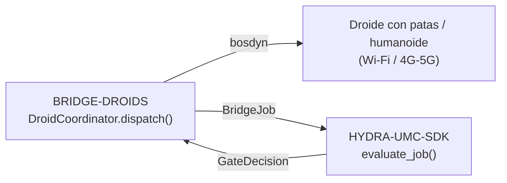

<!-- =============================================================================
HYDRA-UMC-BRIDGE-DROIDS - Droid coordination bridge
Copyright (C) JuanenRac (Electro Hobby 3D) <electrohobby3d@gmail.com>
GPL-3.0-or-later - see LICENSE
============================================================================= -->

<p align="center">
  
</p>

# 🤖 HYDRA-UMC-BRIDGE-DROIDS

<p align="center"><a href="README.md">🇺🇸 English</a> | 🇪🇸 <b>Español</b> | <a href="README_fra.md">🇫🇷 Français</a> | <a href="README_ita.md">🇮🇹 Italiano</a> | <a href="README_deu.md">🇩🇪 Deutsch</a> | <a href="README_zho.md">🇨🇳 简体中文</a> | <a href="README_jpn.md">🇯🇵 日本語</a> | <a href="README_por.md">🇵🇹 Português</a></p>

### 🔗 Frontera de coordinación sin dependencias entre HYDRA-UMC y droides con patas/humanoides

<p align="center">
  
  
  
  
  
  
</p>

---

> **Comprobación de honestidad - qué funciona realmente hoy:** el núcleo de coordinación sin dependencias (`coordinator.py` con `DroidCoordinator`, que hace pasar cada despacho por el propio `evaluate_job()` de `HYDRA-UMC-SDK`) y el emisor de comandos Boston Dynamics Spot (`spot_transport.py` con `SpotDroidControl`) son reales y están cubiertos por 72 tests unitarios que pasan (`python tools/build_test.py` - `test_coordinator.py`, `test_spot_transport.py`, más `test_spot_emulator.py`, que ejecuta el bridge contra un emulador Spot fiel al protocolo pero escrito a mano, no un robot real). Nada de esto se ha probado contra una instalación real de `bosdyn-client`, un enlace de red real, o un Spot/droide físico - el propio `FakeBuilder`/`FakeSink` de `test_spot_transport.py` sustituye a `bosdyn-client` por completo (la librería real ni siquiera necesita estar instalada para que estos tests pasen), y todavía no existe un comando `run` en vivo porque no se ha validado ningún transporte (Wi-Fi/BT/4G-5G) ni plataforma de droide física. Ver "Estado actual y próximos pasos" más abajo, que ya lo indica con claridad, y `CHANGELOG.md` para lo que se ha entregado exactamente hasta ahora.

> **Estado de seguridad física y de ciberseguridad:** este ecosistema no es un sistema de seguridad certificado. Todavía no existe una ruta de E-STOP por hardware, ni límites ni enclavamientos aplicados por el firmware, ni un comando de movimiento verificado; las imágenes de firmware se comprueban con CRC-32 y una firma Ed25519, y una compilación de versión rechaza las claves de desarrollo publicadas (los cabezales de herramienta y las placas de expansión detrás del relé siguen con cargadores de URTC, que usan un HMAC-SHA256 de clave compartida en lugar de una firma); TLS y TLS mutuo son opcionales y están desactivados por defecto; aún no se ha poblado ni probado ninguna placa propia. Lee la [línea base de seguridad](https://github.com/JuanenRac/HYDRA-UMC-DOCS/blob/main/docs/SECURITY_BASELINE.md) y el [modelo de amenazas](https://github.com/JuanenRac/HYDRA-UMC-DOCS/blob/main/docs/THREAT_MODEL.md) antes de fiarte de cualquier afirmación de aquí para la seguridad de una persona.

---

## 📋 De un vistazo

| | |
|---|---|
| Versión | `0.1.3` |
| Madurez | Funcional |
| Tests | 72 (`python tools/build_test.py`) |
| Tecnología | Python / Boston Dynamics Spot SDK (bosdyn-client) / HYDRA-UMC-SDK |
| En hardware real | Solo simulado: probado con emuladores, dobles de prueba o simuladores; no consta ninguna ejecución en hardware real para esta versión |

**Ir a:** [Resumen](#-resumen) · [Arquitectura](#-arquitectura) · [Funciones](#-funciones) · [Seguridad y protección](#-seguridad-y-protección) · [Interfaces](#-interfaces) · [Configuración](#-configuración) · [Inicio rápido](#-inicio-rápido) · [Pruebas](#-pruebas) · [Resolución de problemas](#-resolución-de-problemas) · [Estructura del repositorio](#-estructura-del-repositorio) · [Proyectos relacionados](#-proyectos-relacionados)

## 🚦 Estado del proyecto

Cada línea es una parte de este repositorio y la luz dice hasta dónde llega hoy. Se escribe con lo que el repositorio puede demostrar (pruebas, compilaciones, ejecuciones), no con lo previsto.

🟢 Hecho y verificado · 🟡 Funciona, con límites conocidos · 🟠 Hecho a medias o sin verificar · 🔴 Sin hacer o sin funcionar

| Área | Estado | Qué significa aquí |
|---|---|---|
| Software | 🟡 | Funciona para su propósito principal; la comprobación de honestidad de arriba lista lo que aún falta |
| Pruebas | 🟢 | 72 pruebas automáticas, ejecutadas en cada cambio |
| Hardware real | 🟠 | Solo simulado: probado con emuladores, dobles de prueba o simuladores; no consta ninguna ejecución en hardware real para esta versión |
| Documentación | 🟢 | README en ocho idiomas, comprobado contra el manifiesto en cada cambio |

## 🎯 Resumen

**HYDRA-UMC-BRIDGE-DROIDS** es la frontera de coordinación de alto nivel entre HYDRA-UMC y un droide con patas o humanoide, accesible por Wi-Fi o un enlace celular (4G/5G). Nunca calcula la marcha, el equilibrio ni las trayectorias articulares: valida y reenvía un vocabulario reducido y con nombre de disparadores de acción de cuerpo completo (`WALK_TO`, `PICK_OBJECT`, `PLACE_OBJECT`, `RETURN_HOME`, `HOLD_POSITION`), cada uno con su propio contrato real de parámetros obligatorios. No es un nodo de control de motores, y no puede saltarse a HYDRA-UMC-SERVER, los límites del MCU, los watchdogs ni el E-STOP. El único transporte implementado es la API propia de Boston Dynamics Spot sobre una red IP (no hay Bluetooth); hoy puede enviar `sit`, `stand`, `walk_to` y la parada, y no se ha ejecutado contra un robot real.

Pertenece a la familia **Mobile & Autonomous Bridges** junto a `HYDRA-UMC-BRIDGE-AMR` y `HYDRA-UMC-BRIDGE-UAV`, y comparte el mismo contrato de trabajo y seguridad de `HYDRA-UMC-SDK` que los **External Automation Bridges** estacionarios (CNC, LASER, OPENPNP, PRINTER3D, ROS2) - así que ningún bridge, móvil o estacionario, inventa su propia definición de "seguro para trabajar".

## 🧩 Papel en HYDRA-UMC

**HYDRA-UMC-BRIDGE-DROIDS** permite que una celda de robots pida a un droide con patas o humanoide una acción con nombre (mantener posición, sentarse, ponerse de pie, caminar a un punto, coger o dejar donde la plataforma pueda). Convierte un trabajo de celda ya validado en esa acción y nunca en movimiento crudo.

Comparte con todos los bridges el contrato de seguridad de `HYDRA-UMC-SDK`: un trabajo solo se acepta cuando la puerta compartida `evaluate_job()` lo permite, y esa puerta falla cerrada. Este bridge no tiene transporte MQTT; su único transporte real es el emisor de órdenes de Boston Dynamics Spot.

## 🏛️ Arquitectura

<p align="center">
  
</p>

<details>
<summary>Versión en texto del diagrama (Mermaid)</summary>



</details>

**Por qué está hecho así**

* **Por qué el núcleo nunca calcula marcha ni equilibrio.** El propio cómputo embarcado del droide (tipo Jetson o equivalente) ya ejecuta un controlador de cuerpo completo real y específico del hardware - volver a calcularlo aquí lo duplicaría mal o entraría en conflicto con él. Enviar solo disparadores de destino/acción con nombre (`WALK_TO x y`, `PICK_OBJECT object_id`) mantiene el papel de HYDRA-UMC en la coordinación, siguiendo la nota de arquitectura pegada de la que partió este proyecto: "no calcular la marcha del droide en el núcleo".
* **Por qué cada disparador de acción tiene su propia lista explícita de parámetros obligatorios.** Un `WALK_TO` sin `x`/`y`, o un `PICK_OBJECT` sin `object_id`, es un error real y detectable en la forma de la petición - rechazarlo aquí, antes de cualquier transporte, es estrictamente mejor que reenviar una instrucción incompleta y confiar en que el propio firmware del droide también la rechace de forma segura.
* **Por qué `DroidCoordinator.dispatch()` sigue canalizando cada trabajo por la puerta compartida `evaluate_job()`.** Un droide es solo otro cliente del mismo `bridge_contract` que usan CNC, LASER, OPENPNP, PRINTER3D y ROS2 - no tiene ningún salto especial de la lógica IDLE/READY que hacen cumplir todos los demás bridges y HYDRA-UMC-SERVER.
* **Por qué `HOLD_POSITION` (desde `ABORT`) sigue siendo solicitable durante un fallo.** El requisito de fase productiva de la puerta (`IDLE` + `READY`) deliberadamente no se aplica igual a una petición de aborto - un operador siempre debe poder pedirle a un droide que se quede quieto donde está, incluso en mitad de un fallo, en vez de seguir con lo que estuviera haciendo.
* **Por qué aún no hay un adaptador de transporte para un droide que no sea Spot.** Comprometerse con el protocolo de comandos real Wi-Fi/BT/4G-5G de una plataforma concreta antes de seleccionarla y probarla arriesgaría a dar por sentadas suposiciones que este núcleo local y sin dependencias no puede verificar.
* **Cómo encaja esto en el resto del ecosistema.** BRIDGE-DROIDS se sitúa entre un droide real y `HYDRA-UMC-SDK` → `HYDRA-UMC-SERVER` → seguridad MCU - es una frontera de coordinación, nunca un nodo de control de motores, y no puede saltarse HYDRA-UMC-SERVER, los límites del MCU, los watchdogs ni el E-STOP.

## ✨ Funciones

* ✅ **Núcleo de coordinación real, sin dependencias:** `coordinator.py`'s `DroidCoordinator` no importa ningún transporte (ni socket, ni SDK de fabricante) - es deliberadamente Python puro, comprobable en cualquier máquina sin un droide real conectado. *(implementado, probado en `tests/test_coordinator.py`)*
* ✅ **Vocabulario real de disparadores de acción con nombre:** `WALK_TO`, `PICK_OBJECT`, `PLACE_OBJECT`, `RETURN_HOME`, `HOLD_POSITION`, `STAND`, `SIT` - nunca un comando articular en bruto. La marcha, el equilibrio y el control articular de cuerpo completo siguen siendo autoridad propia del controlador embarcado del droide (tipo Jetson o equivalente). `STAND`/`SIT` son primitivas de postura reales y casi universales en robots con patas - comprobadas contra el [`basic_command.proto` del Spot SDK](https://github.com/boston-dynamics/spot-sdk/blob/master/protos/bosdyn/api/basic_command.proto) público de Boston Dynamics, cuyos comandos de movilidad fundamentales son `stand`/`sit`/`selfright`/`safe_power_off`, no solo caminar/manipular - expuestas como llamadas independientes `sit_request()`/`stand_request()`, deliberadamente fuera del flujo `dispatch()` guiado por `JobPhase` (ninguna fase significa de forma natural "ponerse de pie" o "sentarse"). `sit_request()` siempre se acepta (una desescalada real, mismo razonamiento que `HOLD_POSITION`); `stand_request()` exige una celda `READY` y una máquina `IDLE` (una transición real hacia la disponibilidad productiva). *(implementado)*
* ✅ **Validación real de parámetros por acción:** cada disparador de acción tiene su propio contrato real y mínimo de parámetros obligatorios (p. ej. `WALK_TO` necesita `x`/`y`) comprobado antes de reenviar el trabajo - una petición a la que le falta lo que su propia acción necesita se rechaza localmente, no se pasa en silencio aguas abajo. *(implementado, probado)*
* ✅ **Puerta de seguridad compartida real:** cada trabajo despachado mediante `DroidCoordinator.dispatch()` se evalúa con `evaluate_job()` de `bridge_contract` de `HYDRA-UMC-SDK`, la misma puerta que usan todos los bridges hermanos y HYDRA-UMC-SERVER; una fase productiva exige una máquina externa `IDLE` y una celda HYDRA-UMC `READY`, mientras que `HOLD_POSITION` (mapeado desde `ABORT`) sigue siendo solicitable durante un fallo. *(implementado)*
* ✅ **Enrutado de fase con fallo cerrado y evidencia estática:** una fase futura del SDK desconocida se rechaza en vez de adivinarse. `inspect_action_plan.py` emite el plan de acción estático del esquema `1.0` sin abrir ningún transporte. *(implementado, probado)*
* ✅ **Transporte real Boston Dynamics Spot:** `SpotDroidControl` de `spot_transport.py` envía un despacho ya validado como un comando real de bosdyn-client (`synchro_stand_command`/`synchro_sit_command`/`synchro_trajectory_command_in_body_frame`, enviado a través de `RobotCommandClient.robot_command()`) - un despacho rechazado nunca llega a la red. *(implementado, probado en `tests/test_spot_transport.py`)*
* ✅ **Paradas, objetivos validados y un comando que caduca:** `hold_position()` envía el `stop_command()` de bosdyn (el transporte del `HOLD_POSITION` de `ABORT`, nunca con puerta); `sit()` detiene antes al robot; un `DroidDispatch` lleva los parámetros que validó la puerta y `walk_to()` envía exactamente esos - solo para un despacho `WALK_TO`, con números finitos, un límite de distancia opcional (`PlatformProfile.max_walk_distance_m`) y un `command_timeout_s` obligatorio que pasa a ser el `end_time_secs` del comando, de modo que el robot descarta un paseo si este proceso desaparece; `stand_request()` toma su decisión del propio `evaluate_job()`; una respuesta que no es `STATUS_OK` no se da por enviada. *(implementado, probado con dobles y con el emulador, que ahora lanza errores con la forma de bosdyn; nunca ejecutado contra un Spot real - el lease, el E-Stop por software con su keep-alive y el encendido de motores NO están hechos, así que con esto todavía no se puede mandar a un Spot real, y `RETURN_HOME`, `PICK_OBJECT` y `PLACE_OBJECT` no tienen transporte)*
* ✅ **Build/test sin mutación:** `build-test.bat`/`.sh` compilan el código fuente y ejecutan tests unitarios deterministas sin cambiar la versión ni el CHANGELOG. *(implementado, ver BUILD Y EJECUCIÓN más abajo)*
* 🔜 **Adaptador Wi-Fi/BT/4G-5G específico para una plataforma de droide que no sea Spot** - se introducirá solo tras seleccionar y probar esa plataforma. *(planeado)*
* ✅ **Estado observado de la máquina:** `DroidCoordinator.dispatch()` acepta el estado que informó el droide, que la puerta compartida usa en lugar del `machine_state` escrito en el trabajo (un mensaje que cualquiera en el broker puede publicar); sin informe se sigue usando lo declarado. *(implementado, probado en `tests/test_observed_state.py`)*

## 🔒 Seguridad y protección

| Amenaza | Defensa | Dónde |
|---|---|---|
| Un trabajo para una celda o máquina que no está en estado seguro | Todo trabajo pasa por la puerta compartida `evaluate_job()` del SDK, que falla cerrada; el bridge no tiene lógica propia de aceptar o rechazar | SDK `bridge_contract` |
| Datos de trabajo desmesurados | Como máximo 32 parámetros, claves de hasta 64 caracteres, valores de hasta 1024, identificadores de hasta 128 (`MAX_PARAMETERS`, `MAX_PARAMETER_KEY_CHARS`, `MAX_PARAMETER_VALUE_CHARS`, `MAX_IDENTIFIER_CHARS`) | SDK `bridge_contract` |
| Una orden repetida o reenviada | Un `IdempotencyStore` recuerda cada clave 24 horas y como máximo 10 000 entradas; una repetición recibe la primera respuesta en vez de evaluarse otra vez | SDK `job_intake` |
| Una acción que la plataforma no puede hacer | `PlatformProfile`: `MOBILE_ONLY` permite postura y movimiento, `MOBILE_MANIPULATOR` además `PICK_OBJECT` y `PLACE_OBJECT`; `check_against_profile()` rechaza el resto | `platform_profiles.py` |
| Una orden de marcha sin límite de tiempo o con un valor no finito | `walk_to` exige un `command_timeout_s` finito y positivo para que el robot descarte la orden al vencer; los parámetros no finitos se rechazan | `spot_transport.py` |

**Lo que nunca hace:** nunca envía movimiento crudo, nunca toma la concesión («lease») ni enciende los motores; nunca se ha conectado a un Spot real.

## 🔌 Interfaces

No hay topics MQTT ni rutas HTTP: este bridge es una biblioteca.

| Elemento | Qué es |
|---|---|
| `DroidCoordinator` | `dispatch(job, cell_state, observed_machine_state)`, `sit_request()`, `stand_request()`; devuelve un `DroidDispatch` |
| `SpotDroidControl` | `hold_position()`, `sit()`, `stand()`, `walk_to()`; cada una devuelve un `SpotSendResult` |
| `open_bosdyn_robot_command(hostname, username, password)` | abre la conexión y devuelve el constructor de órdenes y el destino; la ausencia de `bosdyn-client` es un `RuntimeError` claro, no un `ImportError` |

## ⚙️ Configuración

No hay variables de entorno ni fichero de configuración: el host, el usuario y la contraseña del Spot son argumentos de `open_bosdyn_robot_command()`, y el perfil de plataforma (`MOBILE_ONLY` o `MOBILE_MANIPULATOR`) se elige en el código. Cómo se guardan las credenciales en una instalación real todavía no está decidido.

## 🚀 Inicio rápido

Requiere Python 3.11 o superior. Las pruebas y los scripts de compilación esperan `HYDRA-UMC-SDK` clonado junto a este repositorio (`../HYDRA-UMC-SDK`) o indicado con `HYDRA_UMC_SDK_ROOT`.

Pruébalo sin hardware (esto comprueba todo el bridge contra sus emuladores y dobles de prueba):

```bash
py -3 tools/build_test.py          # Windows
python3 tools/build_test.py         # Linux, macOS
```

Arranca el servicio (no hay un script de consola: el servicio es el `run_forever()` del transporte MQTT, que llamas desde tu propio código de arranque):

```python
from hydra_umc_bridge_droids import SpotDroidControl, open_bosdyn_robot_command
builder, sink = open_bosdyn_robot_command("192.168.80.3", "user", "password")   # needs the `spot` extra
control = SpotDroidControl()
control.stand(builder, sink, cell_state, machine_state)   # gated: needs a READY cell and an idle machine
control.hold_position(builder, sink)                      # a stop is never gated
```

## 🧪 Pruebas

72 casos automáticos de `unittest` se ejecutan con `python tools/build_test.py` (que también compila cada módulo). Las pruebas no necesitan hardware, red ni paquetes opcionales: las que necesitarían `paho-mqtt`, `pyserial` o una biblioteca del fabricante usan un sustituto o se saltan si falta el paquete.

| Fichero de pruebas | Pruebas | Qué cubre |
|---|---|---|
| `test_coordinator.py`, `test_observed_state.py`, `test_edge_cases.py` | - | paso de trabajo a acción, el estado observado de la máquina, casos límite |
| `test_platform_profiles.py` | - | qué acciones acepta cada plataforma |
| `test_spot_transport.py`, `test_spot_emulator.py`, `spot_emulator.py` | - | `SpotDroidControl` contra constructores simulados y un emulador de Spot con la forma de bosdyn |

El CI ejecuta `HYDRA_UMC_CI=1 python tools/ci_validate.py`, que comprueba el manifiesto, los documentos, los ocho README y las imágenes, y ejecuta las pruebas con una copia del SDK.

## 🏗️ Compilación y publicación

Requiere Python 3.11+. `tools/build_test.py` espera `HYDRA-UMC-SDK` clonado como directorio hermano (`../HYDRA-UMC-SDK`) o indicado mediante la variable de entorno `HYDRA_UMC_SDK_ROOT`.

```bash
# Windows
build-test.bat      # solo valida — sin cambio de versión/CHANGELOG
build.bat            # Valida y compila (compilar nunca cambia la versión)

# Linux/macOS
bash build-test.sh
bash build.sh
```

`build-test` compila cada módulo bajo `src/` con `py_compile` y ejecuta la suite completa de `unittest` descubierta en `tests/` (todos los ficheros `test_*.py` - 72 tests) - de forma determinista, sin conexión real a ningún droide, sin red y sin cambio de versión/CHANGELOG. `build` ejecuta esa misma validación primero y, solo si tiene éxito, llama a `tools/bump_version.py` para sincronizar la versión entre `pyproject.toml`, `hydra-umc.project.json` y `CHANGELOG.md`. Todavía no existe un comando `run` con hardware real - eso requiere un adaptador de transporte validado y una plataforma de droide real.

## 🩺 Resolución de problemas

| Ves | Porque | Haz |
|---|---|---|
| `ModuleNotFoundError: hydra_umc_sdk` | El SDK no está instalado ni junto a este repositorio | Clona `HYDRA-UMC-SDK` junto a este repositorio o define `HYDRA_UMC_SDK_ROOT` |
| `bosdyn-client` ... `RuntimeError` | El extra opcional de Spot no está instalado | `pip install ".[spot]"` (`bosdyn-client` 4.0 o superior) |
| `accepted` is false on a `DroidDispatch` | La puerta compartida, el perfil de plataforma o una comprobación de parámetros rechazó el trabajo | Lee `reason` en el despacho y arregla la causa; un despacho rechazado nunca se envía al robot |

## 📂 Estructura del repositorio

<p align="center">
  
</p>

<details>
<summary>Versión en texto del árbol</summary>

```text
HYDRA-UMC-BRIDGE-DROIDS/
├── src/hydra_umc_bridge_droids/
│   ├── coordinator.py             convierte un trabajo en disparadores de acción con nombre, nunca movimiento crudo
│   ├── platform_profiles.py       qué acciones se pueden pedir a una plataforma; un droide que no puede moverse
│   └── spot_transport.py          órdenes a Spot con bosdyn-client: hold, sit, stand, walk_to
├── tests/                         72 pruebas, con un emulador de Spot con la forma de bosdyn
├── docs/                          guía del bridge
├── tools/                         ejecutor de compilación y pruebas, subida de versión, validador de CI, generadores y comprobaciones de README e imágenes
├── images/                        banner y las imágenes del README
├── .github/                       flujo de CI y plantillas de incidencias
├── pyproject.toml                 metadatos del paquete y dependencias
├── hydra-umc.project.json         manifiesto: versión, madurez, familia
├── CHANGELOG.md                   qué cambió en cada versión
├── build.sh build.bat             scripts de compilación (nunca cambian la versión)
├── build-test.sh build-test.bat   scripts de compilación (nunca cambian la versión)
├── test.sh test.bat               ejecutan las pruebas
└── SECURITY.md SUPPORT.md CONTRIBUTING.md CODE_OF_CONDUCT.md LICENSE LICENSE.md
```

</details>

## 🗺️ Hoja de ruta y límites conocidos

**Límites conocidos hoy**

**Real hoy:** versión `0.1.3`, funcional como núcleo de coordinación sin dependencias (`DroidCoordinator`) con validación real de parámetros por acción, enrutado de fase con fallo cerrado, un esquema de acción estático `plan-only`, un transporte real Boston Dynamics Spot (`SpotDroidControl`) que envía comandos reales de bosdyn-client, y scripts de build-test sin mutación integrados en CI con un checkout del SDK.

**Frontera de integración:** este bridge es solo una frontera de coordinación - no es un nodo de control de motores, y no puede saltarse HYDRA-UMC-SERVER, los límites del MCU, los watchdogs ni el E-STOP; cada trabajo despachado sigue pasando por la misma puerta compartida que usan todos los bridges hermanos.

**Todavía pendiente:** aún no se ha validado ningún transporte real (Wi-Fi/BT/4G-5G) ni un droide físico - un adaptador de transporte real y una interfaz de comandos de droide documentada se introducirán solo después de seleccionar y probar una plataforma concreta.

## 🌍 Idiomas

Este README y los documentos del repositorio existen en ocho idiomas: inglés, español, alemán, francés, italiano, japonés, chino y portugués (Portugal). Se escriben a la vez y el CI comprueba que los ocho ficheros tengan las mismas secciones y los mismos enlaces. Este repositorio no tiene pantalla ni catálogo de mensajes propios, así que no hay cadenas de interfaz que traducir.

## 🔗 Proyectos relacionados

Este proyecto es parte del ecosistema de robótica HYDRA-UMC del mismo autor (JuanenRac / Electro Hobby 3D). Vale la pena conocerlo, ya que una petición podría en realidad ser sobre alguno de estos en vez de sobre este repositorio.

**Proyecto Padre**
- **[HYDRA-UMC-SERVER](https://github.com/JuanenRac/HYDRA-UMC-SERVER)** — el backend headless real (REST/WebSocket) con el que habla de verdad cada cliente de control; la frontera autenticada del ecosistema a la que reporta este bridge una vez cada comando ha superado la barrera de seguridad local de este propio bridge.

**Proyectos Hermanos** — también hablan con la propia API de HYDRA-UMC-SERVER, cada uno como su propio cliente
- **[HYDRA-UMC-STUDIO](https://github.com/JuanenRac/HYDRA-UMC-STUDIO)** — panel de control web con visualización 3D multi-robot en tiempo real.
- **[HYDRA-UMC-SUITE](https://github.com/JuanenRac/HYDRA-UMC-SUITE)** — centro de mando de enjambre de escritorio (PySide6) para varios servidores a la vez, empaquetado como ejecutable independiente.
- **[HYDRA-UMC-ANDROID-CONTROL](https://github.com/JuanenRac/HYDRA-UMC-ANDROID-CONTROL)** — app nativa de control para Android con inicio de sesión biométrico y un compañero Wear OS emparejado.
- **[HYDRA-UMC-IOS-CONTROL](https://github.com/JuanenRac/HYDRA-UMC-IOS-CONTROL)** — app de control para iOS/iPadOS (Flutter) con sincronización en tiempo real por WebSocket.
- **[HYDRA-UMC-DSI](https://github.com/JuanenRac/HYDRA-UMC-DSI)** — interfaz táctil nativa para la pantalla táctil DSI de 7" a bordo, embebida en el propio CM5.
- **[HYDRA-UMC-BRIDGE-AMR](https://github.com/JuanenRac/HYDRA-UMC-BRIDGE-AMR)** — barrera de coordinación para flotas AGV/AMR mediante un publicador MQTT VDA 5050 (probado solo contra una flota emulada) — uno de los 3 bridges de flota móvil del ecosistema.
- **[HYDRA-UMC-BRIDGE-CNC](https://github.com/JuanenRac/HYDRA-UMC-BRIDGE-CNC)** — coordinador de alto nivel para celdas CNC con acceso a estado/bytes de control GRBL (probado solo contra un emulador).
- **[HYDRA-UMC-BRIDGE-LASER](https://github.com/JuanenRac/HYDRA-UMC-BRIDGE-LASER)** — coordinador de celdas láser que lee 3 señales GPIO de llave/carcasa/enclavamiento (probado solo contra un chip simulado; no puede armar ni disparar un láser).
- **[HYDRA-UMC-BRIDGE-OPENPNP](https://github.com/JuanenRac/HYDRA-UMC-BRIDGE-OPENPNP)** — coordinador de alto nivel seguro para el flujo de placas de pick-and-place OpenPnP.
- **[HYDRA-UMC-BRIDGE-PRINTER3D](https://github.com/JuanenRac/HYDRA-UMC-BRIDGE-PRINTER3D)** — barrera de coordinación segura para impresoras 3D Moonraker/Klipper, con comandos de trabajo reales y controlados.
- **[HYDRA-UMC-BRIDGE-ROS2](https://github.com/JuanenRac/HYDRA-UMC-BRIDGE-ROS2)** — coordinador con un transporte ROS 2 rclpy importado de forma perezosa (todavía no ejecutado contra una instalación de ROS 2).
- **[HYDRA-UMC-BRIDGE-UAV](https://github.com/JuanenRac/HYDRA-UMC-BRIDGE-UAV)** — barrera de coordinación para UAV equipados con cámara, con un emisor de comandos MAVLink (probado solo contra un emulador) — uno de los 3 bridges de flota móvil del ecosistema.

**Directamente Relacionados**
- **[HYDRA-UMC-SDK](https://github.com/JuanenRac/HYDRA-UMC-SDK)** — el contrato JSON-Schema compartido y la barrera de software de puerta de trabajos contra la que cada bridge valida sus comandos (no es una función de seguridad certificada).
- **[HYDRA-UMC-CONNECTOR-HUB](https://github.com/JuanenRac/HYDRA-UMC-CONNECTOR-HUB)** — registro declarativo y validador de manifiestos de adaptador para conectores de máquinas externas; extiende la propia idea de contrato del SDK a máquinas externas sin sustituir a los proyectos de pasarela industrial.

**También Forma Parte del Ecosistema**

*Hardware y Plataforma Base*
- **[HYDRA-UMC](https://github.com/JuanenRac/HYDRA-UMC)** — el diseño de la placa madre del brazo robótico: host CM5 + coprocesador STM32H745 de doble núcleo, pensado para coordinar hasta 8 brazos herramienta por CAN-OTA/SPI-OTA (firmware en fase temprana; todavía no hay ninguna placa poblada).
- **[HYDRA-UMC-OS](https://github.com/JuanenRac/HYDRA-UMC-OS)** — capa de producto reproducible sobre Raspberry Pi OS para el CM5: agente de solo lectura, config/perfiles validados, aprovisionamiento WiFi de primer contacto.

*Backend Central y Clientes*
- **[HYDRA-UMC-EDITOR-URDF](https://github.com/JuanenRac/HYDRA-UMC-EDITOR-URDF)** — creador/editor gráfico de URDF de escritorio que envía los modelos terminados al propio catálogo de STUDIO.
- **[HYDRA-UMC-EDITOR-STL](https://github.com/JuanenRac/HYDRA-UMC-EDITOR-STL)** — editor de escritorio de modelos STL, que transforma/reemplaza/quita/añade piezas reales en el mismo catálogo de modelos que también edita HYDRA-UMC-EDITOR-URDF.

*Plataforma de Herramientas URTC*
- **[URTC](https://github.com/JuanenRac/URTC)** — firmware para la placa física del Universal Robot Tool Controller, más de 25 perfiles de herramienta por bus CAN.
- **[URTC-FLASHER](https://github.com/JuanenRac/URTC-FLASHER)** — herramienta de escritorio con GUI para flashear placas URTC, CAN-OTA más SWD/JTAG de chip completo.
- **[URTC-TESTER](https://github.com/JuanenRac/URTC-TESTER)** — herramienta de escritorio de diagnóstico CAN-bus en vivo para placas URTC, un panel por perfil de herramienta.
- **[URTC-WEB-STUDIO](https://github.com/JuanenRac/URTC-WEB-STUDIO)** — alternativa basada en navegador a URTC-TESTER mediante la Web Serial API, sin instalación local.
- **[URTC-GATEWAY](https://github.com/JuanenRac/URTC-GATEWAY)** — pasarela delante del bus CAN de URTC: lista de identificadores permitidos, límite de tasa y clave de sesión; software probado en ordenador, aún no en un bus real.

*Nodo IA de Visión (Hailo-8)*
- **[HYDRA-UMC-VISION-NODE](https://github.com/JuanenRac/HYDRA-UMC-VISION-NODE)** — nodo de integración para el pipeline de visión Hailo-8, con una comprobación real de disponibilidad de hardware por etapa.
- **[HYDRA-UMC-DETECTION-HEF](https://github.com/JuanenRac/HYDRA-UMC-DETECTION-HEF)** — registro real de modelos compilados con verificación de carga segura por arquitectura Hailo/checksum.
- **[HYDRA-UMC-VISION-STREAMER](https://github.com/JuanenRac/HYDRA-UMC-VISION-STREAMER)** — generador real de pipeline GStreamer + config MediaMTX, con una frontera de integración HailoRT real.
- **[HYDRA-UMC-VISUAL-SERVOING-API](https://github.com/JuanenRac/HYDRA-UMC-VISUAL-SERVOING-API)** — ley de corrección Position-Based Visual Servoing con autorización condicionada al estado de zona; todavía sin estimación de pose por cámara.
- **[HYDRA-UMC-SAFETY-ZONES](https://github.com/JuanenRac/HYDRA-UMC-SAFETY-ZONES)** — lógica v0 de invasión de zona, vigencia de calibración y solicitud de E-STOP que toma las posiciones de los objetos de un fichero; ningún detector la alimenta y todavía no hay un E-STOP físico conectado.

*Nodo IA Cognitivo (Hailo-10)*
- **[HYDRA-UMC-COGNITIVE-NODE](https://github.com/JuanenRac/HYDRA-UMC-COGNITIVE-NODE)** — nodo de integración para el pipeline cognitivo Hailo-10 (orquestación de LLM/VLA/voz).
- **[HYDRA-UMC-VLA-ENGINE](https://github.com/JuanenRac/HYDRA-UMC-VLA-ENGINE)** — codificación/decodificación real de tokens de acción y generación de trayectoria para un modelo Vision-Language-Action.
- **[HYDRA-UMC-VOICE-UI](https://github.com/JuanenRac/HYDRA-UMC-VOICE-UI)** — front-end de voz real (VAD + analizador de intención) con un relé a Watch acotado y con confirmación.
- **[HYDRA-UMC-SEMANTIC-PLANNER](https://github.com/JuanenRac/HYDRA-UMC-SEMANTIC-PLANNER)** — descomposición real de tareas basada en reglas y recuperación semántica de errores sobre códigos de error del MCU.
- **[HYDRA-UMC-DOCS-QA](https://github.com/JuanenRac/HYDRA-UMC-DOCS-QA)** — búsqueda real de documentos TF-IDF (solo librería estándar) sobre los propios documentos Markdown de este ecosistema.
- **[HYDRA-UMC-LOCAL-TECHNICIAN](https://github.com/JuanenRac/HYDRA-UMC-LOCAL-TECHNICIAN)** — técnico de mantenimiento con IA local y con puertas de política para el propio ecosistema - observa, diagnostica y propone arreglos; los dos niveles de riesgo más altos están deliberadamente sin implementar todavía.

*Orquestación y Enjambre*
- **[HYDRA-UMC-ORCHESTRATOR](https://github.com/JuanenRac/HYDRA-UMC-ORCHESTRATOR)** — nodo de integración con un contrato real de informe de salud gRPC/Protobuf y una máquina de estados de misión.
- **[HYDRA-UMC-JOB-DISPATCHER](https://github.com/JuanenRac/HYDRA-UMC-JOB-DISPATCHER)** — cola de trabajos real basada en prioridad con deduplicación, sobre una API HTTP real.
- **[HYDRA-UMC-NODE-HEALING](https://github.com/JuanenRac/HYDRA-UMC-NODE-HEALING)** — watchdog de salud de flota real basado en gRPC, con reintento/backoff y detección de discrepancia de identidad.
- **[HYDRA-UMC-PATH-PLANNER-3D](https://github.com/JuanenRac/HYDRA-UMC-PATH-PLANNER-3D)** — planificador de rutas 3D real basado en RRT, con validación real de colisión de obstáculos/espacio de trabajo.
- **[HYDRA-UMC-SWARM-SYNC](https://github.com/JuanenRac/HYDRA-UMC-SWARM-SYNC)** — sincronización de estado real mediante CRDT LWW-Element-Map, con pruebas de propiedades para convergencia multi-celda.

*Gemelo Digital y Simulación*
- **[HYDRA-UMC-TWIN](https://github.com/JuanenRac/HYDRA-UMC-TWIN)** — nodo de integración para el motor de gemelo digital, con un contrato real de sincronización por compatibilidad de versión.
- **[HYDRA-UMC-HIL-BRIDGE](https://github.com/JuanenRac/HYDRA-UMC-HIL-BRIDGE)** — enrutador hardware-in-the-loop con un enclavamiento de software por colisión entre simulación y hardware real (probado sin hardware real).
- **[HYDRA-UMC-PHYSICS-REPLICA](https://github.com/JuanenRac/HYDRA-UMC-PHYSICS-REPLICA)** — cinemática directa real y validación de límites articulares sobre un subconjunto real de URDF.
- **[HYDRA-UMC-SYNTHETIC-DATA-GEN](https://github.com/JuanenRac/HYDRA-UMC-SYNTHETIC-DATA-GEN)** — generador real de escenas 2D procedurales con exportación de anotaciones YOLO/COCO.

*Datos y Analítica*
- **[HYDRA-UMC-DATALAKE](https://github.com/JuanenRac/HYDRA-UMC-DATALAKE)** — almacén de series temporales real respaldado por sqlite3, con una API HTTP real de ingesta/consulta.
- **[HYDRA-UMC-ANOMALY-DETECTOR](https://github.com/JuanenRac/HYDRA-UMC-ANOMALY-DETECTOR)** — detector de anomalías real basado en FFT + línea base estadística, con monitorización de deriva.
- **[HYDRA-UMC-PRODUCTION-REPORTS](https://github.com/JuanenRac/HYDRA-UMC-PRODUCTION-REPORTS)** — cálculo real de OEE/disponibilidad sobre el histórico de DATALAKE, con exportación CSV reproducible.
- **[HYDRA-UMC-TELEMETRY-COLLECTOR](https://github.com/JuanenRac/HYDRA-UMC-TELEMETRY-COLLECTOR)** — pipeline real de ingesta CAN/WebSocket hacia DATALAKE, con deduplicación por secuencia.

*Pasarela Industrial*
- **[HYDRA-UMC-GATEWAY-INDUSTRIAL](https://github.com/JuanenRac/HYDRA-UMC-GATEWAY-INDUSTRIAL)** — nodo de integración que retransmite a protocolos industriales, con una capa real de lista blanca de comandos/contrapresión.
- **[HYDRA-UMC-OPCUA-SERVER](https://github.com/JuanenRac/HYDRA-UMC-OPCUA-SERVER)** — espacio de direcciones OPC-UA real, verificado con una sesión de cliente real del protocolo binario.
- **[HYDRA-UMC-MQTT-BROKER](https://github.com/JuanenRac/HYDRA-UMC-MQTT-BROKER)** — broker MQTT real con autenticación por cliente opcional y ACL de tópicos.
- **[HYDRA-UMC-MTCONNECT-ADAPTER](https://github.com/JuanenRac/HYDRA-UMC-MTCONNECT-ADAPTER)** — endpoints XML reales `/probe` y `/current` de MTConnect, con salida en modo degradado.

*Herramientas Complementarias y Operaciones del Ecosistema*
- **[HYDRA-UMC-DASHBOARD-AI](https://github.com/JuanenRac/HYDRA-UMC-DASHBOARD-AI)** — paneles de Resúmenes Inteligentes y Resaltado de Anomalías sobre DATALAKE/ANOMALY-DETECTOR, con un respaldo estadístico honesto.
- **[HYDRA-UMC-TOOL-CLI](https://github.com/JuanenRac/HYDRA-UMC-TOOL-CLI)** — CLI de flota con un contrato real y estable de códigos de salida, cliente real y en vivo de la propia API de HYDRA-UMC-SERVER.
- **[HYDRA-UMC-WATCH](https://github.com/JuanenRac/HYDRA-UMC-WATCH)** — app compañera de WearOS con patrones de alerta háptica y un relé de voz al teléfono emparejado (todavía no ejecutada en un reloj físico).
- **[URTC-SMART-RACK](https://github.com/JuanenRac/URTC-SMART-RACK)** — firmware para un rack de montaje de placas con decodificación real de ID de herramienta y lógica de precalentamiento Smart Idle.
- **[URTC-VISION-TOOL](https://github.com/JuanenRac/URTC-VISION-TOOL)** — firmware más un compañero de visión real en Python para un cabezal de inspección térmica/RGB.
- **[HYDRA-UMC-UPDATER](https://github.com/JuanenRac/HYDRA-UMC-UPDATER)** — herramienta administrativa de escritorio que descubre, clona y actualiza cada repositorio de este ecosistema.
- **[HYDRA-UMC-OS-REBUILDER](https://github.com/JuanenRac/HYDRA-UMC-OS-REBUILDER)** — herramienta de escritorio Windows/Linux que construye una imagen de la CM5 lista para grabar, precargada con las versiones más actuales del ecosistema, con configuración de primer arranque de Wi-Fi/usuario/SSH al estilo de Raspberry Pi Imager.
- **[HYDRA-UMC-OPS-AGENT](https://github.com/JuanenRac/HYDRA-UMC-OPS-AGENT)** — coordinador de incidencias de mantenimiento: un rol edge de bajo privilegio recopila un snapshot de inventario/salud saneado, un rol control-plane lo renderiza de solo lectura y pide a un proveedor de IA que sugiera un diagnóstico - nunca aplica un parche ni despliega nada.
- **[HYDRA-UMC-DEV-SERVER](https://github.com/JuanenRac/HYDRA-UMC-DEV-SERVER)** — host de desarrollo reproducible (Raspberry Pi 5 / CM5) que almacena el código del ecosistema y ejecuta tareas acotadas de compilación/pruebas bajo una cola duradera; un rol de desarrollo dedicado, explícitamente distinto de un CM5 operativo.

## 📚 Documentación

Dónde leer más:

* [docs/BRIDGE_GUIDE.md](docs/BRIDGE_GUIDE.md) - alcance, perfiles de plataforma, el transporte de Spot, scripts
* [Base de seguridad del ecosistema](https://github.com/JuanenRac/HYDRA-UMC-DOCS/blob/main/docs/SECURITY_BASELINE.md)
* [Modelo de amenazas del ecosistema](https://github.com/JuanenRac/HYDRA-UMC-DOCS/blob/main/docs/THREAT_MODEL.md)
* [Historial de cambios de este repositorio](CHANGELOG.md)
* [Licencia de este repositorio](LICENSE.md)

## 🤝 Contribuir y comunidad

* Antes de un pull request ejecuta `HYDRA_UMC_CI=1 py -3 tools/ci_validate.py` (o `HYDRA_UMC_CI=1 python3 tools/ci_validate.py`): debe imprimir `CI_VALIDATION=PASS`. No ejecutes `build.sh` ni `build.bat` para esta comprobación; compilar no es comprobar.
* Los ocho README se escriben desde una sola fuente en HYDRA-UMC-DOCS; no los edites a mano. Cambia la fuente y vuelve a escribirlos con `tools/make_readmes.py`.
* No afirmes en un README lo que no se ha ejecutado: di «simulado» o «sin probar en hardware» cuando esa sea la verdad.
* Mira [CONTRIBUTING.md](CONTRIBUTING.md), el [código de conducta](CODE_OF_CONDUCT.md), [SECURITY.md](SECURITY.md) y [SUPPORT.md](SUPPORT.md).

## 👤 AUTOR

**JuanenRac (Electro Hobby 3D)** · electrohobby3d@gmail.com

## 📜 LICENCIA

GPL-3.0-or-later - [LICENSE](LICENSE).
