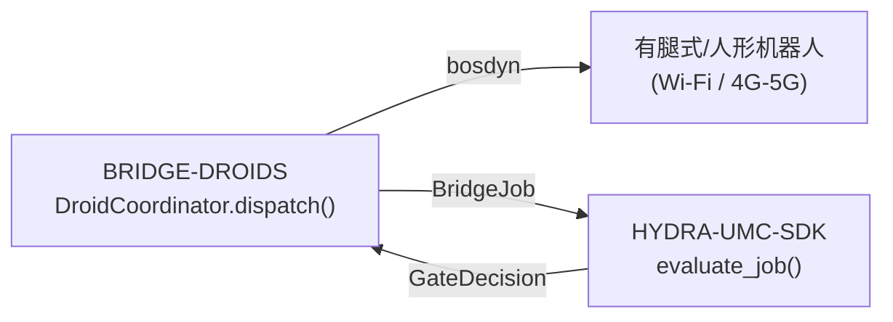

<!-- =============================================================================
HYDRA-UMC-BRIDGE-DROIDS - Droid coordination bridge
Copyright (C) JuanenRac (Electro Hobby 3D) <electrohobby3d@gmail.com>
GPL-3.0-or-later - see LICENSE
============================================================================= -->

<p align="center">
  
</p>

# 🤖 HYDRA-UMC-BRIDGE-DROIDS

<p align="center"><a href="README.md">🇺🇸 English</a> | <a href="README_spa.md">🇪🇸 Español</a> | <a href="README_fra.md">🇫🇷 Français</a> | <a href="README_ita.md">🇮🇹 Italiano</a> | <a href="README_deu.md">🇩🇪 Deutsch</a> | 🇨🇳 <b>简体中文</b> | <a href="README_jpn.md">🇯🇵 日本語</a> | <a href="README_por.md">🇵🇹 Português</a></p>

### 🔗 HYDRA-UMC 与有腿式/人形机器人之间无依赖的协调边界

<p align="center">
  
  
  
  
  
  
</p>

---

> **诚实检查——今天真正可运行的部分：** 无依赖的协调核心（`coordinator.py` 中的 `DroidCoordinator`，每次派发都会经过 `HYDRA-UMC-SDK` 自身真正的 `evaluate_job()`）以及波士顿动力 Spot 命令发送器（`spot_transport.py` 中的 `SpotDroidControl`）都是真实的，并由 72 个通过的单元测试覆盖（`python tools/build_test.py` —— `test_coordinator.py`、`test_spot_transport.py`，以及让该桥接对抗一个协议忠实但纯手写的 Spot 模拟器（而非真实机器人）的 `test_spot_emulator.py`）。以上这些都从未针对真实安装的 `bosdyn-client`、真实的网络链路或实体 Spot/机器人进行过验证——`test_spot_transport.py` 自带的 `FakeBuilder`/`FakeSink` 完全替代了 `bosdyn-client`（这些测试甚至不需要安装真正的库就能通过），并且目前还没有实时的 `run` 命令，因为尚未验证任何传输方式（Wi-Fi/BT/4G-5G）或实体机器人平台。详见下文的"当前状态与后续步骤"（已经如实说明了这一点），以及 `CHANGELOG.md` 中目前具体已交付的内容。

> **安全与安防现状:**本生态系统不是经认证的安全系统。目前尚无硬件 E-STOP 通路,没有由固件强制执行的限位或联锁,也没有经过验证的运动指令;固件映像使用 CRC32 和共享密钥的 HMAC-SHA256 校验,而非非对称签名;TLS 与双向 TLS 均为可选项,默认关闭;自制电路板尚未组装或测试。在依赖此处任何说法来保障人身安全之前,请先阅读[安全基线](https://github.com/JuanenRac/HYDRA-UMC-DOCS/blob/main/docs/SECURITY_BASELINE.md)和[威胁模型](https://github.com/JuanenRac/HYDRA-UMC-DOCS/blob/main/docs/THREAT_MODEL.md)。

---

## 📋 速览

| | |
|---|---|
| 版本 | `0.1.3` |
| 成熟度 | 可用 |
| 测试 | 72 (`python tools/build_test.py`) |
| 技术栈 | Python / Boston Dynamics Spot SDK (bosdyn-client) / HYDRA-UMC-SDK |
| 真实硬件 | 仅模拟：使用模拟器、替身或仿真测试；此版本没有在真实硬件上运行的记录 |

**跳转：** [概述](#-概述) · [架构](#-架构) · [功能](#-功能) · [安全与防护](#-安全与防护) · [接口](#-接口) · [配置](#-配置) · [快速开始](#-快速开始) · [测试](#-测试) · [故障排除](#-故障排除) · [仓库结构](#-仓库结构) · [相关项目](#-相关项目)

## 🚦 项目状态

每一行是本仓库的一个部分，灯号表示它今天做到了哪一步。内容依据仓库能够展示的证据（测试、构建、运行），而不是计划。

🟢 已完成并验证 · 🟡 可用，有已知限制 · 🟠 部分完成或尚未验证 · 🔴 未完成或不可用

| 领域 | 状态 | 在这里的含义 |
|---|---|---|
| 软件 | 🟡 | 主要用途可用；上面的诚实性检查列出了仍然缺少的内容 |
| 测试 | 🟢 | 72 项自动测试，每次变更都会运行 |
| 真实硬件 | 🟠 | 仅模拟：使用模拟器、替身或仿真测试；此版本没有在真实硬件上运行的记录 |
| 文档 | 🟢 | 八种语言的 README，每次变更都会与清单核对 |

## 🎯 概述

**HYDRA-UMC-BRIDGE-DROIDS** 是 HYDRA-UMC 与有腿式或人形机器人平台之间高层协调边界,可通过 Wi-Fi 或蜂窝(4G/5G)链路访问。它从不计算步态、平衡或关节轨迹:它校验并转发一套小型的、具名的全身动作触发器词汇(`WALK_TO`、`PICK_OBJECT`、`PLACE_OBJECT`、`RETURN_HOME`、`HOLD_POSITION`),每一个都有自己真实的必填参数契约。它不是一个电机控制节点,也不能绕过 HYDRA-UMC-SERVER、MCU 限位、看门狗或急停(E-STOP)。 目前唯一实现的传输是 Boston Dynamics Spot 自带的 API(经 IP 网络,没有蓝牙);现在可以发送 `sit`、`stand`、`walk_to` 和停止,且从未针对真实机器人运行过。

它与 `HYDRA-UMC-BRIDGE-AMR` 和 `HYDRA-UMC-BRIDGE-UAV` 同属 **Mobile & Autonomous Bridges** 家族,并与固定式的 **External Automation Bridges**(CNC、LASER、OPENPNP、PRINTER3D、ROS2)共享同一个 `HYDRA-UMC-SDK` 任务与安全契约——因此无论是移动式还是固定式,任何一个桥接都不能自行发明"可以安全工作"的定义。

## 🧩 在 HYDRA-UMC 中的角色

**HYDRA-UMC-BRIDGE-DROIDS** 让机器人单元向足式或人形机器人请求具名动作（保持位置、坐下、站起、走到某点，平台支持时抓取或放置）。它把已通过关口的任务转成该动作，绝不转成原始运动。

与所有桥接一样遵循 `HYDRA-UMC-SDK` 的安全契约：只有共用的 `evaluate_job()` 关口放行，任务才会被接受，且该关口失败时保持关闭。本桥接没有 MQTT 传输，唯一的真实传输是 Boston Dynamics Spot 的命令发送器。

## 🏛️ 架构

<p align="center">
  
</p>

<details>
<summary>图表的文本版本（Mermaid）</summary>



</details>

**为什么这样构建**

* **为什么核心从不计算步态或平衡。** 机器人自身的板载计算单元(Jetson 级或同等水平)已经运行着一个真实的、针对具体硬件的全身控制器——在这里重新推导这一套要么会拙劣地重复它,要么会与它产生冲突。只发送具名的目的地/动作触发器(`WALK_TO x y`、`PICK_OBJECT object_id`)让 HYDRA-UMC 的角色始终停留在协调层面,这与本项目起步时所依据的架构笔记一致:"不要在核心中计算机器人的步态"。
* **为什么每个动作触发器都有自己明确的必填参数列表。** 没有 `x`/`y` 的 `WALK_TO`,或没有 `object_id` 的 `PICK_OBJECT`,是一种真实的、可被捕获的请求格式错误——在任何传输发生之前就在这里拒绝它,严格优于转发一条不完整的指令然后寄望于机器人自身的固件也能安全地拒绝它。
* **为什么 `DroidCoordinator.dispatch()` 仍然让每个任务都经过共享的 `evaluate_job()` 门控。** 机器人只是使用与 CNC、LASER、OPENPNP、PRINTER3D 和 ROS2 相同的 `bridge_contract` 的又一个客户端——它不会获得任何绕过所有其他桥接和 HYDRA-UMC-SERVER 所执行的 IDLE/READY 逻辑的特殊待遇。
* **为什么 `HOLD_POSITION`(源自 `ABORT`)在故障期间仍可请求。** 门控的生产性阶段要求(`IDLE` + `READY`)被刻意地不以同样的方式应用于中止请求——操作员必须始终能够要求机器人原地静止,即使正处于故障中,而不是继续执行它正在做的事情。
* **为什么尚无 Spot 以外的机器人的传输适配器。** 在选定并测试某个具体机器人平台的真实 Wi-Fi/BT/4G-5G 命令协议之前就对其做出承诺,会有引入这个本地无依赖核心无法验证的假设的风险。
* **它如何融入整个生态系统。** BRIDGE-DROIDS 位于真实机器人与 `HYDRA-UMC-SDK` → `HYDRA-UMC-SERVER` → MCU 安全之间——它是一个协调边界,绝不是电机控制节点,也不能绕过 HYDRA-UMC-SERVER、MCU 限位、看门狗或急停。

## ✨ 功能

* ✅ **真实的无依赖协调核心:** `coordinator.py` 中的 `DroidCoordinator` 完全没有导入任何传输相关模块(既无 socket,也无厂商 SDK)——它刻意保持为纯 Python,可以在任何主机上测试,无需连接真实的机器人。*(已实现,并在 `tests/test_coordinator.py` 中测试)*
* ✅ **真实的具名动作触发器词汇:** `WALK_TO`, `PICK_OBJECT`, `PLACE_OBJECT`, `RETURN_HOME`, `HOLD_POSITION`, `STAND`, `SIT`——绝不是原始关节命令。全身步态、平衡和关节级控制始终由机器人自身的板载控制器(Jetson 级或同等)负责。`STAND`/`SIT` 是真实的、几乎通用的足式机器人姿态原语——已对照 Boston Dynamics 公开的 [Spot SDK `basic_command.proto`](https://github.com/boston-dynamics/spot-sdk/blob/master/protos/bosdyn/api/basic_command.proto) 核实,其基础移动命令是 `stand`/`sit`/`selfright`/`safe_power_off`,而不只是行走/操作——以独立的 `sit_request()`/`stand_request()` 调用提供,有意置于由 `JobPhase` 驱动的 `dispatch()` 流程之外(没有任何阶段天然意味着“站起来”或“坐下”)。`sit_request()` 始终被接受(真实的降级,理由与 `HOLD_POSITION` 相同);`stand_request()` 要求单元为 `READY` 且机器为 `IDLE`(向生产就绪的真实过渡)。*(已实现)*
* ✅ **真实的按动作参数校验:** 每个动作触发器都有自己真实的、最小化的必填参数契约(例如 `WALK_TO` 需要 `x`/`y`),在任务被转发之前就会进行检查——缺少其对应动作所需参数的请求会在本地被拒绝,而不会被悄悄传递到下游。*(已实现,已测试)*
* ✅ **真实的共享安全门控:** 每个通过 `DroidCoordinator.dispatch()` 派发的任务都会由 `HYDRA-UMC-SDK` 的 `bridge_contract` 中的 `evaluate_job()` 评估,这与所有兄弟桥接以及 HYDRA-UMC-SERVER 使用的是同一个门控;生产性阶段需要外部机器处于 `IDLE` 且 HYDRA-UMC 单元处于 `READY`,而 `HOLD_POSITION`(从 `ABORT` 映射而来)在故障期间仍可请求。*(已实现)*
* ✅ **安全拒绝的阶段路由与静态证据:** 未知的未来 SDK 阶段会被拒绝,而不是被猜测处理。`inspect_action_plan.py` 会输出静态模式 `1.0` 的动作计划,且不会打开任何传输通道。*(已实现,已测试)*
* ✅ **真实的 Boston Dynamics Spot 传输:** `spot_transport.py` 的 `SpotDroidControl` 将一个已通过门控的调度作为真实的 bosdyn-client 命令(`synchro_stand_command`/`synchro_sit_command`/`synchro_trajectory_command_in_body_frame`,通过 `RobotCommandClient.robot_command()` 发送)——被拒绝的调度永远不会到达网络。*(已实现,在 `tests/test_spot_transport.py` 中测试)*
* ✅ **停止、经过验证的目标和会过期的命令:** `hold_position()` 发送 bosdyn 的 `stop_command()`(`ABORT` 的 `HOLD_POSITION` 的传输,从不经过闸门);`sit()` 会先让机器人停下;`DroidDispatch` 携带闸门验证过的参数,`walk_to()` 发送的正是这些 - 仅限 `WALK_TO` 派发,要求有限数值,可选的距离上限(`PlatformProfile.max_walk_distance_m`)和必需的 `command_timeout_s`(它成为命令的 `end_time_secs`),因此本进程消失时机器人会丢弃这次行走;`stand_request()` 的判断直接来自 `evaluate_job()`;不是 `STATUS_OK` 的响应不会被报告为已发送。*(已实现,已用替身和模拟器测试,模拟器现在会抛出 bosdyn 形式的错误;从未针对真实 Spot 运行 - 租约(lease)、带保活的软件急停和上电都尚未完成,因此还不能用它来指挥真实的 Spot,`RETURN_HOME`、`PICK_OBJECT` 和 `PLACE_OBJECT` 没有传输)*
* ✅ **非变更式构建/测试:** `build-test.bat`/`.sh` 编译源码并运行确定性单元测试,不改变版本或 CHANGELOG。*(已实现,见下方"构建与发布")*
* 🔜 **面向非 Spot 机器人平台的 Wi-Fi/BT/4G-5G 适配器**——只有在选定并测试了该平台之后才会引入。*(计划中)*
* ✅ **观测到的机器状态：** `DroidCoordinator.dispatch()` 接受机器人上报的状态，共享闸门使用它而不是作业中写的 `machine_state`（任何人都能在代理上发布的消息）；没有上报时仍使用声明值。*（已实现，已在 `tests/test_observed_state.py` 中测试）*

## 🔒 安全与防护

| 威胁 | 防御 | 位置 |
|---|---|---|
| 对处于不安全状态的单元或机器下达任务 | 每个任务都经过 SDK 共用的 `evaluate_job()` 关口，该关口失败时保持关闭；桥接本身没有接受/拒绝逻辑 | SDK `bridge_contract` |
| 过大的任务数据 | 最多 32 个参数，键最长 64 个字符，值最长 1024，标识符最长 128（`MAX_PARAMETERS`、`MAX_PARAMETER_KEY_CHARS`、`MAX_PARAMETER_VALUE_CHARS`、`MAX_IDENTIFIER_CHARS`） | SDK `bridge_contract` |
| 重复或重放的命令 | `IdempotencyStore` 将每个键记住 24 小时、最多 10 000 条；重复请求得到第一次的答复而不是重新评估 | SDK `job_intake` |
| 平台做不到的动作 | `PlatformProfile`：`MOBILE_ONLY` 允许姿态和移动，`MOBILE_MANIPULATOR` 还允许 `PICK_OBJECT` 和 `PLACE_OBJECT`；其余由 `check_against_profile()` 拒绝 | `platform_profiles.py` |
| 没有时限或数值不是有限数的行走命令 | `walk_to` 需要有限且为正的 `command_timeout_s`，到期后机器人丢弃该命令；非有限参数被拒绝 | `spot_transport.py` |

**它绝不做的事：** 它从不发送原始运动，不获取租约（lease），也不给电机上电；从未连接过真实的 Spot。

## 🔌 接口

没有 MQTT 主题或 HTTP 路由：本桥接是一个库。

| 项目 | 说明 |
|---|---|
| `DroidCoordinator` | `dispatch(job, cell_state, observed_machine_state)`、`sit_request()`、`stand_request()`；返回 `DroidDispatch` |
| `SpotDroidControl` | `hold_position()`、`sit()`、`stand()`、`walk_to()`；各自返回 `SpotSendResult` |
| `open_bosdyn_robot_command(hostname, username, password)` | 打开连接并返回命令构建器和接收端；缺少 `bosdyn-client` 时抛出明确的 `RuntimeError`，而不是 `ImportError` |

## ⚙️ 配置

没有环境变量，也没有配置文件：Spot 的主机、用户名和密码是 `open_bosdyn_robot_command()` 的参数，平台配置（`MOBILE_ONLY` 或 `MOBILE_MANIPULATOR`）在代码中选择。真实安装中如何保存凭据尚未确定。

## 🚀 快速开始

需要 Python 3.11 或更高版本。测试和构建脚本期望 `HYDRA-UMC-SDK` 位于本仓库旁边（`../HYDRA-UMC-SDK`），或由 `HYDRA_UMC_SDK_ROOT` 指定。

无需硬件即可试用（用模拟器和替身检查整个桥接）：

```bash
py -3 tools/build_test.py          # Windows
python3 tools/build_test.py         # Linux, macOS
```

启动服务（没有控制台脚本：服务就是 MQTT 传输的 `run_forever()`，由你自己的启动代码调用）：

```python
from hydra_umc_bridge_droids import SpotDroidControl, open_bosdyn_robot_command
builder, sink = open_bosdyn_robot_command("192.168.80.3", "user", "password")   # needs the `spot` extra
control = SpotDroidControl()
control.stand(builder, sink, cell_state, machine_state)   # gated: needs a READY cell and an idle machine
control.hold_position(builder, sink)                      # a stop is never gated
```

## 🧪 测试

运行 `python tools/build_test.py` 会执行 72 个自动 `unittest` 用例（同时编译每个模块）。测试不需要硬件、网络或可选软件包：需要 `paho-mqtt`、`pyserial` 或厂商库的用例使用替身，缺少软件包时则跳过。

| 测试文件 | 测试数 | 覆盖内容 |
|---|---|---|
| `test_coordinator.py`, `test_observed_state.py`, `test_edge_cases.py` | - | 任务到动作的映射、观测到的机器状态、边界情况 |
| `test_platform_profiles.py` | - | 各平台接受哪些动作 |
| `test_spot_transport.py`, `test_spot_emulator.py`, `spot_emulator.py` | - | `SpotDroidControl` 对假构建器和 bosdyn 形态的 Spot 模拟器 |

CI 运行 `HYDRA_UMC_CI=1 python tools/ci_validate.py`，检查清单、文档、八个 README 和图片，并使用 SDK 副本运行测试。

## 🏗️ 构建与发布

需要 Python 3.11+。`tools/build_test.py` 期望 `HYDRA-UMC-SDK` 作为兄弟目录被检出(`../HYDRA-UMC-SDK`),或通过环境变量 `HYDRA_UMC_SDK_ROOT` 指定。

```bash
# Windows
build-test.bat      # 仅验证 —— 不改变版本/CHANGELOG
build.bat            # 先验证,成功后更新版本 + CHANGELOG

# Linux/macOS
bash build-test.sh
bash build.sh
```

`build-test` 使用 `py_compile` 编译 `src/` 下的每个模块,并运行在 `tests/` 下发现的完整 `unittest` 套件(所有 `test_*.py` 文件——共 72 个测试)——以确定性的方式进行,没有真实机器人连接,没有网络,也不会改变版本/CHANGELOG。`build` 会先运行同样的验证,只有成功后才调用 `tools/bump_version.py`,在 `pyproject.toml`、`hydra-umc.project.json` 和 `CHANGELOG.md` 之间同步版本号。目前尚无真正的硬件 `run` 命令——这需要经过验证的传输适配器和真实的机器人平台。

## 🩺 故障排除

| 你看到 | 原因 | 处理 |
|---|---|---|
| `ModuleNotFoundError: hydra_umc_sdk` | 未安装 SDK，且不在本仓库旁边 | 把 `HYDRA-UMC-SDK` 克隆到本仓库旁边，或设置 `HYDRA_UMC_SDK_ROOT` |
| `bosdyn-client` ... `RuntimeError` | 未安装可选的 Spot 附加包 | `pip install ".[spot]"`（`bosdyn-client` 4.0 或更高） |
| `accepted` is false on a `DroidDispatch` | 共用关口、平台配置或参数检查拒绝了任务 | 阅读派发上的 `reason` 并排除原因；被拒绝的派发绝不会发给机器人 |

## 📂 仓库结构

<p align="center">
  
</p>

<details>
<summary>目录树的文本版本</summary>

```text
HYDRA-UMC-BRIDGE-DROIDS/
├── src/hydra_umc_bridge_droids/
│   ├── coordinator.py             把任务映射为具名动作触发，绝不发原始运动
│   ├── platform_profiles.py       平台可被要求的动作；一个无法移动的机器人
│   └── spot_transport.py          通过 bosdyn-client 向 Spot 发命令：hold、sit、stand、walk_to
├── tests/                         72 项测试（含 bosdyn 形态的 Spot 模拟器）
├── docs/                          桥接指南
├── tools/                         构建与测试运行器、版本提升、CI 校验、README 与图片的生成和检查
├── images/                        横幅图与 README 的图片
├── .github/                       CI 工作流和 Issue 模板
├── pyproject.toml                 包元数据与依赖
├── hydra-umc.project.json         清单：版本、成熟度、系列
├── CHANGELOG.md                   每个版本的变化
├── build.sh build.bat             构建脚本（从不改变版本）
├── build-test.sh build-test.bat   构建脚本（从不改变版本）
├── test.sh test.bat               运行测试
└── SECURITY.md SUPPORT.md CONTRIBUTING.md CODE_OF_CONDUCT.md LICENSE LICENSE.md
```

</details>

## 🗺️ 路线图与已知限制

**当前已知限制**

**目前真实的部分:** 版本 `0.1.3`,作为一个无依赖协调核心(`DroidCoordinator`)是功能齐备的,配有真实的按动作参数校验、安全拒绝的阶段路由、静态 `plan-only` 动作模式、一个发送真实 bosdyn-client 命令的真实 Boston Dynamics Spot 传输(`SpotDroidControl`),以及已接入 CI 并带 SDK 检出的非变更式 build-test 脚本。

**集成边界:** 本桥接只是一个协调边界——它不是电机控制节点,也不能绕过 HYDRA-UMC-SERVER、MCU 限位、看门狗或急停;每个被派发的任务仍然要经过所有兄弟桥接使用的同一个共享门控。

**仍待完成:** 尚未验证任何真实传输方式(Wi-Fi/BT/4G-5G)或物理机器人——真实的传输适配器和有文档记录的机器人命令接口只会在选定并测试了具体平台之后才会引入。

## 🌍 语言

本 README 和仓库文档提供八种语言：英语、西班牙语、德语、法语、意大利语、日语、中文和葡萄牙语（葡萄牙）。它们同时编写，并由 CI 检查八个文件拥有相同的章节和相同的链接。 本仓库没有自己的界面或消息目录，因此没有需要翻译的界面文字。

## 🔗 相关项目

本项目是同一作者(JuanenRac / Electro Hobby 3D)打造的 HYDRA-UMC 机器人生态系统的一部分。值得了解,因为某个请求实际上可能是关于这些项目之一,而非本仓库本身。

**父项目**
- **[HYDRA-UMC-SERVER](https://github.com/JuanenRac/HYDRA-UMC-SERVER)** — 每个控制客户端真正通信的真实无头后端(REST/WebSocket);每条指令通过本桥接自身的本地安全门限后,本桥接向其汇报的经过认证的生态系统边界。

**兄弟项目** —— 同样与 HYDRA-UMC-SERVER 自身 API 通信,各自作为独立客户端
- **[HYDRA-UMC-STUDIO](https://github.com/JuanenRac/HYDRA-UMC-STUDIO)** — 具有实时多机器人 3D 可视化的网页控制面板。
- **[HYDRA-UMC-SUITE](https://github.com/JuanenRac/HYDRA-UMC-SUITE)** — 面向多台服务器的桌面(PySide6)集群指挥中心，打包为独立可执行文件。
- **[HYDRA-UMC-ANDROID-CONTROL](https://github.com/JuanenRac/HYDRA-UMC-ANDROID-CONTROL)** — 具有生物识别登录和配对 Wear OS 伴侣应用的原生 Android 控制应用。
- **[HYDRA-UMC-IOS-CONTROL](https://github.com/JuanenRac/HYDRA-UMC-IOS-CONTROL)** — 具有实时 WebSocket 同步的 iOS/iPadOS 控制应用(Flutter)。
- **[HYDRA-UMC-DSI](https://github.com/JuanenRac/HYDRA-UMC-DSI)** — 面向机载 7 英寸 DSI 触摸屏的原生触控界面，直接嵌入 CM5 本体。
- **[HYDRA-UMC-BRIDGE-AMR](https://github.com/JuanenRac/HYDRA-UMC-BRIDGE-AMR)** — 通过 VDA 5050 MQTT 发布者为 AGV/AMR 车队提供的协调边界(仅针对仿真车队测试) — 本生态系统 3 个移动车队桥接之一。
- **[HYDRA-UMC-BRIDGE-CNC](https://github.com/JuanenRac/HYDRA-UMC-BRIDGE-CNC)** — 具备 GRBL 状态/控制字节访问能力的高层 CNC 单元协调器(仅针对模拟器测试)。
- **[HYDRA-UMC-BRIDGE-LASER](https://github.com/JuanenRac/HYDRA-UMC-BRIDGE-LASER)** — 读取 3 路钥匙/外壳/联锁 GPIO 信号的激光单元协调器(仅针对模拟芯片测试;无法使激光器上膛或发射)。
- **[HYDRA-UMC-BRIDGE-OPENPNP](https://github.com/JuanenRac/HYDRA-UMC-BRIDGE-OPENPNP)** — 面向 OpenPnP 贴片机板级流程的安全高层协调器。
- **[HYDRA-UMC-BRIDGE-PRINTER3D](https://github.com/JuanenRac/HYDRA-UMC-BRIDGE-PRINTER3D)** — 面向 Moonraker/Klipper 3D 打印机的安全协调边界，具备真实的受控作业指令。
- **[HYDRA-UMC-BRIDGE-ROS2](https://github.com/JuanenRac/HYDRA-UMC-BRIDGE-ROS2)** — 带有惰性导入 rclpy ROS 2 传输层的协调器(尚未在 ROS 2 环境中运行)。
- **[HYDRA-UMC-BRIDGE-UAV](https://github.com/JuanenRac/HYDRA-UMC-BRIDGE-UAV)** — 面向搭载摄像头的无人机的协调边界,带有 MAVLink 指令发送器(仅针对模拟器测试) — 本生态系统 3 个移动车队桥接之一。

**直接相关**
- **[HYDRA-UMC-SDK](https://github.com/JuanenRac/HYDRA-UMC-SDK)** — 每个桥接都据此校验自身指令的共享 JSON-Schema 契约与软件作业门限边界(并非经认证的安全功能)。
- **[HYDRA-UMC-CONNECTOR-HUB](https://github.com/JuanenRac/HYDRA-UMC-CONNECTOR-HUB)** — 面向外部机器连接器的声明式适配器清单注册与校验工具；把 SDK 自身的契约理念扩展到外部机器，而不取代工业网关类项目。

**生态系统中的其他项目**

*核心硬件与平台*
- **[HYDRA-UMC](https://github.com/JuanenRac/HYDRA-UMC)** — 机器人手臂主板设计——CM5 主机 + 双核 STM32H745,目标是通过 CAN-OTA/SPI-OTA 协调最多 8 条工具臂(固件处于早期阶段,尚无已组装的电路板)。
- **[HYDRA-UMC-OS](https://github.com/JuanenRac/HYDRA-UMC-OS)** — 面向 CM5 的可复现 Raspberry Pi OS 产品层——只读代理、经过验证的配置/配置文件、WiFi 首次配网。

*核心后端与客户端*
- **[HYDRA-UMC-EDITOR-URDF](https://github.com/JuanenRac/HYDRA-UMC-EDITOR-URDF)** — 将完成的模型推送到 STUDIO 自身目录的桌面版图形化 URDF 创建/编辑工具。
- **[HYDRA-UMC-EDITOR-STL](https://github.com/JuanenRac/HYDRA-UMC-EDITOR-STL)** — 桌面 STL 模型编辑器，在 HYDRA-UMC-EDITOR-URDF 编辑的同一模型目录中变换/替换/移除/添加真实部件。

*URTC 工具平台*
- **[URTC](https://github.com/JuanenRac/URTC)** — 面向实体 Universal Robot Tool Controller 板卡的固件，通过 CAN 总线支持 25 种以上工具配置。
- **[URTC-FLASHER](https://github.com/JuanenRac/URTC-FLASHER)** — 面向 URTC 板卡的桌面图形烧录工具，支持 CAN-OTA 以及全芯片 SWD/JTAG。
- **[URTC-TESTER](https://github.com/JuanenRac/URTC-TESTER)** — 面向 URTC 板卡的桌面实时 CAN 总线诊断工具，每种工具配置对应一个面板。
- **[URTC-WEB-STUDIO](https://github.com/JuanenRac/URTC-WEB-STUDIO)** — 通过 Web Serial API 实现的浏览器版 URTC-TESTER 替代方案，无需本地安装。
- **[URTC-GATEWAY](https://github.com/JuanenRac/URTC-GATEWAY)** — URTC CAN 总线前的网关：允许的标识符列表、速率限制和会话密钥；软件已在计算机上测试，尚未在真实总线上测试。

*视觉 AI 节点(Hailo-8)*
- **[HYDRA-UMC-VISION-NODE](https://github.com/JuanenRac/HYDRA-UMC-VISION-NODE)** — 面向 Hailo-8 视觉流水线的集成中枢，具备逐阶段的真实硬件就绪检测。
- **[HYDRA-UMC-DETECTION-HEF](https://github.com/JuanenRac/HYDRA-UMC-DETECTION-HEF)** — 具备 Hailo 架构/校验和安全加载验证的真实编译模型注册表。
- **[HYDRA-UMC-VISION-STREAMER](https://github.com/JuanenRac/HYDRA-UMC-VISION-STREAMER)** — 具备真实 HailoRT 集成边界的真实 GStreamer 流水线 + MediaMTX 配置生成器。
- **[HYDRA-UMC-VISUAL-SERVOING-API](https://github.com/JuanenRac/HYDRA-UMC-VISUAL-SERVOING-API)** — 以区域状态为授权条件的 Position-Based Visual Servoing 修正律;尚无摄像头位姿估计。
- **[HYDRA-UMC-SAFETY-ZONES](https://github.com/JuanenRac/HYDRA-UMC-SAFETY-ZONES)** — 从文件读取物体位置的 v0 区域入侵、校准新鲜度与 E-STOP 请求逻辑;没有检测器为其供数,也尚未连接任何物理 E-STOP。

*认知 AI 节点(Hailo-10)*
- **[HYDRA-UMC-COGNITIVE-NODE](https://github.com/JuanenRac/HYDRA-UMC-COGNITIVE-NODE)** — 面向 Hailo-10 认知流水线(LLM/VLA/语音编排)的集成中枢。
- **[HYDRA-UMC-VLA-ENGINE](https://github.com/JuanenRac/HYDRA-UMC-VLA-ENGINE)** — 面向 Vision-Language-Action 模型的真实动作 token 编解码与轨迹生成。
- **[HYDRA-UMC-VOICE-UI](https://github.com/JuanenRac/HYDRA-UMC-VOICE-UI)** — 具备受限、需确认的 Watch 中继的真实语音前端(VAD + 意图解析)。
- **[HYDRA-UMC-SEMANTIC-PLANNER](https://github.com/JuanenRac/HYDRA-UMC-SEMANTIC-PLANNER)** — 基于真实规则的任务分解，以及针对 MCU 错误码的语义化错误恢复。
- **[HYDRA-UMC-DOCS-QA](https://github.com/JuanenRac/HYDRA-UMC-DOCS-QA)** — 面向本生态系统自身 Markdown 文档的真实纯标准库 TF-IDF 文档检索。
- **[HYDRA-UMC-LOCAL-TECHNICIAN](https://github.com/JuanenRac/HYDRA-UMC-LOCAL-TECHNICIAN)** — 面向生态系统自身的本地、按策略门控的 AI 维护技师——观察、诊断并提出修复建议;两个最高风险等级目前特意尚未实现。

*编排与集群*
- **[HYDRA-UMC-ORCHESTRATOR](https://github.com/JuanenRac/HYDRA-UMC-ORCHESTRATOR)** — 具备真实 gRPC/Protobuf 健康报告契约与任务状态机的集成中枢。
- **[HYDRA-UMC-JOB-DISPATCHER](https://github.com/JuanenRac/HYDRA-UMC-JOB-DISPATCHER)** — 基于真实 HTTP API 的真实优先级任务队列，支持去重。
- **[HYDRA-UMC-NODE-HEALING](https://github.com/JuanenRac/HYDRA-UMC-NODE-HEALING)** — 具备重试/退避与身份不匹配检测的真实基于 gRPC 的车队健康看门狗。
- **[HYDRA-UMC-PATH-PLANNER-3D](https://github.com/JuanenRac/HYDRA-UMC-PATH-PLANNER-3D)** — 具备真实障碍物/工作空间碰撞校验的真实基于 RRT 的三维路径规划器。
- **[HYDRA-UMC-SWARM-SYNC](https://github.com/JuanenRac/HYDRA-UMC-SWARM-SYNC)** — 经过多单元收敛属性测试的真实 CRDT LWW-Element-Map 状态同步。

*数字孪生与仿真*
- **[HYDRA-UMC-TWIN](https://github.com/JuanenRac/HYDRA-UMC-TWIN)** — 面向数字孪生引擎的集成中枢，具备真实的版本兼容性同步契约。
- **[HYDRA-UMC-HIL-BRIDGE](https://github.com/JuanenRac/HYDRA-UMC-HIL-BRIDGE)** — 在仿真与真实硬件之间带有软件碰撞联锁的硬件在环路由器(未在真实硬件上测试)。
- **[HYDRA-UMC-PHYSICS-REPLICA](https://github.com/JuanenRac/HYDRA-UMC-PHYSICS-REPLICA)** — 面向真实 URDF 子集的真实正向运动学与关节限位校验。
- **[HYDRA-UMC-SYNTHETIC-DATA-GEN](https://github.com/JuanenRac/HYDRA-UMC-SYNTHETIC-DATA-GEN)** — 具备 YOLO/COCO 标注导出功能的真实程序化 2D 场景生成器。

*数据与分析*
- **[HYDRA-UMC-DATALAKE](https://github.com/JuanenRac/HYDRA-UMC-DATALAKE)** — 具备真实数据摄入/查询 HTTP API 的真实 sqlite3 时序数据存储。
- **[HYDRA-UMC-ANOMALY-DETECTOR](https://github.com/JuanenRac/HYDRA-UMC-ANOMALY-DETECTOR)** — 具备漂移监测能力的真实 FFT + 统计基线异常检测器。
- **[HYDRA-UMC-PRODUCTION-REPORTS](https://github.com/JuanenRac/HYDRA-UMC-PRODUCTION-REPORTS)** — 基于 DATALAKE 历史数据的真实 OEE/可用率计算，支持可复现的 CSV 导出。
- **[HYDRA-UMC-TELEMETRY-COLLECTOR](https://github.com/JuanenRac/HYDRA-UMC-TELEMETRY-COLLECTOR)** — 面向 DATALAKE 的真实 CAN/WebSocket 数据摄入管道，支持序列去重。

*工业网关*
- **[HYDRA-UMC-GATEWAY-INDUSTRIAL](https://github.com/JuanenRac/HYDRA-UMC-GATEWAY-INDUSTRIAL)** — 中继至工业协议的集成中枢，具备真实的指令白名单/背压控制层。
- **[HYDRA-UMC-OPCUA-SERVER](https://github.com/JuanenRac/HYDRA-UMC-OPCUA-SERVER)** — 经真实二进制协议客户端会话验证的真实 OPC-UA 地址空间。
- **[HYDRA-UMC-MQTT-BROKER](https://github.com/JuanenRac/HYDRA-UMC-MQTT-BROKER)** — 具备可选按客户端认证与主题 ACL 的真实 MQTT 代理。
- **[HYDRA-UMC-MTCONNECT-ADAPTER](https://github.com/JuanenRac/HYDRA-UMC-MTCONNECT-ADAPTER)** — 具备降级模式输出的真实 MTConnect `/probe` 与 `/current` XML 端点。

*辅助工具与生态系统运维*
- **[HYDRA-UMC-DASHBOARD-AI](https://github.com/JuanenRac/HYDRA-UMC-DASHBOARD-AI)** — 基于 DATALAKE/ANOMALY-DETECTOR 的智能摘要与异常高亮面板，具备诚实的统计回退机制。
- **[HYDRA-UMC-TOOL-CLI](https://github.com/JuanenRac/HYDRA-UMC-TOOL-CLI)** — 具备真实、稳定退出码契约的车队 CLI，是 HYDRA-UMC-SERVER 自身 API 的真实在线客户端。
- **[HYDRA-UMC-WATCH](https://github.com/JuanenRac/HYDRA-UMC-WATCH)** — 带有触觉提醒模式与配对手机语音中继的 WearOS 伴侣应用(尚未在实体手表上运行)。
- **[URTC-SMART-RACK](https://github.com/JuanenRac/URTC-SMART-RACK)** — 面向板卡安装机架的固件，具备真实的工具 ID 解码与 Smart Idle 预热逻辑。
- **[URTC-VISION-TOOL](https://github.com/JuanenRac/URTC-VISION-TOOL)** — 面向热成像/RGB 检测工具头的固件及真实 Python 视觉伴侣程序。
- **[HYDRA-UMC-UPDATER](https://github.com/JuanenRac/HYDRA-UMC-UPDATER)** — 发现、克隆并更新本生态系统中每个仓库的管理类桌面工具。
- **[HYDRA-UMC-OS-REBUILDER](https://github.com/JuanenRac/HYDRA-UMC-OS-REBUILDER)** —— 构建即刻可烧录、预装生态系统最新版本的 CM5 镜像的 Windows/Linux 桌面工具,具备类似 Raspberry Pi Imager 风格的首次启动 Wi-Fi/用户/SSH 配置。
- **[HYDRA-UMC-OPS-AGENT](https://github.com/JuanenRac/HYDRA-UMC-OPS-AGENT)** — 维护事件协调器：一个低权限的边缘角色采集经过脱敏的库存/健康快照，一个控制面角色以只读方式渲染它，并请求某个 AI 提供方给出诊断建议——从不应用补丁，也从不部署任何内容。
- **[HYDRA-UMC-DEV-SERVER](https://github.com/JuanenRac/HYDRA-UMC-DEV-SERVER)** — 可复现的开发主机（Raspberry Pi 5 / CM5），保存整个生态系统的源代码，并在持久队列下运行有界的构建/测试任务；这是专用的开发角色，明确区别于运行中的 CM5。

## 📚 文档

更多阅读：

* [docs/BRIDGE_GUIDE.md](docs/BRIDGE_GUIDE.md) - 范围、平台配置、Spot 传输、脚本
* [生态系统的安全基线](https://github.com/JuanenRac/HYDRA-UMC-DOCS/blob/main/docs/SECURITY_BASELINE.md)
* [生态系统的威胁模型](https://github.com/JuanenRac/HYDRA-UMC-DOCS/blob/main/docs/THREAT_MODEL.md)
* [本仓库的更新日志](CHANGELOG.md)
* [本仓库的许可证](LICENSE.md)

## 🤝 参与贡献与社区

* 提交 pull request 之前，请运行 `HYDRA_UMC_CI=1 py -3 tools/ci_validate.py`（或 `HYDRA_UMC_CI=1 python3 tools/ci_validate.py`）：它必须输出 `CI_VALIDATION=PASS`。此检查不要运行 `build.sh` 或 `build.bat`；构建不是检查。
* 八个 README 由 HYDRA-UMC-DOCS 中的同一个源生成；请勿手工编辑。修改源文件，再用 `tools/make_readmes.py` 重新生成。
* 不要在 README 中声称尚未运行过的内容：属实时请写“仅模拟”或“尚未在硬件上试过”。
* 请参阅 [CONTRIBUTING.md](CONTRIBUTING.md)、[行为准则](CODE_OF_CONDUCT.md)、[SECURITY.md](SECURITY.md) 和 [SUPPORT.md](SUPPORT.md)。

## 👤 作者

**JuanenRac (Electro Hobby 3D)** · electrohobby3d@gmail.com

## 📜 许可证

GPL-3.0-or-later - [LICENSE](LICENSE).
